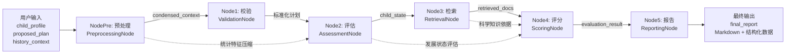

# 架构与设计 (Architecture)

本文档包含了系统的核心架构图、数据流向以及各个微服务或子系统的交互关系。

## 1. 系统架构总览

儿童发展评估系统采用了多层架构，前后端分离，主要由前端展示层、API网关层、业务服务层、核心配置层、大模型路由层、Agent编排层以及基础设施数据层构成。

```mermaid
graph TB
    subgraph 前端展示层 Frontend
        UI[React 19 + TypeScript]
        Assessment[评估功能<br>AssessmentForm/ReportViewer]
        Documents[知识库管理<br>DocumentUploader/DocumentList]
        Knowledge[知识搜索<br>SearchInput/SearchResultList]
        RAGEval[RAG 评估与测试<br>导入/草稿审核/批量执行]
        SysConfig[系统配置页 /system-config<br>动态Schema表单]
        PromptUI[提示词管理页 /prompt-management<br>版本管理/A/B配置/变量预览]
        LLMMonitorUI[LLM监控页 /monitoring<br>调用统计/效果分析/告警]
    end
    
    subgraph API 网关层 API Gateway
        FastAPI[FastAPI 0.135.1]
        CORS[CORS 中间件]
        TaskCtrl[TaskController]
        RagCtrl[RagController]
        RagTestCtrl[RagTestController]
        ConfigCtrl[ConfigController]
        PromptCtrl[PromptController]
        MonitorCtrl[MonitoringController]
    end
    
    subgraph 业务服务层 Services
        DocIngestion[DocumentIngestionService<br>文档导入服务]
        RagSvc[RagService<br>RAG 门面服务]
        RetrievSvc[RetrievalService<br>检索服务]
        IndexMgr[IndexManagerService<br>索引管理服务]
        CacheSvc[CacheService<br>缓存服务]
        TestMgr[RagTestManager<br>并发批量测试/报告管理]
        ValEngine[6层校验引擎 ValidationEngine<br>规则/历史/大模型诊断]
        MonitorSvc[MonitoringService<br>监控服务]
        AlertSvc[AlertService<br>告警服务]
    end
    
    subgraph 核心配置与状态层
        ConfigMgr[ConfigManager 配置管理器<br>支持热更新/原子保存/回滚]
        PromptMgr[PromptManager 提示词管理器<br>MySQL持久化/沙箱测试]
        EventBus[EventBus 事件总线<br>配置变更/SSE实时推送]
        LLMConfig[LLM 嵌套配置<br>凭证管理 + 场景配置]
    end

    subgraph 模型适配与路由层
        LLMFactory[LLMServiceFactory 工厂<br>Provider Registry多提供商]
        Providers[DashScope/OpenAI/Anthropic<br>DeepSeek/Ollama]
        LangChainAdapter[LangChain 适配器]
        LlamaIndexAdapter[LlamaIndex 适配器]
        PipelineOrch[PipelineOrchestrator<br>YAML驱动查询流水线]
    end

    subgraph Agent 核心层 LangGraph
        Graph[LangGraph 工作流<br>create_agent_graph]
        PreNode[PreprocessingNode<br>预处理与上下文压缩]
        ValNode[ValidationNode<br>数据校验与标准化]
        AssessNode[AssessmentNode<br>儿童发展评估]
        RetrievNode[RetrievalNode<br>混合检索专家]
        ScoreNode[ScoringNode<br>AHP 多维评分]
        ReportNode[ReportingNode<br>报告生成]
    end
    
    subgraph 监控与基础设施层 Infrastructure
        LLMMonitor[LLM调用监控器<br>统计收集/效果分析/告警]
        Tracing[Trace/Span 追踪系统<br>全链路耗时与成本计算]
        DI[Injector 依赖注入]
        AsyncMgr[AsyncTaskManager<br>异步任务/SSE分发]
        Cache[CacheService 三级缓存<br>Memory + Redis + Disk]
        Memory[MemoryManager 记忆管理]
        Security[PromptInjectionGuard<br>ContentAuditService]
        ABTest[ABTestFramework]
        Repo[Repository 数据访问层<br>BaseRepository + 专属Repository]
        DB[SQLAlchemy 数据库<br>异步连接池]
        Redis[Redis 客户端<br>分布式锁/会话/SSE心跳]
        Bloom[BloomFilter 布隆过滤器]
    end
    
    subgraph 数据层 Data
        MySQL[(MySQL 5.7<br>唯一持久化数据源<br>配置/测试/文档/监控/提示词)]
        RedisDB[(Redis 7.0<br>三级缓存/消息队列/锁/会话)]
        Chroma[(Chroma 向量库<br>本地持久化<br>相对路径: app_data/storage/vector_store)]
        Files[(文件存储<br>PDF/EPUB<br>相对路径: app_data/storage)]
        Logs[(Loguru 日志系统)]
    end
    
    UI --> Assessment
    UI --> Documents
    UI --> Knowledge
    UI --> RAGEval
    UI --> SysConfig
    UI --> PromptUI
    UI --> LLMMonitorUI
    
    Assessment --> FastAPI
    Documents --> FastAPI
    Knowledge --> FastAPI
    RAGEval --> FastAPI
    SysConfig --> FastAPI
    PromptUI --> FastAPI
    LLMMonitorUI --> FastAPI
    
    FastAPI --> CORS
    CORS --> TaskCtrl
    CORS --> RagCtrl
    CORS --> RagTestCtrl
    CORS --> ConfigCtrl
    CORS --> PromptCtrl
    CORS --> MonitorCtrl
    
    TaskCtrl --> Graph
    RagCtrl --> DocIngestion
    RagCtrl --> RagSvc
    RagTestCtrl --> TestMgr
    ConfigCtrl --> ConfigMgr
    PromptCtrl --> PromptMgr
    MonitorCtrl --> MonitorSvc
    MonitorSvc --> LLMMonitor
    MonitorSvc --> AlertSvc
    
    TestMgr --> PipelineOrch
    RagSvc --> PipelineOrch
    
    PipelineOrch --> PreNode
    PipelineOrch --> ValNode
    PipelineOrch --> AssessNode
    PipelineOrch --> RetrievNode
    PipelineOrch --> ScoreNode
    PipelineOrch --> ReportNode
    
    Graph --> DI
    Graph --> EventBus
    Graph --> Cache
    Graph --> Memory
    Graph --> Security
    Graph --> ABTest
    Graph --> Repo
    
    ConfigMgr --触发--> EventBus
    EventBus --更新模型实例--> LLMFactory
    EventBus --LLM调用日志--> LLMMonitor
    
    LLMFactory --> LangChainAdapter
    LLMFactory --> LlamaIndexAdapter
    
    DocIngestion --> Chroma
    DocIngestion --> MySQL
    RetrievNode --> Chroma
    RetrievNode --> Cache
    ConfigMgr --> Repo
    PromptMgr --> Repo
    LLMMonitor --> Repo
    RagSvc --> Files
    CacheSvc --> RedisDB
    Repo --> DB
    Repo --> RedisDB
```

## 2. 评估工作流数据流向

整个评估流程是一个有向无环图 (DAG)，状态通过 `AgentState` 在各个节点间传递。

### 业务逻辑与流向解释：
1. **预处理阶段**：接收用户上传的历史训练记录（如近一月的运动数据），将其压缩为 `condensed_context`，提取出统计特征（如平均时长、频率一致性），这一步是为了减少 LLM 上下文窗口的 Token 消耗。
2. **评估与检索**：在明确了儿童的发展状态后，检索节点并不会无脑地检索整个知识库，而是结合 `child_profile`（症状描述）和 `proposed_plan`（拟定目标）去精准召回相关文档。
3. **评分与报告**：引入了两层评分机制。第一层是基于检索文档计算的 AHP (层次分析法) 客观评分；第二层是让 `QwenScorer` 等机器学习模型在客观评分基础上结合特征重要度给出最终的 `evaluation_result`。