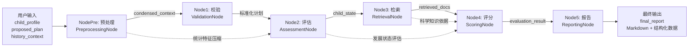

# 架构与设计 (Architecture)

> **文档定位**：本文档专注系统宏观架构、模块交互关系与数据流向。RAG 检索技术细节请参阅 `.ai/rag_pipeline.md`。

本文档包含了系统的核心架构图、数据流向以及各个微服务或子系统的交互关系。

## 1. 系统架构总览

儿童发展评估系统采用了多层架构，前后端分离，主要由前端展示层、API网关层、业务服务层、核心配置层、大模型路由层、Agent编排层以及基础设施数据层构成。

```mermaid
graph TB
    subgraph 前端展示层 Frontend (FSD 架构)
        UI[React 19 + TypeScript + TanStack Query 5 + Zustand 5]
        subgraph Pages 路由页面层
            AssessmentPage[评估首页 /]
            KnowledgeBasePage[知识库页 /knowledge-base]
            KnowledgeSearchPage[知识搜索页 /knowledge-search]
            RagEvalSuite[RAG评估套件 /rag-eval/*]
            SystemConfigPage[系统配置页 /system-config]
            PromptManagementSuite[提示词管理 /prompt-management/*]
            LLMMonitoringPage[LLM监控页 /monitoring]
        end
        subgraph Features 业务特性层
            AssessmentFeature[评估特性]
            DocumentsFeature[知识库特性]
            KnowledgeFeature[搜索特性]
            RagEvalFeature[RAG评估特性<br>pages/components/hooks/stores/utils]
            ConfigFeature[配置特性]
            PromptFeature[提示词特性]
            MonitoringFeature[监控特性<br>LLMMonitoringDashboard]
        end
        subgraph Entities 业务实体层
            AssessmentEntity[评估实体]
            TestCaseEntity[测试用例实体]
            TracingEntity[链路追踪实体]
            RagEvalEntity[RAG评估实体<br>types/enums/mappers/constants]
        end
        subgraph Shared 共享层
            ApiClient[统一API客户端]
            CommonUI[通用UI组件]
            Hooks[通用hooks]
            Utils[工具函数]
        end
        subgraph Stores 状态管理层
            DraftStore[DraftGenerationStore<br>草稿生成状态]
            RunStore[RunProgressStore<br>测试运行状态]
            ReportStore[ReportProgressStore<br>报告生成状态]
        end
    end
    
    subgraph API 网关层 API Gateway
        FastAPI[FastAPI 0.135.1]
        TraceMW[TraceMiddleware<br>TRACE_ID注入]
        RespWrap[ResponseWrapperMiddleware<br>响应包装]
        CORS[CORS 中间件]
        TaskCtrl[TaskController]
        RagCtrl[RagController]
        RagEvalCtrl[RagEvalControllerRegistry<br>7个子控制器]
        ConfigCtrl[ConfigController]
        ConfigHealthCtrl[ConfigHealthController]
        PromptCtrl[PromptManagementController]
        MonitorCtrl[MonitoringController]
        HealthCtrl[HealthController]
    end
    
    subgraph 业务服务层 Services
        subgraph 文档导入服务簇 Document Ingestion
            DocIngestion[DocumentIngestionFacade<br>文档导入门面服务]
            DocParser[DocumentParser<br>文档解析器]
            ChunkIndex[ChunkingIndexing<br>分块索引服务]
            TaskState[TaskStateManager<br>任务状态管理]
        end
        subgraph RAG 服务簇 RAG
            RagSvc[RagService<br>RAG 门面服务]
            RetrievSvc[RetrievalFacade<br>检索门面服务]
            QueryRewriter[QueryRewriter<br>查询重写服务]
            ResultProcessor[ResultProcessor<br>结果处理服务]
            IndexMgr[IndexManagerFacade<br>索引管理门面服务]
        end
        subgraph 缓存服务簇 Cache
            CacheSvc[CacheService<br>三级缓存门面服务]
            L1Cache[MemoryLRUCache<br>内存缓存]
            L2Cache[RedisCache<br>分布式缓存]
            L3Cache[DiskCache<br>磁盘持久化缓存]
        end
        subgraph RAG 评估服务簇 RAG Eval (6子引擎)
            EvalOrchestrator[RagEvalOrchestrator<br>评估编排器]
            DraftEngine[DraftEngine<br>草稿生成/审核/去重]
            CaseEngine[CaseEngine<br>测试用例/测试集管理]
            RunEngine[RunEngine<br>批量执行/快照管理]
            MetricEngine[MetricEngineFacade<br>评分+6层诊断]
            ReportEngine[ReportEngine<br>报告生成/趋势/导出]
            TuningEngine[TuningEngine<br>调优建议/冲突检测]
        end
        MonitorSvc[MonitoringService<br>监控服务]
        AlertSvc[AlertService<br>告警服务]
        TuningSvc[TuningService<br>智能调优建议服务]
    end
    
    subgraph 核心配置与状态层
        ConfigMgr[ConfigManager 配置管理器<br>支持热更新/原子保存/回滚]
        PromptMgr[PromptManager 提示词管理器<br>MySQL持久化/沙箱测试]
        EventBus[EventBus 事件总线<br>配置变更/SSE实时推送]
        LLMConfig[LLM 嵌套配置<br>凭证管理 + 场景配置]
    end

    subgraph 模型适配与路由层
        LLMFactory[LLMServiceFactory 工厂<br>Provider Registry多提供商]
        Providers[DashScope/OpenAI/Anthropic<br>DeepSeek/Ollama]
        LangChainAdapter[LangChain 适配器]
        LlamaIndexAdapter[LlamaIndex 适配器]
        PipelineOrch[PipelineOrchestrator<br>YAML驱动查询流水线]
    end

    subgraph Agent 核心层 LangGraph
        Graph[LangGraph 工作流<br>create_agent_graph]
        PreNode[PreprocessingNode<br>预处理与上下文压缩]
        ValNode[ValidationNode<br>数据校验与标准化]
        AssessNode[AssessmentNode<br>儿童发展评估]
        RetrievNode[RetrievalNode<br>混合检索专家]
        ScoreNode[ScoringNode<br>AHP 多维评分]
        ReportNode[ReportingNode<br>报告生成]
    end
    
    subgraph 监控与基础设施层 Infrastructure
        LLMMonitor[LLM调用监控器<br>统计收集/效果分析/告警]
        Tracing[Trace/Span 追踪系统<br>全链路耗时与成本计算]
        Prometheus[Prometheus 指标收集<br>HTTP/LLM/缓存指标]
        DI[Injector 依赖注入]
        AsyncMgr[AsyncTaskManager<br>异步任务/SSE分发]
        Cache[CacheService 三级缓存<br>Memory + Redis + Disk]
        Memory[MemoryManager 记忆管理]
        Security[PromptInjectionGuard<br>ContentAuditService]
        ABTest[ABTestFramework]
        Repo[Repository 数据访问层<br>BaseRepository + 专属Repository]
        DB[SQLAlchemy 数据库<br>异步连接池]
        Redis[Redis 客户端<br>分布式锁/会话/SSE心跳]
        Bloom[BloomFilter 布隆过滤器]
    end
    
    subgraph 数据层 Data
        MySQL[(MySQL 5.7<br>唯一持久化数据源<br>配置/测试/文档/监控/提示词)]
        RedisDB[(Redis 7.0<br>三级缓存/消息队列/锁/会话)]
        Chroma[(Chroma 向量库<br>本地持久化<br>相对路径: app_data/storage/vector_store)]
        Files[(文件存储<br>PDF/EPUB<br>相对路径: app_data/storage)]
        Logs[(Loguru 日志系统)]
    end
    
    UI --> Assessment
    UI --> Documents
    UI --> Knowledge
    UI --> RAGEval
    UI --> SysConfig
    UI --> PromptUI
    UI --> LLMMonitorUI
    
    Assessment --> FastAPI
    Documents --> FastAPI
    Knowledge --> FastAPI
    RAGEval --> FastAPI
    SysConfig --> FastAPI
    PromptUI --> FastAPI
    LLMMonitorUI --> FastAPI
    
    FastAPI --> CORS
    CORS --> TaskCtrl
    CORS --> RagCtrl
    CORS --> RagEvalCtrl
    CORS --> ConfigCtrl
    CORS --> ConfigHealthCtrl
    CORS --> PromptCtrl
    CORS --> MonitorCtrl
    
    TaskCtrl --> Graph
    RagCtrl --> DocIngestion
    RagCtrl --> RagSvc
    RagEvalCtrl --> EvalOrchestrator
    ConfigCtrl --> ConfigMgr
    PromptCtrl --> PromptMgr
    MonitorCtrl --> MonitorSvc
    MonitorSvc --> LLMMonitor
    MonitorSvc --> AlertSvc
    
    EvalOrchestrator --> PipelineOrch
    RagSvc --> PipelineOrch
    
    PipelineOrch --> PreNode
    PipelineOrch --> ValNode
    PipelineOrch --> AssessNode
    PipelineOrch --> RetrievNode
    PipelineOrch --> ScoreNode
    PipelineOrch --> ReportNode
    
    Graph --> DI
    Graph --> EventBus
    Graph --> Cache
    Graph --> Memory
    Graph --> Security
    Graph --> ABTest
    Graph --> Repo
    
    ConfigMgr --触发--> EventBus
    EventBus --更新模型实例--> LLMFactory
    EventBus --LLM调用日志--> LLMMonitor
    
    LLMFactory --> LangChainAdapter
    LLMFactory --> LlamaIndexAdapter
    
    DocIngestion --> Chroma
    DocIngestion --> MySQL
    RetrievNode --> Chroma
    RetrievNode --> Cache
    ConfigMgr --> Repo
    PromptMgr --> Repo
    LLMMonitor --> Repo
    RagSvc --> Files
    CacheSvc --> RedisDB
    Repo --> DB
    Repo --> RedisDB
```

## 2. 评估工作流数据流向

整个评估流程是一个有向无环图 (DAG)，状态通过 `AgentState` 在各个节点间传递。



### 业务逻辑与流向解释:
1. **预处理阶段**: 接收用户上传的历史训练记录（如近一月的运动数据），将其压缩为 `condensed_context`，提取出统计特征（如平均时长、频率一致性），这一步是为了减少 LLM 上下文窗口的 Token 消耗。
2. **评估与检索**: 在明确了儿童的发展状态后，检索节点并不会无脑地检索整个知识库，而是结合 `child_profile`（症状描述）和 `proposed_plan`（拟定目标）去精准召回相关文档。
3. **评分与报告**: 引入了两层评分机制。第一层是基于检索文档计算的 AHP (层次分析法) 客观评分；第二层是让 `QwenScorer` 等机器学习模型在客观评分基础上结合特征重要度给出最终的 `evaluation_result`。

---

## 3. RAG回测测试全流程
RAG系统的回测测试采用自动化全链路闭环设计，支持效果验证、迭代优化和回归校验。

```mermaid
graph LR
    subgraph 测试准备阶段
        DocUpload[文档上传] --> DocParse[文档解析/分块/索引]
        DocParse --> SnapshotCreate[知识库快照创建]
        DocImport[批量导入历史问答] --> DraftGenerate[LLM自动生成测试草稿]
        DraftGenerate --> DraftReview[人工审核草稿]
        DraftReview --> CaseCreate[生成标准测试用例]
        CaseCreate --> TestSetCreate[组装测试集]
    end
    
    subgraph 测试执行阶段
        TestSetCreate --> TestConfig[测试参数配置/版本标记]
        TestConfig --> BatchRun[批量并发执行测试]
        BatchRun --> SnapshotLock[关联知识库快照保证可复现]
        BatchRun --> ResultCollect[收集原始测试结果]
    end
    
    subgraph 6层校验诊断阶段
        ResultCollect --> Layer1[层1:规则引擎校验<br>语法/格式/必填项检查]
        Layer1 --> Layer2[层2:历史对比校验<br>与历史基线结果对比]
        Layer2 --> Layer3[层3:大模型诊断校验<br>语义/相关性/准确性评估]
        Layer3 --> Layer4[层4:质量校验<br>覆盖率/分块质量/新鲜度检查]
        Layer4 --> Layer5[层5:效果校验<br>embedding质量/意图匹配/错误模式识别]
        Layer5 --> Layer6[层6:回归校验<br>版本对比/AB测试/成本效益分析]
    end
    
    subgraph 报告与优化阶段
        Layer6 --> MetricCalc[多维度指标计算<br>准确率/召回率/F1/响应时间/成本]
        MetricCalc --> ReportGenerate[生成可视化评估报告]
        ReportGenerate --> Suggestion[智能调优建议生成]
        Suggestion --> RegressTest[回归测试验证优化效果]
        RegressTest --> TrendAnalysis[历史版本趋势分析]
        TrendAnalysis --> BaselineUpdate[更新效果基线]
    end
```



### 回测核心特性:
1. **全链路可复现**: 每次测试自动关联知识库快照、模型版本、配置版本，保证测试结果可复现、可对比
2. **6层全维度校验**: 从规则到语义、从质量到效果、从单版本到多版本对比的全链路诊断
3. **自动化回归**: 优化后自动触发回归测试，与历史基线对比验证优化效果
4. **趋势追踪**: 支持多版本效果趋势分析，直观展示优化迭代效果
5. **SSE实时推送**: 测试执行进度、校验结果、报告生成过程实时推送到前端