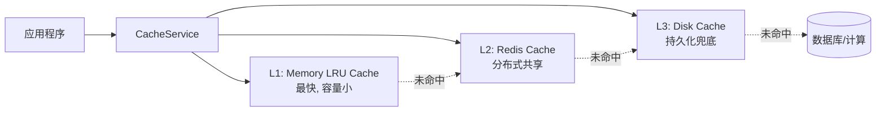
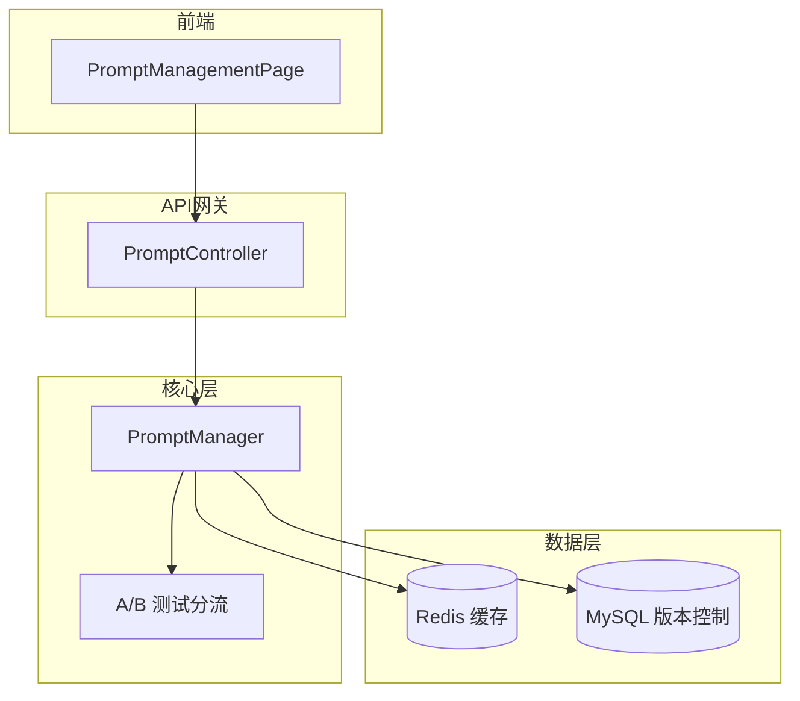
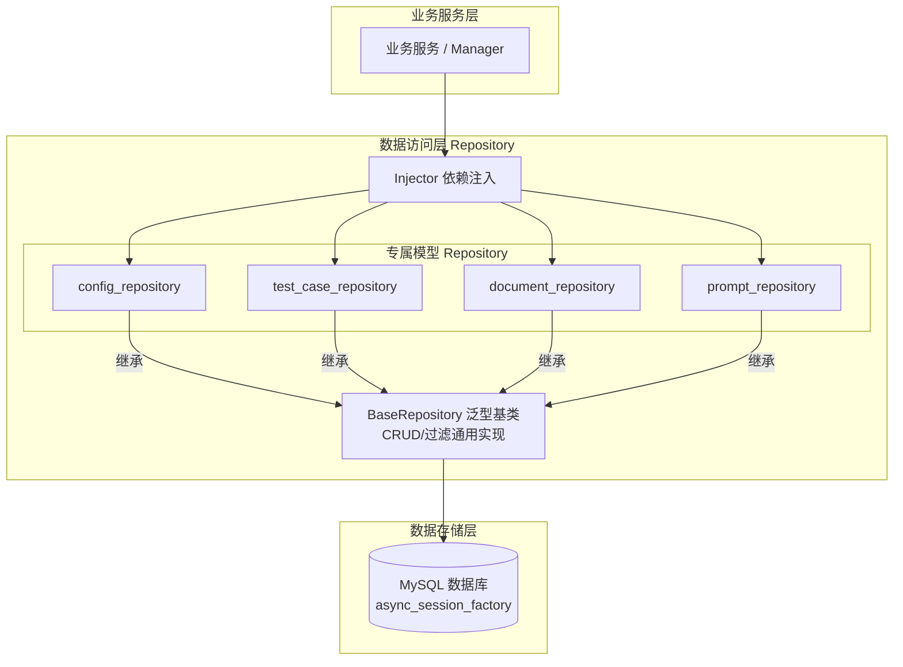
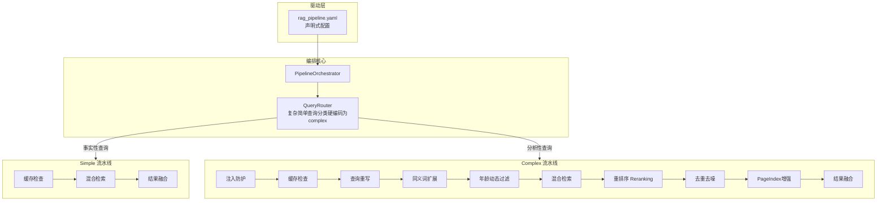

# 核心基础设施与配置系统

本文档详细描述系统的底层基础设施、数据模型以及前端功能模块。

## 4.1 RAG 测试与评估数据模型

基于 MySQL 5.7 存储，所有主键统一采用 UUID `String(36)`，表之间通过弱引用关联，避免严格的外键约束。共 18 张表支持完整工作流与配置追踪。

### 评估工作流模型
- **测试集 (TestSet)**: `id`, `name`, `description`, `source_type`
- **测试用例 (TestCase)**: 包含核心问题、领域、年龄要求、预期回答和指标分数等。
- **测试用例关联 (TestSetCase)**: 管理测试集与用例的多对多关系。
- **测试草稿 (TestCaseDraft)**: LLM 自动提取的原始问题，经过人工审核后转化为 TestCase。
- **运行记录 (TestRun)**: 批量测试的执行记录与状态跟踪。
- **运行结果 (TestRunResult)**: 单条用例的测试明细与多维指标得分。
- **评估报告 (TestReport)**: 汇总 TestRun 结果生成的结构化与 Markdown 报告。

### 配置与追踪模型
- **源文档 (SourceDocument)**: 知识库文件元数据、状态与解析结果。
- **意图标注 (IntentAnnotation) / 意图日志 (QueryIntentLog) / 同义词 (SynonymQueryPair)**: 检索优化模型。
- **配置版本 (ConfigVersion) / 提示词版本 (PromptVersion)**: 记录系统设置的历史变更，支持回滚。
- **配置变更集 (ConfigChangeSet / ConfigChangeSetPrompt)**: 原子保存多项配置与提示词变更的集合。
- **调优建议 (TuningSuggestionRecord / PromptSuggestionRecord / IgnoredSuggestion)**: 6层校验引擎生成的智能建议与用户处理记录。

## 5. 前端功能模块

### 5.1 评估功能 (Assessment)
- **评估表单**: 支持儿童画像和运动计划输入
- **报告查看器**: 渲染 Markdown 报告和可视化图表
- **状态管理**: 使用 Zustand 管理评估流程状态

### 5.2 知识库管理 (Documents)
- **文档上传**: 支持 PDF/EPUB/TXT 上传和导入进度跟踪
- **文档列表**: 展示已索引文档和分块信息
- **任务管理**: 监控文档导入任务状态

### 5.3 知识搜索 (Knowledge)
- **混合检索**: 支持 BM25 + 向量语义搜索
- **结果展示**: 展示检索结果和相关度分数
- **详情查看**: 支持分块详情和来源追溯

### 5.4 RAG 评估与调优 (RAG Evaluation)
- **测试集工作流**: 测试集创建 -> 案例添加 -> 并发测试 -> 报告生成与导出 (PDF/CSV/JSON)。
- **智能诊断与调优面板**: 基于 6 层校验引擎生成调参建议，支持一键应用（推荐模式/审查模式分离）。
- **SSE 实时反馈**: 支持任务进度实时推送、断线重连与页面独立执行。
- **趋势分析**: 包含多指标叠加、配置版本误差线的趋势图表。

### 5.5 系统配置 (System Config)
- **热重载与版本控制**: 动态修改系统运行参数，修改后通过 ConfigCache 热重载生效，支持原子保存与一键回滚。
- **多模式支持**: 提供向导模式 (WizardMode) 和专家模式 (ExpertMode) 分层视图。
- **差异对比**: 可视化展示配置修改 Diff，输入时实时校验取值范围与冲突。

### 5.6 提示词管理 (Prompt Management)
- **沙箱与版本控制**: 创建/查看/对比提示词版本，提供带中文说明和代码引用分析的编辑面板。
- **在线沙箱测试**: 支持注入变量直接预览大模型输出结果。

### 5.7 LLM 监控与分析 (LLM Monitoring)
- **总览仪表盘**: 全系统 LLM 调用统计、消耗趋势、错误率概览
- **全链路追踪 (Tracing)**: 支持查看 LangGraph 到大模型底层调用的完整 Span 层级树，耗时与成本分析。

## 6. 核心基础设施

### 6.1 配置系统
- **三层分层架构**:
  - `core/`：配置基础设施，包含管理器、持久化存储、事件系统
  - `modules/`：按功能域拆分的配置模块（基础配置、AI模型、RAG、业务规则）
  - `rules/`：独立的业务规则配置层
- **统一入口**: 所有配置通过 `from src.config import settings, rules, config_manager` 一站式导入
- **热重载**: 配置文件变更自动生效
- **版本控制**: 支持配置版本管理和回滚
- **事件驱动**: 配置变更通过 EventBus 传播
- **嵌套模型支持**: 后端 `get_all_config_metadata()` 支持递归展开嵌套 Pydantic 模型，前端动态表单支持嵌套对象渲染。
- **LLM 配置重构**:
  - **凭证管理 (`llm_providers`)**: 独立管理各提供商（DashScope/OpenAI 等）的 API Key 和 Base URL，每种提供商只能配置一个凭证。前端提供卡片式管理界面。
  - **场景配置 (`llm_scene_configs`)**: 9 大业务场景独立配置模型参数（provider, model, temperature, max_tokens, top_p 等）。前端按场景分组展示，包含详细的应用场景说明。
  - **参数限制**: 温度参数 (0-2)、最大 Token 数 (1-32000)、Top-p (0-1) 等均有严格的输入限制。

### 6.2 依赖注入
- **DI Container**: 使用 Injector 框架管理依赖
- **服务注册**: 核心服务通过 DI 容器注册和解析
- **测试友好**: 便于单元测试的依赖替换

### 6.3 事件总线
- **发布/订阅**: 组件间解耦的事件通信
- **配置事件**: 配置变更事件通知
- **业务事件**: 业务流程事件触发
- **Redis Pub/Sub**: 支持分布式事件传播，跨进程/跨实例通信

### 6.4 安全防护
- **提示词注入防护**: PromptInjectionGuard 检测和阻止恶意注入
- **内容审核**: ContentAuditService 确保生成内容安全
- **敏感词过滤**: 基于敏感词库的内容过滤

### 6.5 记忆管理
- **MemoryManager**: 管理 Agent 对话历史和上下文
- **向量记忆**: 支持基于向量相似度的记忆检索
- **上下文压缩**: 统计特征压缩降低 Token 消耗

### 6.6 AB 测试
- **ABTestFramework**: 支持不同策略的对比测试
- **流量分配**: 支持流量分组和实验配置
- **效果分析**: 实验结果统计和显著性检验

### 6.7 数据库基础设施
- **SQLAlchemy ORM**: 异步数据库引擎/会话管理，内置慢查询检测，连接池配置
- **Alembic 迁移**: 数据库版本控制和迁移管理
- **数据模型**: `src/models/` 包含配置(版本与审计)、测试用例(用例/草稿/测试集/运行结果)、文档(源文档/导入记录)、监控(A/B指标/LLM日志)、提示词模型
- **配置模块**: `src/config/modules/database.py` 数据库配置

### 6.8 Redis 基础设施



- **Redis 客户端**: 异步 Redis 连接管理，连接池配置，懒加载机制
- **分布式锁**: 基于 Redis 的分布式锁实现 (带看门狗自动续期)
- **会话管理**: 用户会话存储和管理 (Redis Hash 结构)
- **熔断器**: CircuitBreaker 模式实现服务保护
- **布隆过滤器**: pybloom-live 实现的高效去重过滤器
- **三级缓存**: Memory (cachetools LRU) + Redis + Disk 三级缓存架构
- **配置模块**: `src/config/modules/redis.py` Redis 配置

### 6.9 提示词管理系统



- **PromptManager**: 提示词版本控制和 MySQL 存储 + Redis 缓存
  - 位置: `src/core/prompt/manager.py`
  - 功能: 版本管理、A/B 测试分流、缓存失效
- **PromptController**: 提示词 API 控制器
  - 位置: `src/controller/prompt_controller.py`
  - 路由前缀: `/api/v1/prompts`
- **数据模型**: `src/models/prompt.py`
  - `PromptVersion`: 提示词版本 (id, prompt_key, version, content, content_hash, description, created_by, variables, tags, fallback)
  - `PromptABTest`: A/B 测试配置 (id, prompt_key, name, is_active, variant_a_version, variant_b_version, variant_a_ratio)
- **前端页面**: `src/features/prompts/PromptManagementPage.tsx`
  - 路由: `/prompt-management`
  - 功能: 版本列表、在线编辑、版本对比、A/B 测试配置

### 6.10 数据访问层 (Repository Layer)



- **架构**: 基于泛型的 BaseRepository 基类 + 模型专属 Repository 类
- **位置**: `src/repository/`
- **设计要点**:
  - Repository 接收 `async_session_factory` 而非单个 session，每个方法内部通过 `async with` 创建独立 session
  - 过滤查询时校验字段有效性，防止 SQL 注入
  - create/update 方法接收 `Dict[str, Any]`，由调用方负责数据校验
- **BaseRepository 通用方法**: `get_by_id`, `get_all`, `create`, `update`, `delete`, `get_by_filter`, `get_one_by_filter`, `count_by_filter`
- **专属 Repository** (已合并至模块文件):
  - `config_repository.py`: `ConfigVersionRepository`, `ConfigAuditLogRepository` - 配置版本与审计日志
  - `document_repository.py`: `SourceDocumentRepository`, `DocumentRecordRepository` - 文档管理
  - `test_case_repository.py`: `TestCaseRepository`, `TestCaseDraftRepository`, `TestSetRepository`, `TestSetCaseRepository`, `TestRunRepository`, `TestRunResultRepository` - 测试用例管理
  - `prompt_repository.py`: `PromptVersionRepository`, `PromptABTestRepository` - 提示词管理
  - `monitor_repository.py`: `LLMCallLogRepository`, `ABTestMetricRepository` - 监控日志
- **DI 注册**: 所有 Repository 通过 `RepositoryModule` 注册到 Injector 容器 (`src/core/di_container.py`)
- **已迁移模块**: ConfigManager, PromptManager, MonitoringService, RagTestManager (部分 CRUD)

### 6.11 模型适配与路由 (LLM Factory)

```mermaid
graph TB
    subgraph ConfigUI [配置管理前端]
        Cred[凭证管理<br>API Key/Base URL]
        Scene[场景配置<br>模型/参数/提供商]
    end
    
    subgraph FactoryLayer [工厂与路由层]
        Config[ConfigManager]
        Event[EventBus 变更事件]
        Factory[LLMServiceFactory<br/>按场景动态生成/缓存实例]
    end
    
    subgraph Adapters [框架适配层]
        Interface[ILLMService 统一接口]
        LangChain[LangChainAdapter]
        LlamaIndex[LlamaIndexAdapter]
    end
    
    subgraph Models [底层模型]
        Qwen[Qwen3.5-Plus / Qwen3-Omni-Flash 等]
    end
    
    Cred --llm_providers--> Config
    Scene --llm_scene_configs--> Config
    Config --热更新--> Event
    Event -.通知更新待订阅.-> Factory
    
    Factory --> Interface
    Interface <|-- LangChain
    Interface <|-- LlamaIndex
    
    LangChain --> Qwen
    LlamaIndex --> Qwen
```

- **配置结构升级**: 采用嵌套配置模型，分离"凭证管理"与"场景配置"。
  - **凭证管理 (`llm_providers`)**: 独立管理各提供商（DashScope/OpenAI/Anthropic 等）的 API Key 和 Base URL，每种提供商只能配置一个凭证。
  - **场景配置 (`llm_scene_configs`)**: 9 大业务场景独立配置模型参数（provider, model, temperature, max_tokens, top_p 等）。
- **多框架支持**: LangChain 和 LlamaIndex 适配器，统一定义为 `ILLMService`。
- **工厂注入**: `LLMServiceFactory` 根据场景懒加载模型实例，自动从配置中读取凭证和参数。
- **热切换**: 支持配置变更事件安全清理（dispose）旧模型实例，支持动态重载。
- **前端交互**: 系统配置页提供独立的"LLM 凭证管理"区域，场景配置按卡片分组展示，包含详细的应用场景说明和参数输入限制。

### 6.12 RAG 查询流水线编排 (Pipeline Orchestrator)



- **声明式编排**: 基于 `rag_pipeline.yaml` 驱动，消除硬编码的 RAG 查询逻辑
- **分支路由**: 根据分类结果动态选择 `simple` 或 `complex` 流水线（目前临时硬编码为返回 `complex`，待对接动态分类）
- **安全与可观测性**: 流水线首节点强制集成 `prompt_injection_guard` 拦截恶意输入，并提供全链路监控耗时与步骤结果