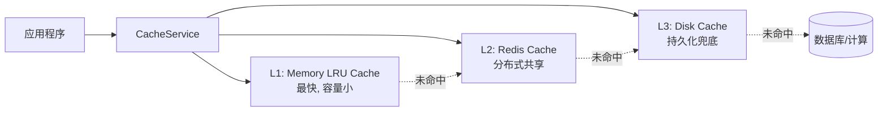
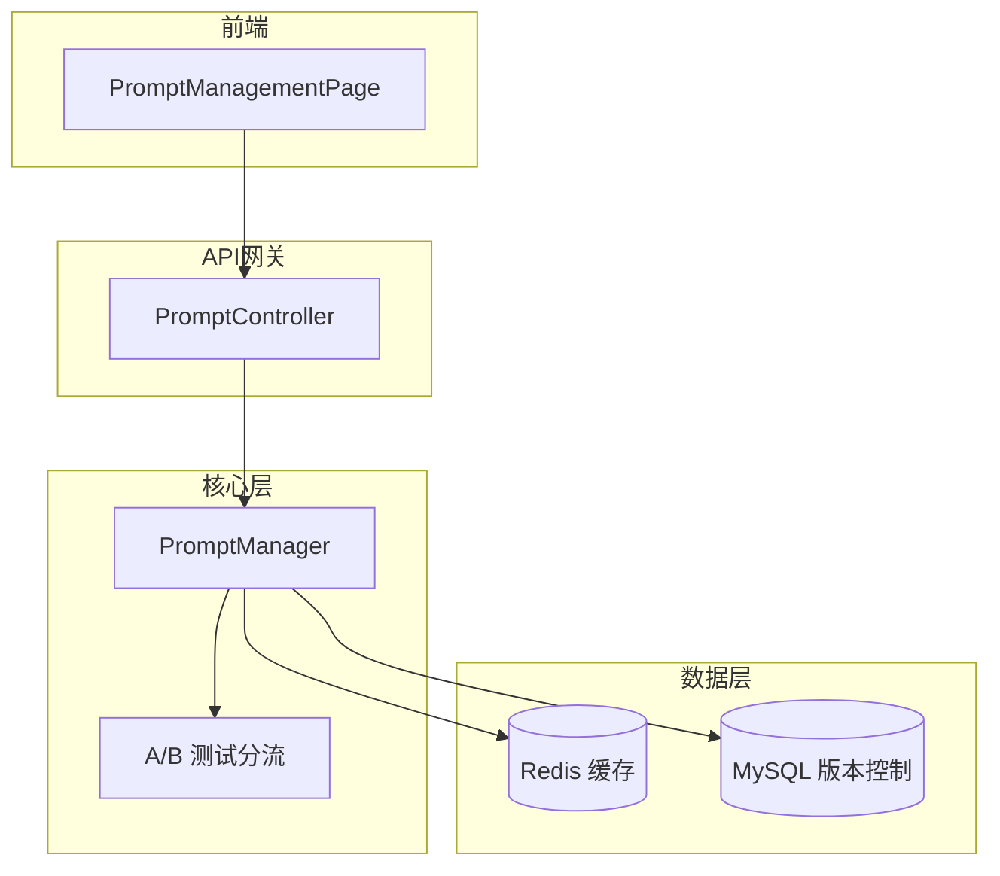
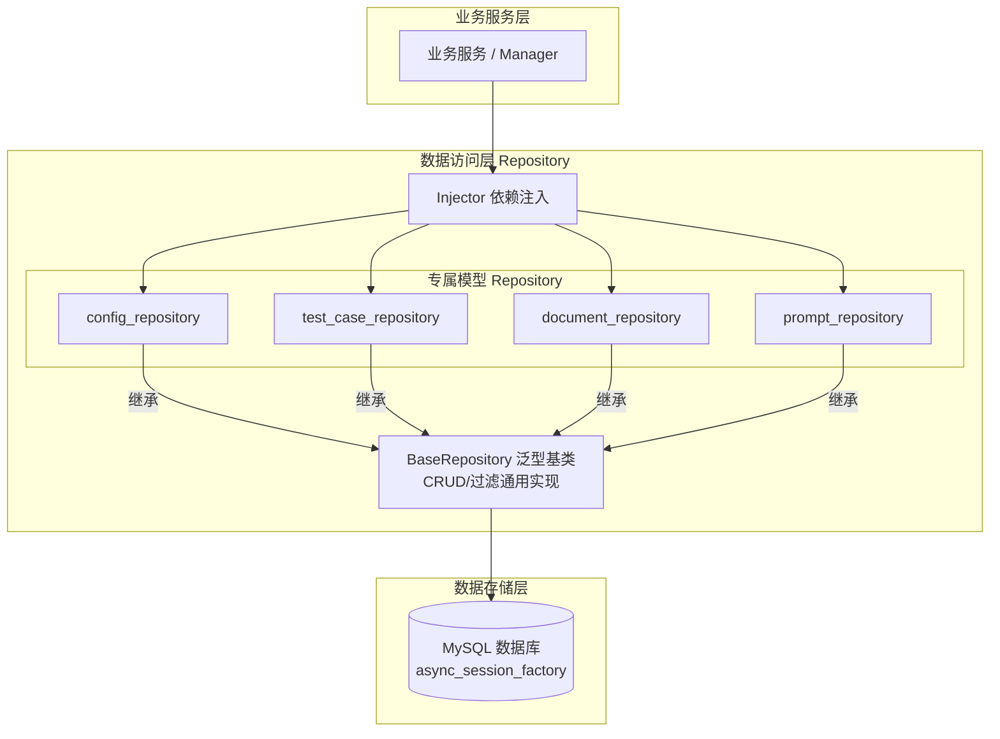
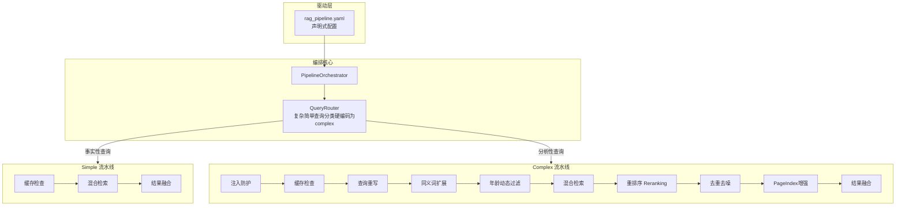

# 核心基础设施与配置系统

本文档详细描述系统的底层基础设施、数据模型以及前端功能模块。

## 4.1 RAG 测试数据模型

### 测试用例 (TestCase)
- `id`, `query`, `age`, `expected_knowledge_ids`, `expected_keywords`, `description`
- `domain`: 领域 (粗大动作/精细动作/语言发展/认知能力/社交情感/感觉统合)
- `answer_points`, `professional_terms`, `age_requirement`, `relevance_scores`
- `source_document_id`, `test_set_id`, `version`

### 源文档 (SourceDocument)
- `id`, `title`, `file_type`, `file_path`, `file_hash`
- `content_summary`, `page_count`, `chapter_structure`, `quality_report`
- `status`: uploaded/parsing/ready/archived

### 测试用例草稿 (TestCaseDraft)
- `id`, `source_document_id`, `query`, `age`, `domain`
- `expected_knowledge_ids`, `expected_keywords`, `description`
- `answer_points`, `professional_terms`, `age_requirement`
- `generation_params`, `status`: draft/reviewed/rejected/imported

### 测试集 (TestSet)
- `id`, `name`, `description`, `source_type`: manual/json_import/book_generated/mixed
- `test_case_ids`: 包含的测试用例ID列表

## 5. 前端功能模块

### 5.1 评估功能 (Assessment)
- **评估表单**: 支持儿童画像和运动计划输入
- **报告查看器**: 渲染 Markdown 报告和可视化图表
- **状态管理**: 使用 Zustand 管理评估流程状态

### 5.2 知识库管理 (Documents)
- **文档上传**: 支持 PDF/EPUB 上传和导入进度跟踪
- **文档列表**: 展示已索引文档和分块信息
- **任务管理**: 监控文档导入任务状态

### 5.3 知识搜索 (Knowledge)
- **混合检索**: 支持 BM25 + 向量语义搜索
- **结果展示**: 展示检索结果和相关度分数
- **详情查看**: 支持分块详情和来源追溯

### 5.4 RAG 评估 (RAG Evaluation)
- **测试集管理**: 创建/编辑/删除/导出测试集，支持添加/移除测试用例
- **评估报告**: 展示检索和生成质量指标
- **Bad Case 分析**: 标记和分析评估失败案例
- **JSON 导入**: 从 JSON 文件批量导入测试用例，支持预览/校验/去重
- **书籍导入**: 上传 PDF/EPUB/TXT 文档，自动生成测试用例草稿（默认 10 条，领域：感觉统合，年龄：0-6 岁）
- **草稿审核**: 表格化审核测试用例草稿，支持编辑/通过/拒绝/批量导入，审核后转为正式测试用例

### 5.5 系统配置 (System Config)
- **动态配置**: 支持运行时配置修改和热重载
- **版本管理**: 配置版本切换和回滚
- **差异对比**: 可视化展示配置变更

### 5.6 提示词管理 (Prompt Management)
- **版本管理**: 创建/查看/对比提示词版本
- **在线编辑**: 支持提示词内容编辑和元数据配置
- **A/B 测试**: 创建和管理提示词 A/B 测试，支持流量分配

### 5.7 LLM 监控与分析 (LLM Monitoring)
- **总览仪表盘**: 全系统 LLM 调用统计、消耗趋势、错误率概览
- **多维度分析**: 支持按提示词、按场景统计消耗与质量
- **告警配置**: 异常率升高、耗时突增、Token消耗超阈值告警

## 6. 核心基础设施

### 6.1 配置系统
- **三层分层架构**:
  - `core/`：配置基础设施，包含管理器、持久化存储、事件系统
  - `modules/`：按功能域拆分的配置模块（基础配置、AI模型、RAG、业务规则）
  - `rules/`：独立的业务规则配置层
- **统一入口**: 所有配置通过 `from src.config import settings, rules, config_manager` 一站式导入
- **热重载**: 配置文件变更自动生效
- **版本控制**: 支持配置版本管理和回滚
- **事件驱动**: 配置变更通过 EventBus 传播

### 6.2 依赖注入
- **DI Container**: 使用 Injector 框架管理依赖
- **服务注册**: 核心服务通过 DI 容器注册和解析
- **测试友好**: 便于单元测试的依赖替换

### 6.3 事件总线
- **发布/订阅**: 组件间解耦的事件通信
- **配置事件**: 配置变更事件通知
- **业务事件**: 业务流程事件触发
- **Redis Pub/Sub**: 支持分布式事件传播，跨进程/跨实例通信

### 6.4 安全防护
- **提示词注入防护**: PromptInjectionGuard 检测和阻止恶意注入
- **内容审核**: ContentAuditService 确保生成内容安全
- **敏感词过滤**: 基于敏感词库的内容过滤

### 6.5 记忆管理
- **MemoryManager**: 管理 Agent 对话历史和上下文
- **向量记忆**: 支持基于向量相似度的记忆检索
- **上下文压缩**: 统计特征压缩降低 Token 消耗

### 6.6 AB 测试
- **ABTestFramework**: 支持不同策略的对比测试
- **流量分配**: 支持流量分组和实验配置
- **效果分析**: 实验结果统计和显著性检验

### 6.7 数据库基础设施
- **SQLAlchemy ORM**: 异步数据库引擎/会话管理，内置慢查询检测，连接池配置
- **Alembic 迁移**: 数据库版本控制和迁移管理
- **数据模型**: `src/models/` 包含配置(版本与审计)、测试用例(用例/草稿/测试集/运行结果)、文档(源文档/导入记录)、监控(A/B指标/LLM日志)、提示词模型
- **配置模块**: `src/config/modules/database.py` 数据库配置

### 6.8 Redis 基础设施



- **Redis 客户端**: 异步 Redis 连接管理，连接池配置，懒加载机制
- **分布式锁**: 基于 Redis 的分布式锁实现 (带看门狗自动续期)
- **会话管理**: 用户会话存储和管理 (Redis Hash 结构)
- **熔断器**: CircuitBreaker 模式实现服务保护
- **布隆过滤器**: pybloom-live 实现的高效去重过滤器
- **三级缓存**: Memory (cachetools LRU) + Redis + Disk 三级缓存架构
- **配置模块**: `src/config/modules/redis.py` Redis 配置

### 6.9 提示词管理系统



- **PromptManager**: 提示词版本控制和 MySQL 存储 + Redis 缓存
  - 位置: `src/core/prompt/manager.py`
  - 功能: 版本管理、A/B 测试分流、缓存失效
- **PromptController**: 提示词 API 控制器
  - 位置: `src/controller/prompt_controller.py`
  - 路由前缀: `/api/v1/prompts`
- **数据模型**: `src/models/prompt.py`
  - `PromptVersion`: 提示词版本 (id, prompt_key, version, content, content_hash, description, created_by, variables, tags, fallback)
  - `PromptABTest`: A/B 测试配置 (id, prompt_key, name, is_active, variant_a_version, variant_b_version, variant_a_ratio)
- **前端页面**: `src/features/prompts/PromptManagementPage.tsx`
  - 路由: `/prompt-management`
  - 功能: 版本列表、在线编辑、版本对比、A/B 测试配置

### 6.10 数据访问层 (Repository Layer)



- **架构**: 基于泛型的 BaseRepository 基类 + 模型专属 Repository 类
- **位置**: `src/repository/`
- **设计要点**:
  - Repository 接收 `async_session_factory` 而非单个 session，每个方法内部通过 `async with` 创建独立 session
  - 过滤查询时校验字段有效性，防止 SQL 注入
  - create/update 方法接收 `Dict[str, Any]`，由调用方负责数据校验
- **BaseRepository 通用方法**: `get_by_id`, `get_all`, `create`, `update`, `delete`, `get_by_filter`, `get_one_by_filter`, `count_by_filter`
- **专属 Repository** (已合并至模块文件):
  - `config_repository.py`: `ConfigVersionRepository`, `ConfigAuditLogRepository` - 配置版本与审计日志
  - `document_repository.py`: `SourceDocumentRepository`, `DocumentRecordRepository` - 文档管理
  - `test_case_repository.py`: `TestCaseRepository`, `TestCaseDraftRepository`, `TestSetRepository`, `TestSetCaseRepository`, `TestRunRepository`, `TestRunResultRepository` - 测试用例管理
  - `prompt_repository.py`: `PromptVersionRepository`, `PromptABTestRepository` - 提示词管理
  - `monitor_repository.py`: `LLMCallLogRepository`, `ABTestMetricRepository` - 监控日志
- **DI 注册**: 所有 Repository 通过 `RepositoryModule` 注册到 Injector 容器 (`src/core/di_container.py`)
- **已迁移模块**: ConfigManager, PromptManager, MonitoringService, RagTestManager (部分 CRUD)

### 6.11 模型适配与路由 (LLM Factory)

```mermaid
graph TB
    subgraph Scenarios [业务场景层]
        Gen[报告生成]
        Assess[评估分析]
        Score[评分机制]
        Extract[信息提取]
    end
    
    subgraph FactoryLayer [工厂与路由层]
        Config[ConfigManager]
        Event[EventBus 变更事件]
        Factory[LLMServiceFactory<br/>按场景动态生成/缓存实例]
    end
    
    subgraph Adapters [框架适配层]
        Interface[ILLMService 统一接口]
        LangChain[LangChainAdapter]
        LlamaIndex[LlamaIndexAdapter]
    end
    
    subgraph Models [底层模型]
        Qwen[Qwen3.5-Plus / Qwen3-Omni-Flash 等]
    end
    
    Gen --> Factory
    Assess --> Factory
    Score --> Factory
    Extract --> Factory
    
    Config --热更新--> Event
    Event -.通知更新待订阅.-> Factory
    
    Factory --> Interface
    Interface <|-- LangChain
    Interface <|-- LlamaIndex
    
    LangChain --> Qwen
    LlamaIndex --> Qwen
```

- **多框架支持**: LangChain 和 LlamaIndex 适配器，统一定义为 `ILLMService`
- **场景隔离**: 9 大独立业务场景（报告生成、评估、重写、解析、评分等），独立配置模型参数
- **工厂注入**: `LLMServiceFactory` 根据场景懒加载模型实例
- **热切换**: 支持配置变更事件安全清理（dispose）旧模型实例，支持动态重载（事件订阅待完善）

### 6.12 RAG 查询流水线编排 (Pipeline Orchestrator)



- **声明式编排**: 基于 `rag_pipeline.yaml` 驱动，消除硬编码的 RAG 查询逻辑
- **分支路由**: 根据分类结果动态选择 `simple` 或 `complex` 流水线（目前临时硬编码为返回 `complex`，待对接动态分类）
- **安全与可观测性**: 流水线首节点强制集成 `prompt_injection_guard` 拦截恶意输入，并提供全链路监控耗时与步骤结果