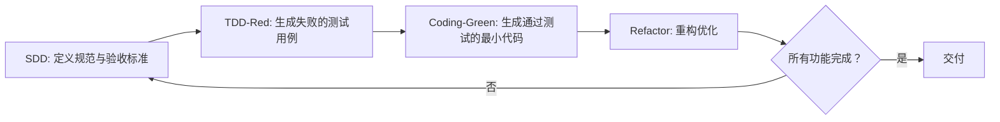

# AI 协同开发规范 (SDD + TDD 融合实践)

本文档确立「规范-测试-代码」的全链路对齐，作为 AI 代理的标准化执行 SOP。

### 7.1 核心执行顺序（严禁颠倒）


- **执行逻辑**：SDD定目标（做什么）→ TDD立标尺（验证标准）→ Coding做交付（精准匹配）
- **人机分工**：**人类主导**规范定义、合理性审查、测试结果校验、代码评审；**AI负责执行**测试生成、代码实现、辅助重构。

### 7.2 全流程实战落地标准

#### 阶段一：SDD 规范定义（蓝图绘制，人类主导）
- **核心目标**：产出机器可读的结构化规范文档（如`specs/xxx.md`），作为全流程唯一真理来源。
- **规范自查清单**：
  - [ ] 数据结构定义清晰（类型、必填项、约束规则）
  - [ ] 组件Props/Events/接口契约明确
  - [ ] 业务规则覆盖正常流程与异常场景
  - [ ] 验收标准（AC）可量化、可直接转化为测试断言，禁止「体验好、加载快」等模糊描述
  - [ ] 文档格式为机器可读的Markdown+YAML/JSON

#### 阶段二：TDD 测试先行（考卷生成，人机协同）
- **核心目标**：基于SDD验收标准生成测试代码，确认测试**全部失败**（红阶段），建立验证基准线。
- **执行步骤**：
  1. 向AI输入完整规范文档，要求：仅生成测试文件，不生成业务实现，全覆盖对应验收标准。
  2. 人工校验测试逻辑，确认其真实反映规范意图，无逻辑漏洞。
  3. 运行测试，**成功标志**：测试全部失败，证明测试用例有效且独立于业务实现。

#### 阶段三：Coding 精准实现（答题过关，人机协同）
- **核心目标**：编写最小代码集，让全部失败的测试通过（绿阶段），严格匹配SDD规范。
- **执行步骤**：
  1. 向AI输入规范文档+失败的测试文件，要求：仅实现满足测试所需的最小逻辑，无冗余代码。
  2. 运行测试，**成功标志**：测试全部通过，功能与规范完全匹配。
  3. 重构优化：AI辅助代码优化，重构后必须再次运行测试，确保全量通过。

#### 阶段四：集成与持续迭代
- **循环推进**：针对新增/修改需求，重复「SDD补充/更新→TDD红→Code绿」的完整循环。
- **自动化集成**：将规范检查、测试运行集成到CI流水线，确保每次提交都符合规范、测试全量通过。

### 2. TDD 执行口诀
> 规范先行定目标，测试生成红光照。
> 代码实现绿通行，重构优化质量高。
> 顺序切记莫颠倒，人机协同效率高。

### 3. 协同 Prompt 模板

**【生成测试用例（红阶段）】**
```text
角色：资深测试工程师
任务：根据以下SDD规范中的【验收标准】，生成{语言/框架}测试用例。
输入：{粘贴SDD规范完整片段}
要求：
1. 只生成测试代码，不生成任何业务实现代码
2. 100%覆盖规范中所有的验收标准
3. 确保测试在无业务实现的场景下必然执行失败（Red阶段）
4. 遵循对应测试框架的最佳实践，不耦合内部实现细节
```

**【生成业务实现（绿阶段）】**
```text
角色：资深开发工程师
任务：编写业务代码，使所有测试用例通过，同时严格符合SDD规范要求。
输入：
1. SDD规范文档：{粘贴规范完整内容}
2. 失败的测试文件：{粘贴测试代码完整内容}
要求：
1. 只编写让所有测试通过所需的最小代码集，不添加任何规范外的冗余逻辑
2. 遵循{开发语言/框架}的行业最佳实践
3. 补充必要的类型定义与代码注释
4. 严格匹配规范中定义的所有规则与约束
```