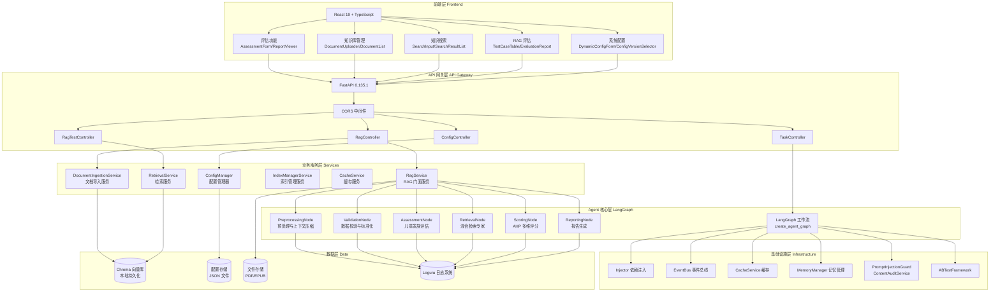
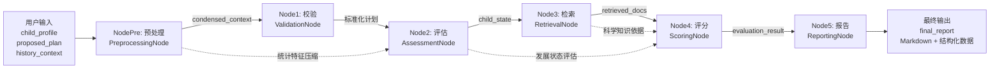

# ⚠️ 不可忽略的核心维护规则 (优先级高于一切)

【文件位置锁定】
- CLAUDE.md 和 AGENTS.md 必须始终位于项目根目录下，相对路径为：
  - `./CLAUDE.md`
  - `./AGENTS.md`
- 禁止将这两个文件移动到其他目录，禁止创建副本
- 任何情况下这两个文件的位置都不可改变

【结构性改动强制同步】
- 任何结构性改动（包括但不限于）必须同步更新 CLAUDE.md 和 AGENTS.md：
  - 新增/删除/移动文件或目录
  - 修改模块职责或依赖关系
  - 调整 Agent 工作流或节点
  - 变更技术栈或核心组件
  - 修改 API 端点或路由
  - 调整配置系统架构
  - 新增/删除服务层或核心基础设施
- 更新时必须在本规则下方标记改动内容，不可省略
- 更新后必须验证两个文档与实际代码结构的一致性

---

# Agent 系统架构

本文档定义了儿童发展评估系统的 Agent 架构。系统基于 **LangGraph** 进行编排，并适时采用 **ReAct** 模式。

## 0. 项目整体架构图

### 系统架构总览 (Mermaid)



### 评估工作流架构 (Mermaid)



### RAG 系统双流水线架构 (Mermaid)

```mermaid
graph TB
    subgraph 文档导入流水线 Ingestion Pipeline
        Upload[用户上传<br/>PDF/EPUB]
        Parse[阶段1: 文档解析<br/>PDFParser/PDFVLParser<br/>PDFParserV2/EPUBParser]
        Chunk[阶段2: 智能分块<br/>语义分块/章节分块<br/>父子块分块]
        Meta[阶段3: 元数据提取<br/>LLM 提取/规则提取<br/>分层模式优化]
        Embed[阶段4: 向量 Embedding<br/>DashScope<br/>text-embedding-v4]
        Index[索引插入<br/>Chroma 向量存储<br/>batch_size=100]
        Layered[阶段5: 分层内容生成<br/>L0 摘要/L1 概览/L2 详情]
        Persist[持久化存储<br/>自动备份<br/>间隔 300 秒]
        
        Upload --> Parse
        Parse --> Chunk
        Chunk --> Meta
        Meta --> Embed
        Embed --> Index
        Index --> Layered
        Layered --> Persist
    end
    
    subgraph 知识检索流水线 Retrieval Pipeline
        Query[用户查询]
        Route[步骤1: 查询路由<br/>QueryRouter<br/>简单/复杂分类]
        Cache[步骤2: 缓存检查<br/>CacheService<br/>容量 1000, TTL 3600s]
        Rewrite[步骤3: 查询重写<br/>可选]
        Synonym[步骤4: 同义词扩展<br/>LLM 生成 + 质量验证]
        AgeFilter[步骤5: 动态年龄过滤<br/>根据发展阶段调整]
        Hybrid[步骤6: 混合检索<br/>BM25 + Vector<br/>并行执行]
        Rerank[步骤7: Cross-Encoder<br/>重排序<br/>BAAI/bge-reranker-v2-m3]
        Dedup[步骤8: 内容去重<br/>精确匹配 + 相似度]
        PageIndex[步骤9: PageIndex 增强<br/>外部知识图谱<br/>熔断/重试机制]
        Fusion[结果融合<br/>分数归一化<br/>动态权重]
        Result[返回 KnowledgeItem<br/>年龄适配度计算<br/>阈值过滤]
        
        Query --> Route
        Route --> Cache
        Cache --> Rewrite
        Rewrite --> Synonym
        Synonym --> AgeFilter
        AgeFilter --> Hybrid
        Hybrid --> Rerank
        Rerank --> Dedup
        Dedup --> PageIndex
        PageIndex --> Fusion
        Fusion --> Result
    end
```



### 配置系统架构 (Mermaid)

```mermaid
graph TB
    subgraph 配置管理层
        ConfigMgr[ConfigManager<br/>配置管理器]
        ConfigRepo[ConfigRepository<br/>配置持久化]
        ConfigEvents[ConfigEvents<br/>配置变更事件]
    end
    
    subgraph 配置模块
        AppSettings[AppSettings<br/>应用配置]
        ModelSettings[ModelSettings<br/>LLM 模型配置]
        EmbedSettings[EmbeddingSettings<br/>Embedding 配置]
        RagSettings[RagSettings<br/>RAG 核心配置]
        VectorSettings[VectorStoreSettings<br/>向量存储配置]
        SplitterSettings[SemanticSplitterSettings<br/>分块配置]
        PageIndexSettings[PageIndexSettings<br/>知识图谱配置]
        FusionSettings[QueryFusionSettings<br/>查询融合配置]
        MLSettings[MLScoringSettings<br/>ML 评分配置]
        PathSettings[PathSettings<br/>路径配置]
        LogSettings[LogSettings<br/>日志配置]
        Rules[Rules<br/>业务规则]
    end
    
    subgraph 配置特性
        HotReload[热重载<br/>文件监听自动生效]
        VersionCtrl[版本控制<br/>切换/回滚]
        DiffView[差异对比<br/>可视化变更]
        EnvOverride[环境变量覆盖<br/>.env.dev]
    end
    
    ConfigMgr --> ConfigRepo
    ConfigMgr --> ConfigEvents
    ConfigMgr --> AppSettings
    ConfigMgr --> ModelSettings
    ConfigMgr --> EmbedSettings
    ConfigMgr --> RagSettings
    ConfigMgr --> VectorSettings
    ConfigMgr --> SplitterSettings
    ConfigMgr --> PageIndexSettings
    ConfigMgr --> FusionSettings
    ConfigMgr --> MLSettings
    ConfigMgr --> PathSettings
    ConfigMgr --> LogSettings
    ConfigMgr --> Rules
    
    ConfigMgr --> HotReload
    ConfigMgr --> VersionCtrl
    ConfigMgr --> DiffView
    ConfigMgr --> EnvOverride
    
    ConfigEvents -.事件通知.-> HotReload
```



## 1. 系统概览

本系统是一个由专用 Agent/节点组成的有向循环图 (DAG)，负责处理用户输入并生成全面的儿童发展评估报告。

### 核心工作流
`网关 (Gateway)` -> `预处理 (Preprocessing)` -> `校验 (Validation)` -> `评估 (Assessment)` -> `检索 (Retrieval)` -> `评分 (Scoring)` -> `报告生成 (Report Generation)`

## 2. Agent 定义

### 2.0 NodePre: 预处理与上下文压缩 (Preprocessing & Context Compression)
- **角色**: 上下文窗口优化器
- **职责**: 将大规模历史数据压缩为统计特征，以降低 Token 消耗。
- **输入**: 原始 `history_context` (JSON 列表)。
- **输出**: `condensed_context` (JSON 对象)。
- **核心逻辑**:
  - **特征提取**:
    - `weekly_avg_duration`: 计算周平均时长。
    - `frequency_consistency`: 基于变异系数 (CV) 计算频率一致性。
    - `intensity_trend`: 对比前后半段数据判断强度趋势 (rising/falling/stable)。
    - `diversity_score`: 计算活动种类的多样性占比。
  - **关键反馈提取**: 提取最近 3 条记录的反馈和备注。
  - *注意*: 当前版本暂未包含向量记忆功能，仅做统计压缩。

### 2.1 Node1: 数据校验与标准化 Agent (Data Validation & Standardization)
- **角色**: 把关人 / 输入守卫
- **职责**: 校验输入 Schema 并标准化数据格式（单位、默认值）。
- **输入**: 原始 `proposed_plan` (拟定计划), `child_profile` (儿童画像)。
- **输出**: 更新后的 `proposed_plan`。
- **工具/库**: Pydantic (基础类型校验), LLM (qwen-plus, 用于智能填补)。
- **逻辑**:
  - **智能填补 (Intensity Imputation)**:
    1.  优先匹配本地规则库 (如 "drawing" -> "low", "running" -> "high")。
    2.  若未命中，调用 LLM 根据活动名称和儿童年龄推断强度。
  - *注意*: 年龄适配度和脑区刺激分析已移至评分节点或后续流程处理。

### 2.2 Node2: 儿童发展评估模型 (Child Development Assessment Model)
- **角色**: 画像师
- **职责**: 将用户描述的问题映射到专业的感统维度，并对标年龄里程碑。
- **输入**: `child_profile`, `condensed_context`。
- **输出**: `child_state` (包含前庭觉、本体觉等维度的状态评估)。
- **工具/库**: LLM (qwen-plus)。
- **逻辑**:
  - **里程碑对比**: 使用内置的年龄里程碑数据 (`_get_age_milestones`) 作为评估参照。
  - **综合评估**: 结合儿童画像和历史运动特征（如有），生成包含各感统维度（等级 1-5）和综合评价的结构化数据。
  - **异常处理**: 若 JSON 解析失败，具备自动修复机制；若 LLM 不可用，返回默认兜底评估。

### 2.3 Node3: 混合检索专家 (Hybrid Retrieval Expert)
- **角色**: 知识专家
- **职责**: 检索与计划和儿童画像相关的科学依据及知识库条目。
- **输入**: `child_profile` (Issues), `proposed_plan` (Goals)。
- **输出**: `retrieved_docs` (结构化知识条目列表)。
- **核心架构**: 采用 **BM25关键词检索 + 向量语义检索 + Cross-Encoder重排序** 混合架构，详见 [RAG系统完整技术文档](../RAG_SYSTEM_COMPLETE_DOCUMENTATION.md)。

#### 2.3.1 文档导入流水线 (Ingestion Pipeline)

```
用户上传 PDF/EPUB → 文档解析 → 智能分块 → 元数据提取 → 向量Embedding → 索引插入 → 持久化存储
```

**阶段 1: 文档解析**
- **解析器工厂**: `get_parser()` 根据文件扩展名自动选择解析器
- **PDFParser**: PyMuPDF 传统文本提取，支持书签(TOC)分割为章节级 Document
- **PDFVLParser**: Qwen-VL 多模态 OCR，扫描版 PDF 专用，ThreadPoolExecutor 并行解析
- **PDFParserV2**: 三级降级解析器 (VLM → 传统文本提取)，含内容质量校验
- **EPUBParser**: EbookLib + BeautifulSoup，支持 TOC 层级结构
- **扫描版检测**: 文本提取率 < 50% 或平均文本长度 < 100 → 触发 VL 解析

**阶段 2: 智能分块**
- **章节级分块** (`split_chapters_into_chunks`): EPUB/带书签 PDF 使用
  - 预切分超长章节 (>3000 字符) → 语义分块 → 合并相邻小块 → 二次细分
- **页面级分块** (`split_pages_into_chunks`): 普通 PDF 使用
  - 语义分块 → 降级为 SentenceSplitter (chunk_size=1536, overlap=200)
- **父子块分块** (`hierarchical_chunking`): 父块提供上下文，子块用于精确检索
- **语义分块器**: 自动语言检测 (中/英文字母占比 > 70%)，中文 buffer_size=5/threshold=90，英文 buffer_size=3/threshold=75
- **分隔符优先级**: 标题边界 → 段落边界 → 句子结束符

**阶段 3: 元数据提取**
- **标准模式**: 每个节点调用 LLM 提取 (topics, brain_regions, target_age_min/max, developmental_domains, difficulty_level)，并发数=20
- **分层模式** (性能提升约80倍):
  - 文档级元数据: 从第一个节点提取一次，复用给所有节点
  - 关键块识别: 章节开头 + 内容突变处 (>50%变化) + 均匀采样 (每10选1)
  - 关键块: LLM 提取；普通块: 规则提取 (正则匹配年龄、领域标签映射)
- **内容去重**: MD5 content_hash 去重，跳过已存在的块

**阶段 4: 索引插入**
- **分批插入**: batch_size=100，每批报告进度
- **向量存储**: Chroma (本地持久化)，支持扩展到 Pinecone/Milvus/Weaviate
- **Embedding**: DashScope text-embedding-v4，最大文本长度 1536 字符，批处理大小 10
- **自动持久化**: 后台线程，间隔 300 秒，原子写入 + 备份恢复

**阶段 5: 分层内容生成 (可选)**
- **L0 摘要** (~100字): LLM → summa TextRank → 直接截断
- **L1 概览** (~500字): LLM → summa TextRank → 直接截断
- **L2 详情**: 原始内容
- **批量生成**: 动态批次大小 (20/10)，并发限制 8

#### 2.3.2 知识检索流水线 (Retrieval Pipeline)

```
用户查询 → 查询路由 → 缓存检查 → 查询重写 → 同义词扩展 → 年龄过滤 → 混合检索 → 重排序 → 内容去重 → 返回 KnowledgeItem
```

**步骤 1: 查询路由 (QueryRouter)**
- LLM 分类: 简单查询 (事实性/定义性) vs 复杂查询 (比较分析/多步骤)
- 模型: qwen3-omni-flash，置信度阈值 0.8，最多重试 2 次
- 降级: 解析失败 → 默认复杂查询

**步骤 2: 缓存检查 (CacheService)**
- 缓存键: md5(query + age + limit)
- 容量: 1000 条目，TTL: 3600 秒，LRU 淘汰

**步骤 3: 查询重写 (可选)**
- 触发条件: rag_query_rewrite_enabled = True
- 将自然语言转为更适合检索的关键词短语

**步骤 4: 同义词扩展**
- LLM 生成 JSON 格式同义词列表
- 质量验证: 过滤单字、过长词 (>10)、非中文字符

**步骤 5: 动态年龄过滤**
- 根据儿童发展阶段调整过滤参数:
  - 婴儿期 (0-1岁): tolerance=1, strictness=0.9, weight=0.5
  - 幼儿期 (1-3岁): tolerance=2, strictness=0.8, weight=0.4
  - 学龄前 (3-6岁): tolerance=2, strictness=0.7, weight=0.3
  - 学龄期 (6-12岁): tolerance=3, strictness=0.6, weight=0.25
- 构建 MetadataFilter: target_age_min/max 范围过滤

**步骤 6: 混合检索执行 (并行)**
- **BM25 检索**: BM25Retriever + jieba 分词，Top-K=10
- **向量检索**: VectorRetriever (Chroma) + DashScope Embedding，Top-K=10
- **结果融合** (HybridRetrievalMerger):
  - BM25 分数校准: Sigmoid 校准到 [0,1] (scale_factor=5)
  - 向量分数校准: 分段校准 (>=0.5 映射到 [0.5,1.0]，<0.5 映射到 [0,0.25])
  - 动态权重: 关键词密度 >0.5 → BM25权重0.7；<0.2 → BM25权重0.3；默认0.5
  - 加权融合 + 全局归一化 + 按 node_id 去重

**步骤 7: Cross-Encoder 重排序**
- 模型: BAAI/bge-reranker-v2-m3 (懒加载)
- 初始候选 30 个 → Cross-Encoder 评分 → 返回 Top 5

**步骤 8: 转换为 KnowledgeItem**
- 年龄适配度计算 (child_development_engine)
- 内容去重: 精确匹配 + 包含关系 + difflib 相似度 (>0.85)
- 阈值过滤

**步骤 9: 复杂查询增强 (可选)**
- 触发条件: query_type == "complex" 且 pageindex_enabled = True
- PageIndex 检索: 外部知识图谱，熔断机制 (失败5次→熔断60秒)，重试 (3次指数退避)
- 结果融合: 去重 + 分数提升 (1.2x) + 混合补充 (最多5个) + 重新归一化

#### 2.3.3 搜索页面专用检索

与知识检索的区别:
- 初始候选: rag_reranker_initial_k (30)
- 无年龄过滤
- 搜索专用融合策略: 纯向量惩罚 (no_match_vector_penalty=0.5)
- 搜索专用阈值: hybrid/vector 均为 0.35
- 相对截断: 保留 Top 50% 结果

### 2.4 Node4: 评分 Agent (Value Assessment)
- **角色**: 裁判 / 评估员
- **职责**: 对拟定计划进行多维度打分。
- **输入**: `proposed_plan`, `retrieved_docs`, `child_state`, `child_profile`。
- **输出**: `evaluation_result` (分数, 理由, SHAP 值, 维度分析, 建议)。
- **逻辑**: **分层评分引擎**
  1.  **Level 1 (AHP 基准评分 - 已实现)**:
      - **科学性 (40%)**: 基于 RAG 文档的相关性和对家长主诉问题的覆盖率。
      - **年龄适配度 (30%)**: 检查周总时长、单次时长是否符合年龄建议。
      - **安全性 (30%)**: 检查高风险活动与年龄的匹配度，以及 RAG 检索到的风险提示；结合 `child_state` (如前庭觉缺陷) 进行个性化扣分。
  2.  **Level 2 & 3 (ML 预测与融合 - 规划中)**: 暂未实现，目前直接输出 AHP 分数。
  3.  **输出**: 生成详细的维度分析 (`DimensionAnalysis`) 和改进建议 (`suggestions`)。

### 2.5 Node5: 报告生成 Agent (Report Generation)
- **角色**: 撰稿人 / 沟通者
- **职责**: 将所有数据综合成家长友好的 Markdown 报告。
- **输入**: 所有前序状态 (`child_profile`, `child_state`, `evaluation_result`, `retrieved_docs`)。
- **输出**: `final_report` (Markdown + 结构化数据)。
- **逻辑**:
  - **数据准备**: 整理雷达图数据、科学依据列表、算法分析详情。
  - **流式支持**: 若 `is_streaming` 为 True，返回 Prompts 供上层流式调用。
  - **报告生成**: 调用 LLM (qwen-plus) 生成 Markdown 报告。
  - **兜底机制**: 若 LLM 调用失败，生成基础的降级报告。

### 2.6 专家反馈循环 (异步 - 规划中)
- **角色**: 人在回路审核员
- **职责**: 事后审查分数以微调系统。
- **动作**: 标记 Bad Case，提供修正分，更新金标准数据集。

## 3. 状态管理 (LangGraph)

`AgentState` 是在节点间传递的共享内存结构。

```python
class AgentState(BaseModel):
    """LangGraph 状态定义"""

    input_text: Optional[str] = None
    child_profile: ChildProfile
    proposed_plan: ProposedPlan
    child_state: Optional[ChildState] = None
    condensed_context: Optional[CondensedContext] = None
    history_context: Optional[List[HistoryRecord]] = Field(
        default_factory=list, description="原始历史记录"
    )
    retrieved_docs: List[KnowledgeItem] = Field(default_factory=list)
    evaluation_result: Optional[EvaluationResult] = None
    final_report: Optional[FinalReport] = None
    messages: List[Dict[str, str]] = Field(default_factory=list, description="对话历史")
    report_prompts: Optional[List[str]] = Field(None, description="用于流式生成的 Prompt 列表")
    is_streaming: bool = Field(False, description="是否启用流式输出")
```

## 4. 交互模型

- **用户**: 提交画像 (`child_profile`) + 计划 (`proposed_plan`) + 可选历史 (`history_context`)。
- **系统**: 返回包含 `final_report` (Markdown) 和结构化数据 (雷达图、分数) 的 JSON 响应。

## 5. 前端功能模块

### 5.1 评估功能 (Assessment)
- **评估表单**: 支持儿童画像和运动计划输入
- **报告查看器**: 渲染 Markdown 报告和可视化图表
- **状态管理**: 使用 Zustand 管理评估流程状态

### 5.2 知识库管理 (Documents)
- **文档上传**: 支持 PDF/EPUB 上传和导入进度跟踪
- **文档列表**: 展示已索引文档和分块信息
- **任务管理**: 监控文档导入任务状态

### 5.3 知识搜索 (Knowledge)
- **混合检索**: 支持 BM25 + 向量语义搜索
- **结果展示**: 展示检索结果和相关度分数
- **详情查看**: 支持分块详情和来源追溯

### 5.4 RAG 评估 (RAG Evaluation)
- **测试集管理**: 导入和管理 RAG 评估测试集
- **评估报告**: 展示检索和生成质量指标
- **Bad Case 分析**: 标记和分析评估失败案例

### 5.5 系统配置 (System Config)
- **动态配置**: 支持运行时配置修改和热重载
- **版本管理**: 配置版本切换和回滚
- **差异对比**: 可视化展示配置变更

## 6. 核心基础设施

### 6.1 配置系统
- **模块化架构**: 按功能域拆分的配置模块
- **热重载**: 配置文件变更自动生效
- **版本控制**: 支持配置版本管理和回滚
- **事件驱动**: 配置变更通过 EventBus 传播

### 6.2 依赖注入
- **DI Container**: 使用 Injector 框架管理依赖
- **服务注册**: 核心服务通过 DI 容器注册和解析
- **测试友好**: 便于单元测试的依赖替换

### 6.3 事件总线
- **发布/订阅**: 组件间解耦的事件通信
- **配置事件**: 配置变更事件通知
- **业务事件**: 业务流程事件触发

### 6.4 安全防护
- **提示词注入防护**: PromptInjectionGuard 检测和阻止恶意注入
- **内容审核**: ContentAuditService 确保生成内容安全
- **敏感词过滤**: 基于敏感词库的内容过滤

### 6.5 记忆管理
- **MemoryManager**: 管理 Agent 对话历史和上下文
- **向量记忆**: 支持基于向量相似度的记忆检索
- **上下文压缩**: 统计特征压缩降低 Token 消耗

### 6.6 AB 测试
- **ABTestFramework**: 支持不同策略的对比测试
- **流量分配**: 支持流量分组和实验配置
- **效果分析**: 实验结果统计和显著性检验
