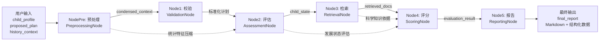

# ⚠️ 不可忽略的核心维护规则 (优先级高于一切)

【文件位置锁定】
- CLAUDE.md 和 AGENTS.md 必须始终位于项目根目录下，相对路径为：
  - `./CLAUDE.md`
  - `./AGENTS.md`
- 禁止将这两个文件移动到其他目录，禁止创建副本
- 任何情况下这两个文件的位置都不可改变

【结构性改动强制同步】
- 任何结构性改动（包括但不限于）必须同步更新 CLAUDE.md 和 AGENTS.md：
  - 新增/删除/移动文件或目录
  - 修改模块职责或依赖关系
  - 调整 Agent 工作流或节点
  - 变更技术栈或核心组件
  - 修改 API 端点或路由
  - 调整配置系统架构
  - 新增/删除服务层或核心基础设施
- 更新时必须在本规则下方标记改动内容，不可省略
- 更新后必须验证两个文档与实际代码结构的一致性

【以第一性原理！从原始需求和问题本质出发，不从惯例或模板出发。
1. 不要假设我清楚自己想要什么。动机或目标不清晰时，停下来讨论。 
2. 目标清晰但路径不是最短的，直接告诉我并建议更好的办法。 
3. 遇到问题追根因，不打补丁。每个决策都要能回答"为什么"。 
4. 输出说重点，砍掉一切不改变决策的信息。】

---

# ⚠️ 核心工作原则 (不可忽略)

【以第一性原理！从原始需求和问题本质出发，不从惯例或模板出发。 
1. 不要假设我清楚自己想要什么。动机或目标不清晰时，停下来讨论。 
2. 目标清晰但路径不是最短的，直接告诉我并建议更好的办法。 
3. 遇到问题追根因，不打补丁。每个决策都要能回答"为什么"。 
4. 输出说重点，砍掉一切不改变决策的信息。】

---

# CLAUDE.md - 项目指南

## 项目整体架构图

### 系统架构总览 (Mermaid)

```mermaid
graph TB
    subgraph 前端展示层 Frontend
        UI[React 19 + TypeScript]
        Assessment[评估功能<br/>AssessmentForm/ReportViewer]
        Documents[知识库管理<br/>DocumentUploader/DocumentList]
        Knowledge[知识搜索<br/>SearchInput/SearchResultList]
        RAGEval[RAG 评估与测试<br/>导入/草稿审核/批量执行]
        SysConfig[系统配置页 /system-config<br/>动态Schema表单]
        PromptUI[提示词管理页 /prompts<br/>版本管理/A/B配置/变量预览]
        LLMMonitorUI[LLM监控页 /monitor/llm<br/>调用统计/效果分析/告警]
    end
    
    subgraph API 网关层 API Gateway
        FastAPI[FastAPI 0.135.1]
        CORS[CORS 中间件]
        TaskCtrl[TaskController]
        RagCtrl[RagController]
        RagTestCtrl[RagTestController]
        ConfigCtrl[ConfigController]
        PromptCtrl[PromptController]
        MonitorCtrl[MonitoringController]
    end
    
    subgraph 业务服务层 Services
        DocIngestion[DocumentIngestionService<br/>文档导入服务]
        RagSvc[RagService<br/>RAG 门面服务]
        RetrievSvc[RetrievalService<br/>检索服务]
        IndexMgr[IndexManagerService<br/>索引管理服务]
        CacheSvc[CacheService<br/>缓存服务]
        TestMgr[RagTestManager<br/>并发批量测试/生成/评分]
    end
    
    subgraph 核心配置与状态层
        ConfigMgr[ConfigManager 配置管理器<br/>支持热更新与版本控制]
        PromptMgr[PromptManager 提示词管理器<br/>JSON持久化/A/B分发]
        EventBus[EventBus 事件总线<br/>配置变更/LLM调用事件广播]
    end

    subgraph 模型适配与路由层
        LLMFactory[LLMServiceFactory 工厂<br/>9大独立业务场景模型]
        LangChainAdapter[LangChain 适配器]
        LlamaIndexAdapter[LlamaIndex 适配器]
        PipelineOrch[PipelineOrchestrator<br/>YAML驱动查询流水线编排]
    end

    subgraph Agent 核心层 LangGraph
        Graph[LangGraph 工作流<br/>create_agent_graph]
        PreNode[PreprocessingNode<br/>预处理与上下文压缩]
        ValNode[ValidationNode<br/>数据校验与标准化]
        AssessNode[AssessmentNode<br/>儿童发展评估]
        RetrievNode[RetrievalNode<br/>混合检索专家]
        ScoreNode[ScoringNode<br/>AHP 多维评分]
        ReportNode[ReportingNode<br/>报告生成]
    end
    
    subgraph 监控与基础设施层 Infrastructure
        LLMMonitor[LLM调用监控器<br/>统计收集/效果分析/告警]
        DI[Injector 依赖注入]
        Cache[CacheService 三级缓存<br/>Memory + Redis + Disk]
        Memory[MemoryManager 记忆管理]
        Security[PromptInjectionGuard<br/>ContentAuditService]
        ABTest[ABTestFramework]
        Repo[Repository 数据访问层<br/>BaseRepository + 专属Repository]
        DB[SQLAlchemy 数据库<br/>异步连接池]
        Redis[Redis 客户端<br/>分布式锁/会话/熔断]
        Bloom[BloomFilter 布隆过滤器]
    end
    
    subgraph 数据层 Data
        MySQL[(MySQL 8.0<br/>唯一持久化数据源<br/>配置/测试/文档/监控/提示词)]
        RedisDB[(Redis 7.0<br/>三级缓存/消息队列/锁/会话)]
        Chroma[(Chroma 向量库<br/>本地持久化<br/>存储位置: /app_data/storage/vector_store)]
        Files[(文件存储<br/>PDF/EPUB<br/>存储位置: /app_data/storage)]
        Logs[(Loguru 日志系统)]
    end
    
    UI --> Assessment
    UI --> Documents
    UI --> Knowledge
    UI --> RAGEval
    UI --> SysConfig
    UI --> PromptUI
    UI --> LLMMonitorUI
    
    Assessment --> FastAPI
    Documents --> FastAPI
    Knowledge --> FastAPI
    RAGEval --> FastAPI
    SysConfig --> FastAPI
    PromptUI --> FastAPI
    LLMMonitorUI --> FastAPI
    
    FastAPI --> CORS
    CORS --> TaskCtrl
    CORS --> RagCtrl
    CORS --> RagTestCtrl
    CORS --> ConfigCtrl
    CORS --> PromptCtrl
    CORS --> MonitorCtrl
    
    TaskCtrl --> Graph
    RagCtrl --> DocIngestion
    RagCtrl --> RagSvc
    RagTestCtrl --> TestMgr
    ConfigCtrl --> ConfigMgr
    PromptCtrl --> PromptMgr
    MonitorCtrl --> LLMMonitor
    
    TestMgr --> PipelineOrch
    RagSvc --> PipelineOrch
    
    PipelineOrch --> PreNode
    PipelineOrch --> ValNode
    PipelineOrch --> AssessNode
    PipelineOrch --> RetrievNode
    PipelineOrch --> ScoreNode
    PipelineOrch --> ReportNode
    
    Graph --> DI
    Graph --> EventBus
    Graph --> Cache
    Graph --> Memory
    Graph --> Security
    Graph --> ABTest
    Graph --> Repo
    
    ConfigMgr --触发--> EventBus
    EventBus --更新模型实例--> LLMFactory
    EventBus --LLM调用日志--> LLMMonitor
    
    LLMFactory --> LangChainAdapter
    LLMFactory --> LlamaIndexAdapter
    
    DocIngestion --> Chroma
    DocIngestion --> MySQL
    RetrievNode --> Chroma
    RetrievNode --> Cache
    ConfigMgr --> Repo
    PromptMgr --> Repo
    LLMMonitor --> Repo
    RagSvc --> Files
    CacheSvc --> RedisDB
    Repo --> DB
    Repo --> RedisDB
```



### 评估工作流架构 (Mermaid)



### RAG 系统双流水线架构 (Mermaid)

```mermaid
graph TB
    subgraph 文档导入流水线 Ingestion Pipeline
        Upload[用户上传<br/>PDF/EPUB]
        Parse[阶段1: 文档解析<br/>PDFParser/PDFVLParser<br/>PDFParserV2/EPUBParser]
        Chunk[阶段2: 智能分块<br/>语义分块/章节分块<br/>父子块分块]
        Meta[阶段3: 元数据提取<br/>LLM 提取/规则提取<br/>分层模式优化]
        Embed[阶段4: 向量 Embedding<br/>DashScope<br/>text-embedding-v4]
        Index[索引插入<br/>Chroma 向量存储<br/>batch_size=100]
        Layered[阶段5: 分层内容生成<br/>L0 摘要/L1 概览/L2 详情]
        Persist[持久化存储<br/>自动备份<br/>间隔 300 秒]
        
        Upload --> Parse
        Parse --> Chunk
        Chunk --> Meta
        Meta --> Embed
        Embed --> Index
        Index --> Layered
        Layered --> Persist
    end
    
    subgraph 知识检索流水线 Retrieval Pipeline
        Query[用户查询]
        Route[步骤1: 查询路由<br/>QueryRouter<br/>简单/复杂分类]
        Cache[步骤2: 缓存检查<br/>CacheService<br/>容量 1000, TTL 3600s]
        Rewrite[步骤3: 查询重写<br/>可选]
        Synonym[步骤4: 同义词扩展<br/>LLM 生成 + 质量验证]
        AgeFilter[步骤5: 动态年龄过滤<br/>根据发展阶段调整]
        Hybrid[步骤6: 混合检索<br/>BM25 + Vector<br/>并行执行]
        Rerank[步骤7: Cross-Encoder 重排序<br/>BAAI/bge-reranker-v2-m3]
        Dedup[步骤8: 内容去重<br/>精确匹配 + 相似度]
        PageIndex[步骤9: PageIndex 增强<br/>无向量推理式层级树索引<br/>熔断/重试机制]
        Fusion[结果融合<br/>分数归一化<br/>动态权重]
        Result[返回 KnowledgeItem<br/>年龄适配度计算<br/>阈值过滤]
        
        Query --> Route
        Route --> Cache
        Cache --> Rewrite
        Rewrite --> Synonym
        Synonym --> AgeFilter
        AgeFilter --> Hybrid
        Hybrid --> Rerank
        Rerank --> Dedup
        Dedup --> PageIndex
        PageIndex --> Fusion
        Fusion --> Result
    end
```



### 配置系统架构 (Mermaid)

```mermaid
graph TB
    subgraph 配置管理层
        ConfigMgr[ConfigManager<br/>配置管理器]
        ConfigRepo[ConfigRepository<br/>配置持久化]
        ConfigEvents[ConfigEvents<br/>配置变更事件]
    end
    
    subgraph 基础设施层 core/
        CoreManager[manager.py<br/>配置管理器实现]
        CoreRepository[repository.py<br/>存储层实现]
        CoreEvents[events.py<br/>事件定义]
    end
    
    subgraph 配置模块层 modules/
        subgraph 基础配置
            App[app.py<br/>应用配置]
            Logging[logging.py<br/>日志配置]
            Paths[paths.py<br/>路径配置]
        end
        
        subgraph AI模型配置 models/
            LLM[llm.py<br/>LLM模型配置]
            Embedding[embedding.py<br/>Embedding配置]
            MLScoring[ml_scoring.py<br/>ML评分配置]
        end
        
        subgraph RAG配置 rag/
            RagCore[core.py<br/>RAG核心设置]
            RagRetrieval[retrieval.py<br/>检索配置]
            RagChunking[chunking.py<br/>分块配置]
            RagVector[vector_store.py<br/>向量存储配置]
            RagPageIndex[pageindex.py<br/>PageIndex索引配置]
            RagPipeline[pipeline.py<br/>导入流水线配置]
        end
    end
    
    subgraph 业务规则层 rules/
        Rules[rules.py<br/>规则定义]
        RulesJson[rules.json<br/>规则数据(静态)]
    end
    
    subgraph 配置特性
        HotReload[热重载<br/>事件驱动生效]
        VersionCtrl[版本控制<br/>MySQL持久化]
        RedisCache[Redis缓存<br/>加速读取]
        EnvOverride[环境变量覆盖<br/>.env.dev]
    end
    
    ConfigMgr --> CoreManager
    CoreManager --> CoreRepository
    CoreManager --> CoreEvents
    
    ConfigMgr --> App
    ConfigMgr --> Logging
    ConfigMgr --> Paths
    ConfigMgr --> LLM
    ConfigMgr --> Embedding
    ConfigMgr --> MLScoring
    ConfigMgr --> RagCore
    ConfigMgr --> RagRetrieval
    ConfigMgr --> RagChunking
    ConfigMgr --> RagVector
    ConfigMgr --> RagPageIndex
    ConfigMgr --> RagPipeline
    ConfigMgr --> Rules
    
    Rules --> RulesJson
    
    ConfigMgr --> HotReload
    ConfigMgr --> VersionCtrl
    ConfigMgr --> RedisCache
    ConfigMgr --> EnvOverride
    
    ConfigEvents -.事件通知.-> HotReload
```

## 项目概览
**儿童发展评估 Agent (Child Development Assessment Agent)** 是一个基于 AI 的系统，根据儿童的发展画像评估其运动计划。该系统使用 **LangGraph** 进行编排，采用 **ReAct** 架构，并集成了 **LangChain** 和 **LlamaIndex**。

- **项目状态**: 开发中，尚未上线
- **部署策略**: 采用 MySQL 8.0 + Redis 7.0 架构，取代了原有的本地 JSON 存储。MySQL 负责核心数据的唯一持久化，Redis 承担三级缓存、消息队列、分布式锁和会话存储。
- **目标**: 根据用户输入自动生成专业的评估报告。
- **架构**: 多 Agent 系统 (预处理 -> 校验 -> 评估 -> 检索 -> 评分 -> 报告)。
- **前端**: React + TypeScript (已初始化)。
- **后端**: FastAPI + LangGraph (已实现基础架构)。
- **包管理**: uv

## 技术栈
- **语言**: Python 3.13.12, TypeScript 5.9.3
- **编排**: LangGraph 1.1.0
- **LLM 框架**: LangChain 1.2.11
- **RAG**: LlamaIndex 0.14.16
- **API**: FastAPI 0.135.1
- **校验**: Pydantic 2.12.5, Zod 3.x
- **日志**: Loguru 0.7.3
- **前端**: React 19.2.4, Ant Design 6.3.2, ProComponents 2.8.10
- **样式**: SCSS Module (禁止直接写 CSS，必须分离样式文件)
- **状态管理**: Zustand (全局), TanStack Query (服务端)
- **路由**: React Router v7
- **可视化**: Ant Design Charts
- **工具库**: Lodash-es, Day.js, Clsx
- **数据库**:
  - 关系型: MySQL 8.0 (SQLAlchemy 2.0 ORM + Alembic 迁移)
  - 向量: Chroma (本地持久化，支持扩展到 Pinecone/Milvus/Weaviate)
  - 缓存/消息: Redis 7.0 (分布式缓存/Pub/Sub/分布式锁/会话)
- **ML**: XGBoost 3.2.0, SHAP 0.51.0, Scikit-learn 1.8.0
- **依赖注入**: Injector 0.24.0
- **重排序**: Sentence-Transformers 5.3.0 (BAAI/bge-reranker-v2-m3)
- **数据库驱动**: aiomysql, pymysql, redis, hiredis
- **缓存**: cachetools (LRU 内存缓存)
- **布隆过滤器**: pybloom-live
- **工具**: uv 0.10.9

## 常用命令

### 后端 (Python - 使用 uv)
- **进入目录**: `cd backend`
- **初始化环境**: `uv sync`
- **激活环境**: `source .venv/bin/activate`
- **安装依赖**: `uv sync` (或 `uv add <package>`)
- **运行服务**: `uv run python src/server.py`
- **API 文档**: `http://localhost:8000/docs`
- **运行测试**: `uv run pytest`
- **格式化代码**: `uv run black .`
- **Lint 检查**: `uv run flake8 .`

### 前端 (React)
- **进入目录**: `cd frontend`
- **安装依赖**: `npm install --legacy-peer-deps`
- **开发服务器**: `npm run dev`
- **构建**: `npm run build`
- **Lint 检查**: `npm run lint`

## 项目结构 (当前)
```
/
├── backend/             # 后端项目根目录
│   ├── .venv/           # 虚拟环境
│   ├── src/             # Python 源代码
│   │   ├── config/      # 配置系统 (模块化配置 + 热重载)
│   │   │   ├── settings.py          # 配置聚合入口
│   │   │   ├── config_manager.py    # 配置管理器 (支持版本控制)
│   │   │   ├── config_events.py     # 配置变更事件
│   │   │   ├── config_repository.py # 配置持久化
│   │   │   ├── modules/             # 配置模块
│   │   │   │   ├── app.py           # 应用配置
│   │   │   │   ├── logging.py       # 日志配置
│   │   │   │   ├── paths.py         # 路径配置
│   │   │   │   ├── database.py      # 数据库配置 (MySQL)
│   │   │   │   └── redis.py         # Redis 配置
│   │   │   ├── models/              # AI 模型配置
│   │   │   │   ├── llm.py           # LLM 模型配置
│   │   │   │   ├── embedding.py     # Embedding 配置
│   │   │   │   └── ml_scoring.py    # ML 评分配置
│   │   │   ├── rag/                 # RAG 配置
│   │   │   │   ├── core.py          # RAG 核心配置
│   │   │   │   ├── retrieval.py     # 检索配置
│   │   │   │   ├── chunking.py      # 分块配置
│   │   │   │   ├── vector_store.py  # 向量存储配置
│   │   │   │   ├── pageindex.py     # PageIndex 配置
│   │   │   │   └── pipeline.py      # 导入流水线配置
│   │   │   └── rules.py             # 业务规则
│   │   ├── controller/  # API 控制器
│   │   │   ├── task_controller.py   # 任务管理
│   │   │   ├── rag_controller.py    # RAG 管理
│   │   │   ├── rag_test_controller.py # RAG 测试 (含测试集导入/文档上传/草稿审核/测试集管理)
│   │   │   ├── config_controller.py # 配置管理
│   │   │   └── prompt_controller.py # 提示词管理
│   │   ├── core/        # Agent 核心逻辑
│   │   │   ├── llm/     # LLM 服务工厂
│   │   │   │   ├── base.py              # LLM 服务统一接口
│   │   │   │   ├── factory.py           # 按场景动态生成实例
│   │   │   │   └── adapters/            # 框架适配器
│   │   │   ├── pipeline/ # RAG 查询流水线编排
│   │   │   │   └── orchestrator.py      # 流水线编排器
│   │   │   ├── monitor/ # LLM 调用监控
│   │   │   │   └── llm_monitor.py       # 监控服务
│   │   │   ├── nodes/   # LangGraph 节点
│   │   │   ├── ml/      # ML 评分模块
│   │   │   ├── graph.py # 工作流编排
│   │   │   ├── prompts.py # 提示词管理
│   │   │   ├── di_container.py # 依赖注入
│   │   │   ├── event_bus.py # 事件总线 (支持 Redis Pub/Sub)
│   │   │   ├── memory_manager.py # 记忆管理
│   │   │   ├── ab_test_framework.py # AB 测试
│   │   │   ├── prompt_injection_guard.py # 提示词注入防护
│   │   │   ├── database.py # SQLAlchemy 数据库管理
│   │   │   ├── redis_client.py # Redis 客户端单例
│   │   │   ├── distributed_lock.py # 分布式锁 (带看门狗)
│   │   │   ├── session_manager.py # 会话管理 (Redis Hash)
│   │   │   ├── circuit_breaker.py # 熔断器
│   │   │   ├── bloom_filter.py # 布隆过滤器
│   │   │   └── [其他核心模块...]
│   │   ├── models/      # SQLAlchemy ORM 模型
│   │   │   ├── config.py # 配置模型
│   │   │   ├── test_case.py # 测试用例模型
│   │   │   ├── document.py # 文档模型
│   │   │   ├── monitor.py # 监控模型
│   │   │   └── prompt.py # 提示词模型
│   │   ├── model/       # 数据模型 (Pydantic)
│   │   ├── constants/   # 领域常量
│   │   │   └── test_case.py     # 测试用例领域枚举
│   │   ├── service/     # 业务服务
│   │   │   ├── rag_service.py           # RAG 门面服务
│   │   │   ├── retrieval_service.py     # 检索服务
│   │   │   ├── document_ingestion_service.py # 文档导入
│   │   │   ├── index_manager_service.py # 索引管理
│   │   │   ├── cache_service.py         # 缓存服务 (三级缓存)
│   │   │   ├── content_audit_service.py # 内容审核
│   │   │   ├── document_manager.py      # 文档管理
│   │   │   ├── rag_test_manager.py      # RAG 测试管理 (含测试集导入/文档上传/草稿审核/测试集管理)
│   │   │   └── monitoring_service.py    # 监控服务
│   │   ├── repository/  # 数据访问层
│   │   │   ├── base.py  # 通用 BaseRepository
│   │   │   ├── config_version_repository.py
│   │   │   ├── config_audit_log_repository.py
│   │   │   ├── source_document_repository.py
│   │   │   ├── document_record_repository.py
│   │   │   ├── test_case_repository.py
│   │   │   ├── test_case_draft_repository.py
│   │   │   ├── test_set_repository.py
│   │   │   ├── test_set_case_repository.py
│   │   │   ├── test_run_repository.py
│   │   │   ├── test_run_result_repository.py
│   │   │   ├── prompt_version_repository.py
│   │   │   ├── prompt_ab_test_repository.py
│   │   │   ├── llm_call_log_repository.py
│   │   │   └── ab_test_metric_repository.py
│   │   ├── data/        # 静态数据
│   │   │   ├── test_sets/ # RAG 评估测试集
│   │   │   ├── child_development_milestones.json # 发展里程碑
│   │   │   └── jieba_custom_dict.txt    # 结巴自定义词典
│   │   ├── utils/       # 工具类
│   │   └── server.py    # 后端入口
│   ├── alembic/         # 数据库迁移
│   │   ├── env.py       # 迁移环境配置
│   │   ├── README       # 迁移说明
│   │   └── script.py.mako # 迁移模板
│   ├── alembic.ini      # Alembic 配置文件
│   ├── scripts/         # 运维脚本
│   │   ├── debug/       # 调试脚本
│   │   ├── maintenance/ # 维护脚本
│   │   ├── performance/ # 性能测试
│   │   ├── rag/         # RAG 评估脚本
│   │   └── migrate_test_cases.py # 测试用例数据迁移
│   ├── tests/           # 后端测试
│   ├── logs/            # 后端日志
│   ├── reports/         # 评估报告输出
│   ├── pyproject.toml   # 后端依赖配置
│   ├── uv.lock          # 依赖锁定文件
│   └── .env.dev         # 开发环境配置 (含 MySQL/Redis 配置)
├── frontend/            # 前端项目根目录
│   ├── src/             # React 源代码
│   │   ├── api/         # API 请求层
│   │   │   ├── assessment/ # 评估 API
│   │   │   ├── config/     # 配置 API
│   │   │   ├── documents/  # 文档 API
│   │   │   ├── knowledge/  # 知识库 API
│   │   │   ├── rag-test/   # RAG 测试 API
│   │   │   └── prompt/     # 提示词 API
│   │   ├── components/  # UI 组件
│   │   ├── features/    # 功能模块
│   │   │   ├── assessment/ # 评估功能
│   │   │   ├── documents/  # 知识库管理
│   │   │   ├── knowledge/  # 知识搜索
│   │   │   ├── rag-evaluation/ # RAG 评估
│   │   │   │   ├── components/ # 评估组件
│   │   │   │   │   ├── TestCaseTable.tsx        # 测试用例表格
│   │   │   │   │   ├── TestCaseModal.tsx        # 测试用例弹窗
│   │   │   │   │   ├── EvaluationReport.tsx     # 评估报告
│   │   │   │   │   ├── BadCaseList.tsx          # Bad Case 列表
│   │   │   │   │   ├── ImportJsonModal.tsx      # JSON 导入弹窗
│   │   │   │   │   ├── UploadDocumentModal.tsx  # 文档上传弹窗
│   │   │   │   │   ├── TestCaseReviewTable.tsx  # 草稿审核表格
│   │   │   │   │   └── TestSetManager.tsx       # 测试集管理
│   │   │   │   ├── hooks/       # 评估逻辑 Hook
│   │   │   │   │   └── useRagEvaluation.ts      # 评估主 Hook
│   │   │   │   └── pages/       # 评估页面
│   │   │   │       └── RagEvaluationPage.tsx    # 评估主页面
│   │   │   ├── prompt-management/ # 提示词管理
│   │   │   │   ├── components/
│   │   │   │   ├── hooks/
│   │   │   │   └── pages/
│   │   │   │       └── PromptManagementPage.tsx
│   │   ├── pages/       # 页面
│   │   ├── store/       # 状态管理 (Zustand)
│   │   ├── hooks/       # 自定义 Hooks
│   │   ├── models/      # TypeScript 类型
│   │   ├── router/      # 路由配置
│   │   └── utils/       # 工具函数
│   ├── public/          # 静态资源
│   ├── package.json     # 前端依赖配置
│   └── vite.config.ts   # 构建配置
├── docs/                # 项目文档
│   ├── RAG_SYSTEM_COMPLETE_DOCUMENTATION.md # RAG 系统完整文档
│   ├── RAG_SEQUENCE_DIAGRAMS.md  # RAG 序列图
│   ├── analysis/        # 系统分析文档
│   ├── backend/         # 后端文档
│   ├── frontend/        # 前端文档
│   ├── plans/           # 实施计划
│   ├── requirements/    # 需求文档
│   ├── superpowers/     # 设计文档
│   │   ├── plans/       # 实施计划
│   │   ├── solutions/   # 解决方案
│   │   └── specs/       # 规格说明
│   └── testing/         # 测试文档
├── scripts/             # 根目录脚本
│   └── debug/           # 调试脚本
├── tests/               # 根目录测试
├── reports/             # 根目录报告
├── book/                # 知识库源文件 (PDF/EPUB)
├── .trae/               # Trae IDE 配置
│   ├── skills/          # 自定义技能
│   └── specs/           # 规格文件
├── README.md            # 项目说明
├── CODE_WIKI.md         # 代码百科
├── AGENTS.md            # Agent 定义文档
└── CLAUDE.md            # 本文件
```

## 规划结构 (目标)
```
/
├── src/                 # 后端源代码 (FastAPI + LangGraph)
│   ├── api/             # API 路由与控制器 (Routers)
│   ├── core/            # 核心组件 (Security, Middleware, Events)
│   ├── domain/          # 业务领域模型 (Entities, Value Objects)
│   ├── services/        # 业务逻辑服务 (Service Layer)
│   ├── agents/          # LangGraph Agent 逻辑
│   ├── graph/           # 工作流编排 (Workflows)
│   ├── schemas/         # Pydantic 数据传输对象 (DTOs)
│   ├── db/              # 数据库访问 (Repositories, Models)
│   ├── utils/           # 通用工具
│   └── server.py        # 应用入口
├── frontend/            # React 应用 (规划中)
│   ├── public/          # 静态资源
│   └── src/             # 源代码
│       ├── assets/      # 图片、样式等资源
│       ├── components/  # 公共组件 (Atomic Design)
│       ├── config/      # 全局配置 (路由、主题等)
│       ├── hooks/       # 自定义 Hooks
│       ├── layouts/     # 页面布局
│       ├── pages/       # 页面视图
│       ├── services/    # API 请求服务
│       ├── store/       # 状态管理 (Zustand/Redux)
│       ├── types/       # TypeScript 类型定义
│       ├── utils/       # 工具函数
│       ├── App.tsx      # 根组件
│       └── main.tsx     # 入口文件
├── books/               # RAG 数据源
└── tests/               # 测试代码
```

## 代码规范
- **风格**: Python 遵循 PEP 8。
- **日志**: 使用 `src.utils.logger` 而不是 `print`。
- **类型提示**: 所有函数签名必须包含类型提示。
- **文档字符串**: 复杂函数使用 Google 风格的文档字符串。
- **错误处理**: 使用自定义异常。
- **状态**: 保持 `AgentState` 整洁。
- **导入**: 优先使用绝对导入。
- **提示词管理**: 所有LLM相关的提示词必须统一存放在 `src/core/prompts.py` 文件中，禁止在业务代码中硬编码提示词。
- **注释规范**: 所有代码注释必须使用中文，禁止使用英文注释，确保代码可读性和团队协作一致性。

## 核心概念
- **StandardizedInput**: 校验后的标准数据格式。
- **AgentState**: 通过 LangGraph 传递的全局状态对象。
- **MCP Server**: 用于检索结构化知识的模型上下文协议服务器。
- **AHP**: 用于基准评分逻辑的层次分析法 (Analytic Hierarchy Process)。
- **配置系统**: 模块化配置架构，支持热重载、版本控制、配置差异对比。
- **依赖注入**: 使用 Injector 框架实现核心组件的依赖注入。
- **事件总线**: 基于 EventBus 的配置变更事件传播机制。
- **提示词注入防护**: PromptInjectionGuard 防止恶意提示词注入攻击。
- **内容审核**: ContentAuditService 确保生成内容的安全性。
- **AB 测试**: ABTestFramework 支持不同策略的对比测试。

## RAG 系统架构

RAG 系统是本项目知识库检索的核心，采用分层架构，包含文档导入和知识检索两条流水线。完整技术文档见 [RAG_SYSTEM_COMPLETE_DOCUMENTATION.md](./docs/RAG_SYSTEM_COMPLETE_DOCUMENTATION.md)。

### 核心模块

| 模块 | 文件路径 | 职责 |
|------|----------|------|
| RAG 门面服务 | `backend/src/service/rag_service.py` | 统一入口，聚合所有子服务 |
| 检索服务 | `backend/src/service/retrieval_service.py` | YAML 驱动的声明式核心检索逻辑，含缓存/重写/同义词扩展 |
| 文档导入服务 | `backend/src/service/document_ingestion_service.py` | 文档解析→分块→元数据→索引，支持断点续传 |
| 索引管理服务 | `backend/src/service/index_manager_service.py` | 向量索引生命周期管理，自动持久化 |
| 混合检索融合器 | `backend/src/core/hybrid_retrieval.py` | BM25 + 向量结果融合，动态权重 |
| Cross-Encoder 重排序器 | `backend/src/core/reranker.py` | BAAI/bge-reranker-v2-m3 重排序 |
| 查询路由器 | `backend/src/core/query_router.py` | 简单/复杂查询分类 |
| 动态年龄过滤器 | `backend/src/core/age_filter.py` | 根据儿童发展阶段动态调整过滤 |
| 分层内容生成器 | `backend/src/core/layered_content_generator.py` | L0摘要/L1概览/L2详情三层生成 |
| 上下文压缩器 | `backend/src/core/context_compressor.py` | 检索后上下文压缩，Token预算控制 |
| PageIndex 包装器 | `backend/src/core/pageindex_wrapper.py` | 无向量推理式层级树索引检索，含熔断/重试/降级 |
| 结果融合器 | `backend/src/core/result_fusion.py` | PageIndex 与混合检索结果融合 |
| 向量存储工厂 | `backend/src/core/vector_store_factory.py` | 向量存储抽象层，支持多种向量库 |
| Embedding 封装 | `backend/src/core/embedding.py` | DashScope Embedding 安全包装器 |
| 元数据处理器 | `backend/src/core/metadata_processor.py` | 分块策略与元数据提取 |
| 文档解析器 | `backend/src/core/parsers.py` | PDF/EPUB 解析，支持三级降级 |

### 技术栈

| 组件 | 技术选型 |
|------|----------|
| RAG 框架 | LlamaIndex |
| 向量存储 | Chroma (本地持久化) |
| Embedding | DashScope text-embedding-v4 |
| BM25 检索 | llama_index.retrievers.bm25 + jieba |
| 重排序 | Cross-Encoder (BAAI/bge-reranker-v2-m3) |
| PDF 解析 | PyMuPDF + Qwen-VL (扫描版) |
| EPUB 解析 | EbookLib + BeautifulSoup |
| 语义分块 | SemanticSplitterNodeParser |
| 本地摘要 | summa (TextRank) |

### 关键配置

所有 RAG 配置在 `backend/src/config/settings.py` 中定义，支持环境变量覆盖。主要配置分类：

- **混合检索**: BM25/Vector 权重、合并模式、Top-K、动态权重
- **缓存**: 启用状态、最大容量 (1000)、TTL (3600秒)
- **分块**: chunk_size (1024/1536)、overlap (200)、语义分块参数
- **重排序**: 模型名称、initial_k (30)、final_k (5)
- **年龄过滤**: 严格程度、容忍范围、适配度权重
- **PageIndex**: 启用状态、熔断/重试/降级配置
- **自动持久化**: 启用状态、间隔 (300秒)
- **Embedding**: 模型名称、最大文本长度 (1536)、批处理大小 (10)

### API 端点

路由前缀: `/rag`

| 端点 | 方法 | 功能 |
|------|------|------|
| `/rag/upload` | POST | 上传 PDF/EPUB 并后台索引 |
| `/rag/tasks/{task_id}/cancel` | POST | 取消上传任务 |
| `/rag/tasks` | GET | 列出所有上传任务 |
| `/rag/tasks/{task_id}` | GET | 查询任务状态 |
| `/rag/status` | GET | RAG 服务状态 |
| `/rag/documents/{filename}` | DELETE | 删除文档 |
| `/rag/documents` | GET | 列出已索引文档 |
| `/rag/search` | GET | 搜索知识库内容 |
| `/rag/documents/{file_hash}/chunks` | GET | 获取文档分块列表 |
| `/rag/chunks/{chunk_id}` | GET | 获取分块详情 |
| `/rag/layered-progress/{task_id}` | GET | 分层内容生成进度 |

路由前缀: `/rag/test`

| 端点 | 方法 | 功能 |
|------|------|------|
| `/rag/test/cases` | POST/GET | 创建/列出测试用例 |
| `/rag/test/cases/{case_id}` | GET/PUT/DELETE | 获取/更新/删除测试用例 |
| `/rag/test/cases/import/preview` | POST | 预览JSON导入的测试用例 |
| `/rag/test/cases/batch` | POST | 批量导入测试用例 |
| `/rag/test/run` | POST | 运行所有测试用例 (支持并发) |
| `/rag/test/run/{case_id}` | POST | 运行单个测试用例 |
| `/rag/test/runs` | GET | 列出所有测试运行 |
| `/rag/test/runs/{run_id}` | GET | 获取单个测试运行 |
| `/rag/test/runs/sse` | GET | SSE 进度推送 |
| `/rag/test/compare` | GET | 比较两个测试运行 |
| `/rag/test/snapshots` | POST/GET | 创建/列出快照 |
| `/rag/test/snapshots/{snapshot_id}` | GET | 获取单个快照 |
| `/rag/test/snapshots/{snapshot_id}/restore` | POST | 恢复快照 |
| `/rag/test/compare-configs/{v1}/{v2}` | GET | 对比配置版本 |
| `/rag/test/documents/upload` | POST | 上传源文档（默认自动生成草稿） |
| `/rag/test/documents` | GET | 列出所有源文档 |
| `/rag/test/documents/{doc_id}` | GET/DELETE | 获取/删除源文档 |
| `/rag/test/documents/{doc_id}/generate-drafts` | POST | 手动生成测试用例草稿 |
| `/rag/test/drafts` | GET | 列出草稿 |
| `/rag/test/drafts/{draft_id}` | GET/PUT | 获取/更新草稿 |
| `/rag/test/drafts/{draft_id}/review` | POST | 审核草稿 |
| `/rag/test/drafts/import` | POST | 导入已审核草稿 |
| `/rag/test/sets` | POST/GET | 创建/列出测试集 |
| `/rag/test/sets/{set_id}` | GET/PUT/DELETE | 获取/更新/删除测试集 |
| `/rag/test/sets/{set_id}/cases` | POST/DELETE | 添加/移除测试用例 |
| `/rag/test/sets/{set_id}/export` | GET | 导出测试集为JSON |

## 配置系统架构

配置系统采用模块化设计，支持热重载和版本控制。

### 配置模块（三层架构）

#### 基础设施层 core/
| 模块 | 文件 | 职责 |
|------|------|------|
| 配置管理器 | `core/manager.py` | 配置加载、热重载、版本管理 |
| 配置仓库 | `core/repository.py` | 配置持久化存储 |
| 配置事件 | `core/events.py` | 配置变更事件发布/订阅 |

#### 配置模块层 modules/
| 分类 | 模块 | 文件 | 职责 |
|------|------|------|------|
| **基础配置** | 应用配置 | `modules/app.py` | 应用基础配置 (host, port, debug) |
| | 日志配置 | `modules/logging.py` | 日志级别和格式配置 |
| | 路径配置 | `modules/paths.py` | 文件路径配置 |
| | 数据库配置 | `modules/database.py` | MySQL 数据库连接池配置 |
| | Redis 配置 | `modules/redis.py` | Redis 连接/缓存/锁配置 |
| **AI模型配置** | LLM模型 | `modules/models/llm.py` | LLM 模型配置 |
| | Embedding配置 | `modules/models/embedding.py` | DashScope Embedding 配置 |
| | ML评分配置 | `modules/models/ml_scoring.py` | ML 评分模型配置 |
| **RAG配置** | RAG核心 | `modules/rag/core.py` | RAG 系统核心配置 |
| | 检索配置 | `modules/rag/retrieval.py` | 检索、重排序、查询路由配置 |
| | 分块配置 | `modules/rag/chunking.py` | 语义分块器配置 |
| | 向量存储 | `modules/rag/vector_store.py` | 向量存储工厂配置 |
| | PageIndex配置 | `modules/rag/pageindex.py` | PageIndex索引配置 |
| | 导入流水线 | `modules/rag/pipeline.py` | 文档导入流水线配置 |

#### 业务规则层 rules/
| 模块 | 文件 | 职责 |
|------|------|------|
| 业务规则 | `rules/rules.py` | 业务规则定义 |
| 规则数据 | `rules/rules.json` | 规则配置数据 |

### 配置特性

- **热重载**: 配置文件变更自动生效，无需重启服务
- **版本控制**: 支持配置版本切换和回滚
- **差异对比**: 可视化展示配置变更差异
- **事件驱动**: 配置变更通过 EventBus 通知相关组件
- **环境变量**: 支持 `.env.dev` 环境变量覆盖

## MySQL + Redis 基础设施

### 数据库基础设施 (SQLAlchemy 2.0 + Alembic)

| 模块 | 文件路径 | 职责 |
|------|----------|------|
| 数据库管理 | `src/core/database.py` | SQLAlchemy 异步引擎/会话管理，慢查询检测，连接池配置 |
| 配置模型 | `src/models/config.py` | 系统配置版本、审计日志 ORM 模型 |
| 测试用例模型 | `src/models/test_case.py` | 测试用例/草稿/测试集/运行结果 ORM 模型 |
| 文档模型 | `src/models/document.py` | 源文档、导入记录 ORM 模型 |
| 监控模型 | `src/models/monitor.py` | A/B 测试指标、LLM 调用日志 ORM 模型 |
| 提示词模型 | `src/models/prompt.py` | 提示词模板 ORM 模型 |
| Alembic 迁移 | `alembic/env.py`, `alembic.ini` | 数据库版本控制和迁移管理 |

**核心特性**:
- **异步连接池**: 使用 `aiomysql` 驱动，支持异步操作
- **连接池配置**: `pool_size`, `max_overflow`, `pool_timeout`, `pool_recycle`
- **会话管理**: `SessionManager` 提供异步会话上下文管理器
- **迁移系统**: Alembic 管理数据库 schema 版本，支持升级/降级
- **慢查询监控**: 内置慢查询检测机制，自动记录超过阈值的 SQL 语句

**环境变量** (`.env.dev`):
```
MYSQL_HOST=localhost
MYSQL_PORT=3306
MYSQL_USER=root
MYSQL_PASSWORD=your_password
MYSQL_DATABASE=child_development
MYSQL_POOL_SIZE=10
MYSQL_MAX_OVERFLOW=20
MYSQL_POOL_TIMEOUT=30
MYSQL_POOL_RECYCLE=1800
```

### Redis 基础设施

| 模块 | 文件路径 | 职责 |
|------|----------|------|
| Redis 客户端 | `src/core/redis_client.py` | 异步 Redis 连接管理，连接池配置，懒加载机制 |
| 分布式锁 | `src/core/distributed_lock.py` | 基于 Redis 的分布式锁实现 (带看门狗自动续期) |
| 会话管理 | `src/core/session_manager.py` | 用户会话存储和管理 (Redis Hash 结构) |
| 熔断器 | `src/core/circuit_breaker.py` | CircuitBreaker 模式实现服务保护 |
| 布隆过滤器 | `src/core/bloom_filter.py` | pybloom-live 实现的高效去重过滤器 |
| 事件总线增强 | `src/core/event_bus.py` | Redis Pub/Sub 支持分布式事件传播 |
| 三级缓存 | `src/service/cache_service.py` | Memory (cachetools LRU) + Redis + Disk |

**核心特性**:
- **异步客户端**: 使用 `redis.asyncio` + `hiredis` 解析器
- **分布式锁**: 支持超时自动释放，防止死锁
- **会话管理**: 可配置 TTL，支持用户会话持久化
- **熔断器**: 失败阈值/恢复超时配置，保护下游服务
- **布隆过滤器**: 高效去重，适用于大规模数据场景
- **三级缓存**: Memory → Redis → Disk 层级缓存，平衡性能与成本
- **Pub/Sub**: 支持跨进程/跨实例的事件传播

**环境变量** (`.env.dev`):
```
REDIS_URL=redis://localhost:6379/0
REDIS_PASSWORD=your_password
REDIS_MAX_CONNECTIONS=20
REDIS_CACHE_DEFAULT_TTL=3600
REDIS_LOCK_TIMEOUT=30
REDIS_SESSION_TTL=86400
REDIS_PUBSUB_ENABLED=true
```

### 提示词管理系统

| 模块 | 文件路径 | 职责 |
|------|----------|------|
| PromptManager | `src/core/prompt/manager.py` | 提示词版本控制、MySQL 存储 + Redis 缓存、A/B 测试分流 |
| PromptController | `src/controller/prompt_controller.py` | 提示词 API 控制器，路由前缀 `/api/v1/prompts` |
| 数据模型 | `src/models/prompt.py` | `PromptVersion`、`PromptABTest` 模型定义 |
| 前端页面 | `frontend/src/features/prompt-management/pages/PromptManagementPage.tsx` | 版本管理、在线编辑、版本对比、A/B 测试配置 |

**API 端点**:
- `GET /api/v1/prompts/{prompt_key}` - 获取提示词（支持版本和 A/B 测试参数）
- `POST /api/v1/prompts/{prompt_key}/versions` - 创建新版本
- `GET /api/v1/prompts/{prompt_key}/versions` - 列出所有版本
- `GET /api/v1/prompts/{prompt_key}/versions/{version}` - 获取版本详情
- `GET /api/v1/prompts/{prompt_key}/compare` - 对比两个版本
- `POST /api/v1/prompts/ab-tests` - 创建 A/B 测试
- `GET /api/v1/prompts/ab-tests` - 列出 A/B 测试
- `POST /api/v1/prompts/ab-tests/{test_id}/toggle` - 启用/禁用 A/B 测试

**核心特性**:
- **版本控制**: 自动递增版本号，内容哈希去重
- **缓存机制**: Redis 缓存提示词内容，支持标签失效
- **A/B 测试**: 基于流量比例的版本分流，支持动态启用/禁用
- **前端管理**: 可视化版本列表、在线编辑器、版本对比、A/B 测试配置

### LLM 监控与分析 (LLM Monitoring)
- **总览仪表盘**: 全系统 LLM 调用统计、消耗趋势、错误率概览
- **多维度分析**: 支持按提示词、按场景统计消耗与质量
- **告警配置**: 异常率升高、耗时突增、Token消耗超阈值告警

### 模型适配与路由 (LLM Factory)
- **多框架支持**: LangChain 和 LlamaIndex 适配器，统一定义为 `ILLMService`
- **场景隔离**: 9 大独立业务场景（报告生成、评估、重写、解析、评分等），独立配置模型参数
- **工厂注入**: `LLMServiceFactory` 根据场景懒加载模型实例
- **热切换**: 监听配置变更事件，安全清理（dispose）旧模型实例，支持 0 停机动态重载

### RAG 查询流水线编排 (Pipeline Orchestrator)
- **声明式编排**: 基于 `query_pipeline.yaml` 驱动，消除硬编码的 RAG 查询逻辑
- **分支路由**: 根据 `QueryRouter` 分类结果动态选择 `simple` (事实性) 或 `complex` (分析性) 流水线
- **安全与可观测性**: 流水线首节点强制集成 `prompt_injection_guard` 拦截恶意输入，并提供全链路监控耗时与步骤结果

# Claude/Agent Rules

## Backend Development

- **Dependency Management**: All backend dependencies must be explicitly configured in `backend/pyproject.toml`. Do not rely on implicit dependencies or manual installation without updating the configuration file.
- **Configuration Management**: 
  - 所有可配置参数必须在 `backend/src/config/` 下的对应模块中定义，并支持通过 `.env.dev` 环境变量覆盖
  - 禁止在业务代码中硬编码任何配置值，必须从 `from src.config import settings` 统一读取
  - 新增配置项时必须同时添加到 `.env.dev.example` 作为示例
  - 配置系统采用三层架构：core（基础设施）、modules（功能模块）、rules（业务规则）
- **代码规范**:
  - 所有配置相关的修改必须同步更新配置文件，不得直接在代码中写死数值
- **RAG 系统修改规范**:
  - 修改 RAG 相关逻辑后，必须同步更新 `docs/RAG_SYSTEM_COMPLETE_DOCUMENTATION.md` 文档
  - 新增的 RAG 模块必须在本文档的"RAG 系统架构"章节中注册
  - 配置变更必须更新配置表格，包括环境变量名、默认值、说明