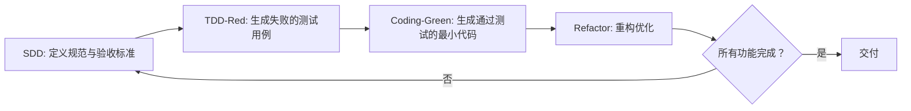

# AI开发范式：SDD + TDD 融合实践指南 核心总结
本文档为掘金《AI 开发范式：SDD + TDD 融合实践指南》的核心内容总结，可直接复用至项目 `agents.md`（AI代理工作流定义）与 `claude.md`（Claude协同开发规范）中，适配AI时代人机协同的高质量前端开发场景。

## 一、核心概述
本文档面向前端工程师、全栈开发者与技术负责人，针对AI编程普及后出现的**氛围编码风险、代码质量黑盒、后期维护债务**三大核心痛点，提出**SDD（规范驱动开发）+ TDD（测试驱动开发）** 深度融合的开发范式。
- 核心理念：**规范先行 (SDD) → 测试驱动 (TDD) → 精准编码 (Coding)**
- 核心价值：建立标准化人机协同作业流程，约束AI代码生成的边界与一致性，从源头保障代码质量、降低维护成本，实现「规范-测试-代码」的全链路对齐。

## 二、核心概念与融合工作流
### 2.1 核心概念定义
| 方法论 | 核心定义 | 核心价值 |
|--------|----------|----------|
| SDD 规范驱动开发 | 以结构化、机器可读的规范文档为**唯一真理来源**，编码前先精确定义系统的数据结构、接口契约、业务规则和验收标准 | 消除需求歧义，为AI提供精准上下文约束，避免幻觉与过度设计，形成与代码同步演进的「活文档」 |
| TDD 测试驱动开发 | 以测试用例驱动功能实现，严格遵循「红-绿-重构」循环：先编写失败的测试，再写最小代码让测试通过，最后重构优化 | 锁定系统行为，为规范提供可执行解释，提供即时验证反馈，为重构与迭代提供安全保障 |

### 2.2 融合标准执行顺序（核心纪律，严禁颠倒）

- 执行逻辑：SDD定目标（做什么）→ TDD立标尺（验证标准）→ Coding做交付（精准匹配）
- 人机分工边界：**人类主导**规范定义、合理性审查、测试结果校验、代码评审；**AI负责执行**测试生成、代码实现、辅助重构。

## 三、全流程实战落地标准
本流程可直接作为AI代理的标准化执行SOP，写入`agents.md`。
### 3.1 阶段一：SDD 规范定义（蓝图绘制，人类主导）
- 核心目标：产出机器可读的结构化规范文档（如`specs/xxx.md`），作为全流程唯一真理来源
- 规范文档必填模块：
  1. 数据结构定义（类型、必填项、约束规则）
  2. 组件/接口规范（入参、出参、事件回调）
  3. 业务规则（正常流程、异常场景、状态流转逻辑）
  4. 验收标准（AC）：可量化、可直接转化为测试断言，禁止「体验好、加载快」等模糊描述
- 格式要求：Markdown + YAML/JSON，兼顾人类可读性与AI解析能力

### 3.2 阶段二：TDD 测试先行（考卷生成，人机协同）
- 核心目标：基于SDD验收标准生成测试代码，确认测试**全部失败**（红阶段），建立验证基准线
- 执行步骤：
  1. 向AI输入完整规范文档，指令要求：仅生成测试文件，不生成业务实现，全覆盖对应验收标准
  2. 人工校验测试逻辑，确认其真实反映规范意图，无逻辑漏洞
  3. 运行测试，**成功标志**：测试全部失败，证明测试用例有效且独立于业务实现

### 3.3 阶段三：Coding 精准实现（答题过关，人机协同）
- 核心目标：编写最小代码集，让全部失败的测试通过（绿阶段），严格匹配SDD规范
- 执行步骤：
  1. 向AI输入规范文档+失败的测试文件，指令要求：仅实现满足测试所需的最小逻辑，无冗余代码
  2. 运行测试，**成功标志**：测试全部通过，功能与规范完全匹配
  3. 重构优化：AI辅助代码优化，重构后必须再次运行测试，确保全量通过

### 3.4 阶段四：集成与持续迭代
- 循环推进：针对新增/修改需求，重复「SDD补充/更新→TDD红→Code绿」的完整循环
- 自动化集成：将规范检查、测试运行集成到CI流水线，确保每次提交都符合规范、测试全量通过

## 四、AI增强版「红-绿-重构」核心差异
| 阶段 | 传统TDD | AI增强版SDD+TDD | 核心动作 |
|------|---------|------------------|----------|
| 规划 | 开发者脑海中构思测试 | SDD文档化规范定义 | 人类定义规则，AI辅助完善规范 |
| 红（Red） | 开发者手写失败测试 | AI基于规范自动生成测试用例 | 确认测试全量失败，建立验证基准 |
| 绿（Green） | 开发者手写最小实现代码 | AI基于规范+测试生成实现代码 | 确认测试全量通过，完成功能交付 |
| 重构（Refactor） | 开发者人工重构 | AI辅助重构优化 | 保持测试全量通过，提升代码质量 |

## 五、配套工具链推荐
| 分类 | 推荐工具 |
|------|----------|
| SDD规范管理 | Markdown+YAML/JSON、GitHub Spec Kit、Cursor/JetBrains AI |
| TDD测试框架 | Vitest、Testing Library、Playwright/Cypress（E2E测试） |
| AI编程助手 | GitHub Copilot、Cursor、Codeium/Tabnine（支持私有化部署） |

## 六、团队落地最佳实践与避坑指南
### 6.1 成功关键因素
1. 规范粒度控制：聚焦输入输出、状态流转、UI表现规则，不纠结非核心的实现细节
2. 验收标准可测性：每条AC都可直接转化为测试断言，使用量化描述
3. 严格的流程纪律：严禁跳过测试直接生成业务代码，坚守执行顺序
4. 清晰的人机分工：人类把控业务价值与核心规则，AI负责执行层落地

### 6.2 常见陷阱与应对方案
| 常见陷阱 | 现象 | 应对方案 |
|----------|------|----------|
| Spec更新滞后 | 代码变更后规范未同步，导致AI生成基于旧规范的错误代码 | Spec纳入Git版本管理，代码逻辑变更必须先更新Spec |
| 测试耦合实现细节 | 测试绑定内部函数名/结构，重构即触发测试报错 | 坚持测试用户可见行为，不测试内部实现 |
| 盲目信任AI生成测试 | 测试逻辑错误导致假阳性通过，无法验证真实功能 | 红阶段必须人工校验测试逻辑，确认其符合规范意图 |

### 6.3 团队落地行动路线图
1. 第1周（试点启动）：选择非核心新模块，编写SDD规范，完成一次完整的规范→测试→代码循环
2. 第2-3周（模板沉淀）：输出团队SDD规范模板、AI Prompt库，搭建基础CI流水线
3. 第1个月（全面推广）：新项目强制推行SDD+TDD流程，组织内部分享与经验交流
4. 第3个月（持续优化）：提升规范到测试的自动化程度，完善可视化回归测试体系

## 七、可直接复用的核心资产（适配Claude/AI Agents）
### 7.1 SDD规范自查清单
- [ ] 数据结构定义清晰（类型、必填项、约束规则）
- [ ] 组件Props/Events/接口契约明确
- [ ] 业务规则覆盖正常流程与异常场景
- [ ] 验收标准可量化、可直接转化为测试断言
- [ ] 文档格式为机器可读的Markdown+YAML/JSON

### 7.2 TDD执行口诀
> 规范先行定目标，
> 测试生成红光照。
> 代码实现绿通行，
> 重构优化质量高。
> 顺序切记莫颠倒，
> 人机协同效率高。

### 7.3 通用Prompt模板（适配Claude/AI编程助手）
【生成测试用例（红阶段）】
```text
角色：资深测试工程师
任务：根据以下SDD规范中的【验收标准】，生成{语言/框架}测试用例。
输入：
{粘贴SDD规范完整片段}
要求：
1. 只生成测试代码，不生成任何业务实现代码
2. 100%覆盖规范中所有的验收标准
3. 确保测试在无业务实现的场景下必然执行失败（Red阶段）
4. 遵循对应测试框架的最佳实践，不耦合内部实现细节
```

【生成业务实现（绿阶段）】
```text
角色：资深开发工程师
任务：编写业务代码，使所有测试用例通过，同时严格符合SDD规范要求。
输入：
1. SDD规范文档：{粘贴规范完整内容}
2. 失败的测试文件：{粘贴测试代码完整内容}
要求：
1. 只编写让所有测试通过所需的最小代码集，不添加任何规范外的冗余逻辑
2. 遵循{开发语言/框架}的行业最佳实践
3. 补充必要的类型定义与代码注释
4. 严格匹配规范中定义的所有规则与约束
```