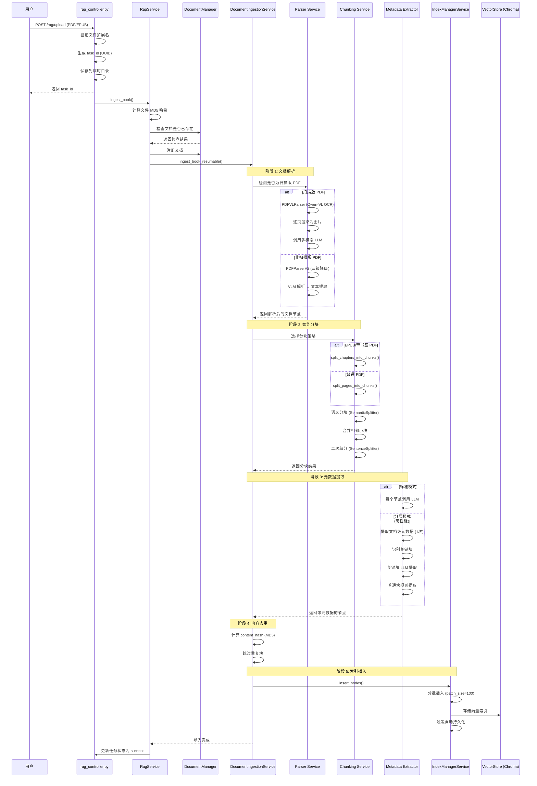
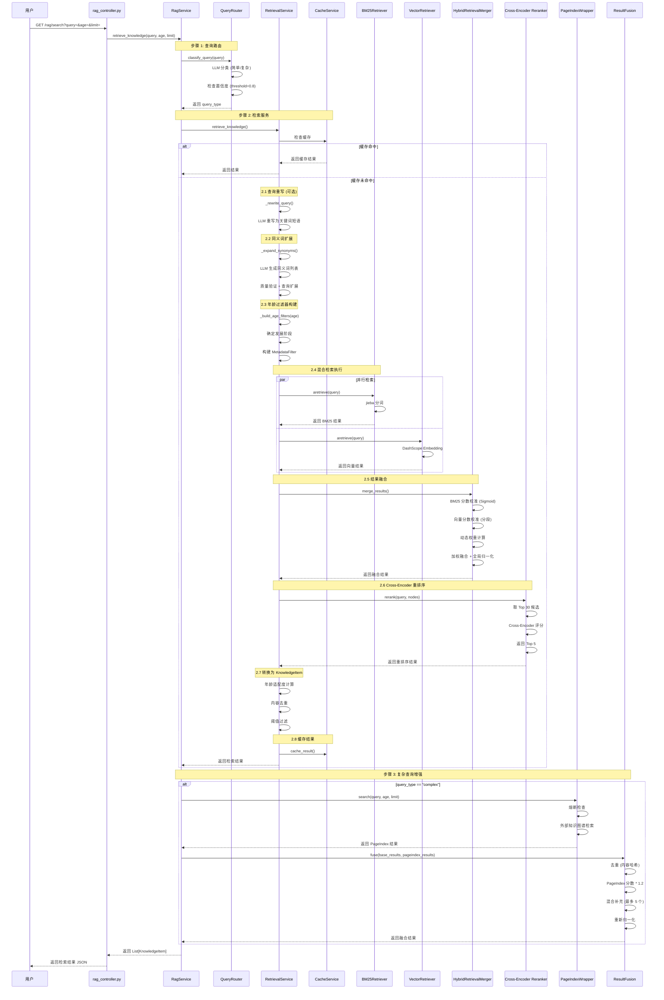
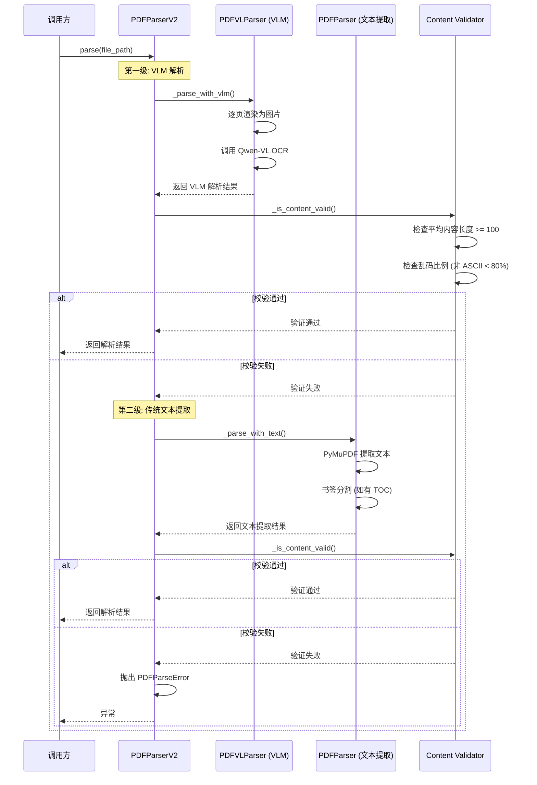

# RAG 系统时序图

> 本文档包含 RAG 系统的核心时序图,展示文档导入和知识检索的完整流程。

---

## 时序图 1: 文档导入流水线 (Ingestion Pipeline)

---

## 时序图 2: 知识检索流水线 (Retrieval Pipeline)

---

## 时序图 3: PDFParserV2 三级降级解析流程

---

## 使用说明

这些时序图使用 Mermaid 语法编写,可以通过以下方式查看:

1. **VS Code / Trae IDE**: 安装 Mermaid 插件后直接预览
2. **GitHub / GitLab**: 原生支持 Mermaid 渲染
3. **在线编辑器**: 访问 https://mermaid.live/ 粘贴代码查看
4. **Markdown 编辑器**: Typora、Obsidian 等支持 Mermaid 的编辑器
