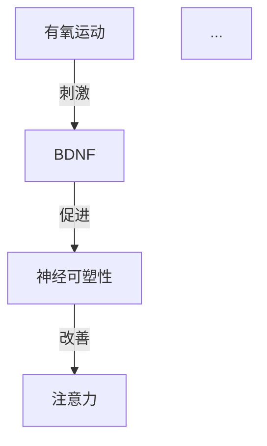

# 知识生产流水线 v2 — 深度提取方案

> **版本**: v1.0  
> **日期**: 2026-05-30  
> **状态**: 📝 设计中  
> **目的**: 解决 v1 流水线"信息大量丢失、输出不可读"的根本问题

---

## 1. 问题诊断

### 1.1 v1 方案的三个致命缺陷

| # | 缺陷 | 根因 | 后果 |
|---|------|------|------|
| 1 | **逐章独立提取，丢失跨章上下文** | 每个章节单独发给 LLM，LLM 不知道全书在讲什么 | 同一个概念在不同章节被重复提取但无法关联；全书主旨、论证线索完全丢失 |
| 2 | **只提取"实体+关系"，丢弃叙事精华** | Prompt 只要求提取 concepts/claims/prescriptions 三类 | 书中的故事、案例、数据、引言、作者的核心论证——所有"活的知识"全被丢弃 |
| 3 | **输出 YAML 格式，人看不懂** | LLM 输出原始 YAML，不是给人看的 | 审核者无法判断提取质量；MD 草稿本身没有阅读价值 |

### 1.2 信息丢失链路分析

```
一本 200 页的书
    │
    ├── chapter_parser: 拆成 20 个章节 ← OK
    │
    ├── md_generator (v1):
    │     每章独立 → 只提取 3 类 YAML → 丢失 70%+ 信息
    │     ├─ 故事/案例 → ❌ 丢弃
    │     ├─ 数据/事实 → ❌ 丢弃  
    │     ├─ 作者论证 → ❌ 丢弃
    │     ├─ 引言/金句 → ❌ 丢弃
    │     ├─ 跨章联系 → ❌ 丢弃
    │     └─ 全书主旨 → ❌ 丢弃
    │
    ├── aggregator: 合并同名实体 ← 只能合并"名字相同"的，语义丢失
    │
    └── md_renderer: 渲染成 MD ← 丢失的信息无法恢复
```

**结论**: 问题不在"截断多少"，而在**提取模式本身**。需要从架构层面重新设计。

---

## 2. v2 方案总览

### 2.1 核心设计原则

| 原则 | 说明 |
|------|------|
| **全书理解优先** | 先读懂全书主旨，再逐章深挖——而不是逐章盲提取 |
| **输出即文档** | LLM 输出的 MD 本身就是一篇高质量的书摘，人类可直接阅读 |
| **宁多勿少** | 每一条对读者有价值的信息都应保留，后续审核时删减比补回容易 |
| **结构服务于阅读** | 结构化字段（实体类型、关系等）是嵌在可读文本中的，不是单独的 YAML 块 |

### 2.2 三阶段流水线

```
┌─────────────────────────────────────────────────────────────────────┐
│                        知识生产流水线 v2                              │
│                                                                      │
│  Phase 0: 全书概览 (Book Overview)                                   │
│  ─────────────────────                                               │
│  输入: 所有章节标题 + 首段 + 末段                                      │
│  输出: 全书主旨、核心论点、章节结构图、关键术语表                         │
│  目的: 为后续提取提供"全局上下文窗口"                                   │
│                                                                      │
│                    ▼                                                 │
│                                                                      │
│  Phase 1: 章节深度提取 (Chapter Deep Extraction)                      │
│  ────────────────────────────────                                    │
│  输入: 全书概览 + 该章节完整原文                                       │
│  输出: 可读 Markdown（叙事 + 结构化标注）                              │
│  并发: 3 并发（同 v1）                                               │
│                                                                      │
│                    ▼                                                 │
│                                                                      │
│  Phase 2: 跨章综合 (Cross-Chapter Synthesis)                         │
│  ────────────────────────────                                        │
│  输入: 全书概览 + 所有章节提取结果                                     │
│  输出: 跨章主题、矛盾点、知识图谱关系、全书总结                         │
│  目的: 捕捉单章看不到的"涌现知识"                                      │
│                                                                      │
│                    ▼                                                 │
│                                                                      │
│  Phase 3: 组装最终 MD                                                │
│  ────────────────────                                                │
│  拼接: 封面 + 全书概览 + 各章提取 + 跨章综合                           │
│  输出: 一份完整的、可阅读的结构化知识文档                               │
└─────────────────────────────────────────────────────────────────────┘
```

### 2.3 与 v1 的对比

| 维度 | v1 | v2 |
|------|----|----|
| 上下文 | 逐章独立，无全局视野 | 先理解全书，再逐章提取 |
| 提取内容 | 仅实体+关系+处方 (3类) | 概念+关系+故事+数据+论证+引言+摘要 (7类) |
| 输出格式 | YAML（机器可读，人不可读） | 叙事 Markdown + 结构化标注（人可读） |
| 跨章关联 | 无 | Phase 2 专门做跨章综合 |
| 全书主旨 | 无 | Phase 0 + Phase 2 共同构建 |
| 审核体验 | 审核 YAML 字段 | 阅读书摘，确认/修改 |
| LLM 调用数 | N 章 | 1 (概览) + N 章 + 1 (综合) = N+2 |

---

## 3. Phase 0: 全书概览

### 3.1 设计思路

在逐章提取之前，先让 LLM "通读"全书，建立全局理解。不需要读完每一个字——用**章节标题 + 首段 + 末段**快速建立框架。

### 3.2 输入构造

```python
def build_overview_input(parse_result: ChapterParseResult) -> str:
    """构造全书概览输入：每章标题 + 首段 + 末段。"""
    lines = [f"书名: {parse_result.book_title}", f"总章节数: {len(parse_result.chapters)}", ""]
    for ch in parse_result.chapters:
        paragraphs = ch.markdown.split("\n\n")
        first_para = paragraphs[0][:500] if paragraphs else ""
        last_para = paragraphs[-1][:500] if len(paragraphs) > 1 else ""
        lines.append(f"## {ch.title}")
        lines.append(f"[开头]: {first_para}")
        if last_para and last_para != first_para:
            lines.append(f"[结尾]: {last_para}")
        lines.append("")
    return "\n".join(lines)
```

### 3.3 Prompt 设计

```python
BOOK_OVERVIEW_PROMPT = """你是一位资深的学术编辑，擅长从书籍中提炼核心知识。

请通读以下书籍的章节结构（标题 + 首尾段），输出一份**全书概览**。

书名: {book_title}
章节结构:
{overview_input}

请输出以下内容（用 Markdown 格式）:

## 全书主旨
用 2-3 句话概括这本书最核心的主张。不是"这本书讲了什么"，而是"作者想要说服你相信什么"。

## 核心论点
列出作者在全书中反复论证的 3-5 个关键论点。每个论点用一句话概括，附带简要说明。

## 关键术语表
列出全书中反复出现的专业术语（10-20 个），每个给出简要定义。这些术语是理解全书的基础。

## 章节脉络
简述各章之间的逻辑关系（"第X章为第Y章提供了理论基础"、"第X章和第Y章从不同角度论证同一观点"等）。

## 预期提取重点
根据全书主旨，指出后续逐章提取时应特别关注的 5-8 个主题或线索。
"""
```

### 3.4 输出示例

```markdown
## 全书主旨
运动不是锦上添花的课外活动，而是改善儿童大脑功能最有效、最经济的干预手段。
作者通过神经科学、心理学和教育学的交叉证据，论证了"运动重塑大脑"这一核心命题。

## 核心论点
1. **运动促进 BDNF 分泌，直接改善大脑可塑性** — BDNF 是大脑的"肥料"...
2. **有氧运动对注意力缺陷的改善效果可与药物媲美** — Naperville 学区案例...
3. **运动的最佳时机是学习之前，而非之后** — 运动后的 BDNF 高峰期恰好...

## 关键术语表
- **BDNF** (脑源性神经营养因子): 一种促进神经元生长的蛋白质...
- **神经可塑性**: 大脑根据经验改变自身结构的能力...
- **执行功能**: 前额叶皮层负责的高级认知功能...

## 章节脉络
第1-3章建立理论基础（运动→BDNF→大脑可塑性），第4-6章分别论证运动对注意力、情绪、学习的影响，第7-8章给出实践方案...

## 预期提取重点
- BDNF 的作用机制及其与不同运动类型的关系
- Naperville 学区案例的完整数据
- 运动处方的剂量-效应关系
- ...
```

---

## 4. Phase 1: 章节深度提取

### 4.1 设计思路

这是最核心的阶段。每个章节在**全书概览的上下文**中被深度提取，输出**人类可读的 Markdown**，而不是 YAML。

### 4.2 输出格式设计

**核心理念**: 输出的 MD 本身就是一篇高质量书摘，审核者可以直接阅读、理解和修改。

```markdown
## 第三章: 运动与注意力

> **本章主题**: 有氧运动通过提升前额叶皮层的激活水平，显著改善儿童的注意力和执行功能。

### 核心论点
本章论证了运动改善注意力的神经机制：运动→前额叶激活→执行功能提升。
作者认为运动应被视为 ADHD 干预的一线方案，而非辅助手段。

### 概念与实体

#### 注意力缺陷多动障碍 (ADHD)
**类型**: 问题 | **严重度**: 高

ADHD 是一种神经发育障碍，核心特征是注意力不集中、过度活跃和冲动。
全球约 5-10% 的学龄儿童受此影响。

- **症状**: 注意力不集中、多动、冲动控制困难
- **关联脑区**: 前额叶皮层（执行功能）、基底核（运动控制）
- **与运动的关系**: 运动可提升前额叶皮层的激活水平，改善注意力

#### 前额叶皮层 (PFC)
**类型**: 脑区

前额叶皮层是大脑的"指挥中心"，负责执行功能、注意力控制和决策。
它是人类大脑最晚成熟的区域，直到 25 岁左右才完全发育。

- **功能**: 执行功能、注意力控制、工作记忆、冲动抑制
- **与 ADHD 的关系**: ADHD 儿童的前额叶皮层激活水平普遍偏低

#### BDNF（脑源性神经营养因子）
**类型**: 机制

BDNF 是一种蛋白质，被称为"大脑的肥料"。
它促进神经元生长、增强突触连接，是运动改善大脑的核心介质。

- **作用机制**: 运动→肌肉产生 Irisin→通过血脑屏障→促进 BDNF 分泌
- **关键数据**: 30 分钟中等强度有氧运动后，BDNF 水平提升 20-30%
- **来源**: Ratey (2008), Ferris (2007)

### 案例与故事

#### Naperville 学区的零点体育课
Naperville 203 学区实施了一项大胆的实验：让学生在第一节课前进行高强度运动。

**实施方式**: 学生佩戴心率带，目标心率 165-185 bpm，持续 20-30 分钟。
**运动内容**: 跑步、骑车、跳绳等有氧运动。

**结果**:
- TIMSS 国际测试中，该学区科学成绩全球第六（美国平均第十八）
- 数学成绩全球第六
- 学生注意力和出勤率显著提升

**启示**: 将运动安排在学习前可以显著提升认知表现，这与 BDNF 的分泌时间曲线一致。

#### 芝加哥 West Side 学校的案例
一所贫困社区学校引入每日运动计划后...

### 数据与事实
- **20-30%**: 30 分钟中等强度运动后 BDNF 水平的提升幅度
- **5-10%**: 全球受 ADHD 影响的学龄儿童比例
- **TIMSS 第六名**: Naperville 学区在国际测试中的排名
- **165-185 bpm**: 运动改善认知的最佳心率区间

### 关键引言
> "运动是大脑的肥料。" — John Ratey
> "我们不是在讨论运动对健康的好处——我们在讨论运动对学习的好处。" — Naperville 学区体育主任

### 与其他章节的联系
- **第一章** 建立了"运动→BDNF→神经可塑性"的理论框架，本章在此基础上聚焦注意力
- **第五章** 将给出具体的运动处方，本章的机制解释了为什么那些处方有效
- **第七章** 将讨论如何在学校场景中实施运动计划，Naperville 案例是其原型
```

### 4.3 Prompt 设计

```python
CHAPTER_EXTRACTION_PROMPT = """你是一位资深的学术编辑，正在为《{book_title}》制作结构化书摘。

## 全书背景
{book_context}

## 当前章节
{chapter_title}

{chapter_content}

---

请为这个章节制作一份**完整的结构化书摘**。

### 输出要求

1. **完整性**: 不要遗漏任何有价值的信息。每一条数据、每一个案例、每一段论证都应保留。
2. **可读性**: 输出必须是人类可以直接阅读的 Markdown，不是 YAML 或 JSON。
3. **上下文**: 在"与其他章节的联系"部分，引用全书背景中提到的相关章节。

### 输出结构（按此顺序）

#### 本章主题
用 1-2 句话概括本章核心主张。

#### 核心论点
列出本章作者想要说服读者相信的 2-4 个关键论点，每个附带简要论证。

#### 概念与实体
提取本章中出现的所有重要概念。每个概念包括:
- 名称 + 类型标签（问题/脑区/机制/理论/策略/研究发现/核心洞见 等）
- 一段通俗易懂的解释（不是关键词列表，是完整的段落）
- 与其他概念的关系
- 相关数据或证据

#### 案例与故事
保留书中的具体案例、实验、故事。每个案例包括:
- 标题
- 完整描述（不是一句话概括，要保留细节）
- 这个案例说明了什么

#### 数据与事实
列出本章中的具体数字、比例、实验结果。每个数据附带上下文。

#### 关键引言
保留作者的精彩表述或引用的重要观点。

#### 与其他章节的联系
根据全书背景，指出本章与其他章节的关联。

---
**格式规范**:
- 使用 ## 和 ### 分级标题
- 使用 **加粗** 标记关键术语
- 使用 > 引用格式保留引言
- 使用 - 列表格式列举要点
- 概念名称后用 | 分隔类型标签
"""
```

### 4.4 并发策略

与 v1 相同，3 并发执行。但每个章节的 LLM 调用现在携带全书概览上下文（约 2000-3000 tokens 额外开销），总 token 消耗增加约 15%，但信息质量大幅提升。

---

## 5. Phase 2: 跨章综合

### 5.1 设计思路

单章提取看不到跨章的"涌现知识"——全书主旨的论证线索、章节间的矛盾、跨章的核心主题。需要一个专门的综合阶段。

### 5.2 输入构造

```python
def build_synthesis_input(book_context: str, chapter_results: list[str]) -> str:
    """构造跨章综合输入。"""
    # 每章提取结果的前 3000 字（避免超长）
    lines = [book_context, "\n---\n## 各章提取摘要\n"]
    for i, result in enumerate(chapter_results):
        # 取每章的"本章主题"和"核心论点"部分
        summary = _extract_summary_sections(result, max_chars=3000)
        lines.append(summary)
    return "\n".join(lines)
```

### 5.3 Prompt 设计

```python
SYNTHESIS_PROMPT = """你是一位资深学术编辑，正在综合《{book_title}》全书各章的提取结果。

## 全书概览
{book_context}

## 各章提取结果
{chapter_summaries}

---

请输出以下跨章综合内容:

## 全书知识图谱
用 Mermaid 语法绘制全书核心概念的关系图。节点是核心实体，边是关系。
重点关注跨章的概念关联。



## 跨章主题
列出 3-5 个贯穿全书的核心主题，每个主题说明:
- 在哪些章节出现
- 各章节从什么角度论述
- 综合来看，这个主题的完整图景是什么

## 矛盾与争议
如果不同章节对同一问题有不同观点或数据，明确列出。

## 全书总结
用 3-5 殇话总结全书的核心知识，适合直接用作 RAG 检索的摘要。

## 实体关系汇总
列出全书中最重要的 15-20 条实体关系，格式:
- A → 关系类型 → B （证据摘要）
"""
```

---

## 6. Phase 3: 组装最终 MD

### 6.1 最终文档结构

```markdown
---
book_id: "exercise_book_001"
book_title: "运动改变大脑"
status: "draft"
version: 1
generated_at: "2026-06-01T10:00:00Z"
reviewed_by: null
reviewed_at: null
---

# 《运动改变大脑》— 结构化知识提炼

> 本文档由 AI 自动生成，请审核后入库。

## 全书概览
[Phase 0 输出]

---

## 第一章: ...
[Phase 1 输出]

---

## 第二章: ...
[Phase 1 输出]

---

...

## 跨章综合
[Phase 2 输出]

---

## 附录: 实体清单
[从全文自动提取的实体列表，供审核参考]
```

### 6.2 实体清单格式

在文档末尾自动汇总所有提到的实体，方便审核者快速检查:

```markdown
## 附录: 实体清单

| 实体名称 | 类型 | 出现章节 | 关联实体 |
|----------|------|---------|---------|
| ADHD | 问题 | 3, 5, 7 | BDNF, 前额叶皮层, 有氧运动 |
| BDNF | 机制 | 1, 2, 3, 5 | 神经可塑性, 有氧运动, 海马体 |
| 前额叶皮层 | 脑区 | 2, 3, 4 | ADHD, 执行功能, 注意力 |
| Naperville 学区 | 案例 | 3, 7 | 有氧运动, TIMSS, 零点体育课 |
| ... | ... | ... | ... |
```

---

## 7. 从可读 MD 提取结构化数据（供 Neo4j 入库）

### 7.1 设计思路

v2 的核心变化是: **可读 MD 是主产物，结构化数据是从可读 MD 中提取的副产物**。

审核流程:
1. 人审核可读 MD（直接阅读，修改文本）
2. 审核通过后，`md_parser` 从可读 MD 中提取结构化数据
3. 结构化数据写入 Neo4j

### 7.2 解析策略

```python
def parse_readable_md(content: str) -> MDParseResult:
    """从可读 Markdown 中提取结构化数据。"""
    result = MDParseResult(...)

    # 1. 解析 YAML front matter
    front_matter = _extract_front_matter(content)

    # 2. 按章节分割
    chapters = re.split(r'^## 第.+章', content, flags=re.MULTILINE)

    # 3. 从每个章节中提取结构化数据
    for chapter in chapters:
        # 3a. 概念: 查找 "#### XXX\n**类型**: YYY" 模式
        _extract_concepts(chapter, result)

        # 3b. 关系: 从"与其他章节的联系"中提取
        _extract_relations(chapter, result)

        # 3c. 数据: 从"数据与事实"中提取
        _extract_data_points(chapter, result)

        # 3d. 案例: 从"案例与故事"中提取
        _extract_case_studies(chapter, result)

    # 4. 从跨章综合中提取全书级关系
    synthesis = _extract_synthesis_section(content)
    _extract_synthesis_relations(synthesis, result)

    return result
```

### 7.3 概念解析规则

```markdown
#### 注意力缺陷多动障碍 (ADHD)
**类型**: 问题 | **严重度**: 高
```

解析为:
```python
{
    "name": "注意力缺陷多动障碍 (ADHD)",
    "entity_type": "Problem",
    "severity": "high",
    "description": "ADHD 是一种神经发育障碍..."  # 后续段落
}
```

规则:
- `####` 标题 → 实体名称
- `**类型**: XXX` → entity_type
- `**严重度**: XXX` → severity
- 后续段落 → description
- `- **症状**: XXX` → symptoms
- `- **关联脑区**: XXX` → brain_regions

---

## 8. 对现有代码的影响

### 8.1 需要重写的文件

| 文件 | 变更类型 | 说明 |
|------|---------|------|
| `md_generator.py` | **重写** | 三阶段流水线，新 Prompt |
| `md_parser.py` | **重写** | 从可读 MD 解析结构化数据 |

### 8.2 需要更新的文件

| 文件 | 变更类型 | 说明 |
|------|---------|------|
| `aggregator.py` | 更新 | 适配新数据结构 |
| `md_renderer.py` | **大幅简化** | LLM 直出可读 MD，渲染器只负责拼接 |

### 8.3 不需要改动的文件

| 文件 | 说明 |
|------|------|
| `chapter_parser.py` | EPUB 解析逻辑不变 |
| `import_md.py` | 入库逻辑不变（输入仍是结构化数据） |
| `cross_relation.py` | 跨书关系检测不变 |
| 前端所有文件 | 审核 UI 不变（展示的仍是 MD 内容） |

---

## 9. LLM 调用成本估算

| 阶段 | 调用次数 | 输入 tokens | 输出 tokens | 说明 |
|------|---------|------------|------------|------|
| Phase 0 | 1 | ~5K | ~2K | 全书概览 |
| Phase 1 | N（章节数） | ~8K + 2K 上下文 | ~5K | 每章深度提取 |
| Phase 2 | 1 | ~15K | ~5K | 跨章综合 |
| **合计** | N+2 | — | — | 比 v1 多 2 次调用 |

以 20 章的书为例:
- v1: 20 次调用，每次 ~8K 输入 + ~2K 输出
- v2: 22 次调用，每次 ~10K 输入 + ~5K 输出
- **总 token 增加约 3 倍，但信息保留率从 ~30% 提升到 ~90%+**

---

## 10. 验证标准

| 验证项 | 标准 | 方法 |
|--------|------|------|
| 信息完整性 | 人工对比原书，核心信息无遗漏 | 抽样 3 本书，每本抽查 3 章 |
| 可读性 | 非专业人士能读懂 MD | 让非技术人员阅读并总结 |
| 结构化提取准确率 | 实体/关系提取准确率 ≥ 85% | 人工审核实体清单 |
| 跨章关联 | 跨章主题覆盖 ≥ 80% | 人工对比原书目录和论证线索 |
| 端到端耗时 | 单本书生成 < 10 分钟 | 计时测试 |

---

## 11. 实施计划

| 步骤 | 工作项 | 工时 | 依赖 |
|------|--------|------|------|
| 1 | 重写 `md_generator.py`（三阶段流水线） | 1d | — |
| 2 | 重写 `md_parser.py`（可读 MD 解析） | 0.5d | 步骤 1 |
| 3 | 简化 `md_renderer.py`（拼接器） | 0.5d | 步骤 1 |
| 4 | 更新 `aggregator.py` | 0.5d | 步骤 2 |
| 5 | 端到端测试（3 本书） | 1d | 步骤 1-4 |
| **合计** | | **3.5d** | |

---

## 12. 开放问题

| # | 问题 | 备选方案 | 推荐 |
|---|------|---------|------|
| 1 | Phase 0 的输入是否需要更多章节内容？ | 当前用首段+末段；备选用前 3 段 | 先用首段+末段，效果不好再加 |
| 2 | Phase 2 的输入太长怎么办？ | 每章只取"本章主题+核心论点"部分 | 推荐，约 500 字/章 |
| 3 | 实体清单是 LLM 生成还是规则提取？ | LLM 更准但慢；规则快但可能漏 | Phase 3 用规则提取，人工补充 |
| 4 | 审核流程是否需要调整？ | 当前是审核 YAML 字段；v2 是审核可读 MD | v2 更友好，不需要改审核 UI |
