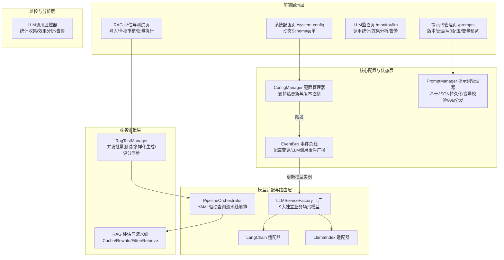
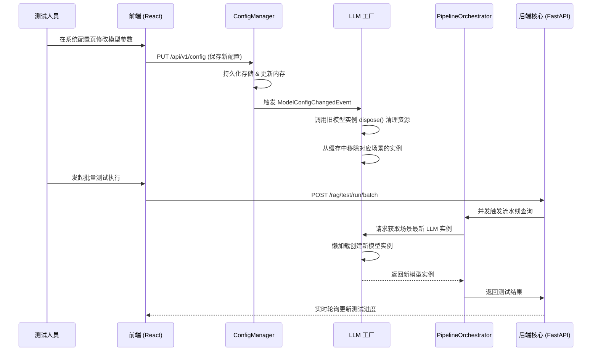

# 儿童发展评估系统 - 核心模块重构与整合设计方案

**版本**: 2.0 (整合版)
**日期**: 2026-04-11
**状态**: 待执行 (针对代码意外删除后的重新设计)
**描述**: 本方案整合了 2026-04-09 至 2026-04-11 期间关于配置系统拆分、提示词管理、RAG 测试集导入、批量测试执行、系统配置页重构、AI 模型全模型支持及 RAG 查询流水线编排等 9 份设计文档。去除了冗余描述，优化了各模块间的依赖逻辑，确保架构统一、高效。

---

## 1. 总体重构架构视图

**⚠️ 核心重构原则：项目未上线，无历史包袱。所有旧代码（如遗留配置、硬编码提示词、旧的流程控制）不需要做迁移或向前兼容，重构时可直接丢弃或被新架构替换。**

由于原始实现代码被删除，本次重构将从“第一性原理”出发，建立高内聚、低耦合的模块化系统。

### 1.1 系统架构图



### 1.2 核心数据流向图



---

## 2. 配置系统重构 (Configuration System)

### 2.1 三层配置目录架构
摒弃原有的 700 行庞大 `settings.py`，采用三层目录架构，确保前端配置树结构与后端目录完全一致：

```text
backend/src/config/
├── core/                  # 基础设施：manager.py(版本与热更新), repository.py, events.py
├── modules/               # 配置模块（支持热更新与环境覆盖）
│   ├── app.py             # 基础应用配置
│   ├── logging.py         # 日志配置
│   ├── paths.py           # 路径配置
│   ├── models/            # 模型配置组 (llm.py, embedding.py, ml_scoring.py)
│   └── rag/               # RAG知识库组 (core.py, retrieval.py, chunking.py, vector_store.py, pipeline.py, pageindex.py)
├── rules/                 # 业务规则加载 (rules.py, rules.json)
└── __init__.py            # 多重继承聚合入口，对外导出单例 `settings`
```

### 2.2 热更新与原子性更新
1. **监听机制**：`watchdog` 监听 `.env`、`.yaml` 和配置目录，触发 `reload_settings()`。
2. **原子性保证**：使用读写锁机制。重载失败时，保留原有配置实例，避免系统崩溃。
3. **事件驱动**：派发 `ConfigChangedEvent` 和 `ModelConfigChangedEvent` 供订阅方动态调整运行时资源。

### 2.3 统一的独立前端配置页
- 新增路由 `/system-config`，替代原评估页中的右侧边栏 `ConfigTuningPanel`。
- **Schema 驱动表单**：新增 `GET /api/v1/config/schema` 接口，返回所有配置模块的标准 JSON Schema 定义，前端无需硬编码配置项定义，使用 `ConfigFieldRenderer` 动态渲染 Switch、InputNumber、Slider 等 Ant Design 控件。
- 提供“恢复默认”、“应用到所有场景”、“配置版本对比”及批量导出/导入功能。
- **安全校验**：配置保存接口 `PUT /api/v1/config` 增加严格的字段校验，禁止修改系统级只读配置，防止恶意操作。

---

## 3. 全模型支持与独立场景配置 (Unified LLM Support)

### 3.1 9大独立业务场景
模型配置从全局统一更改为**按场景独立配置**。每个场景拥有独立的 `provider`, `model_name`, `temperature`, `max_tokens`, `retry_count`, `timeout`, `api_key`, `base_url`。

| 场景标识 | 用途说明 | 使用框架适配器 |
|---------|----------|--------------|
| `report_generation` | 生成最终用户可读的评估报告 | LlamaIndex |
| `assessment` | 儿童发展状态评估，对标里程碑 | LlamaIndex |
| `validation` | 数据格式校验和智能补全 | LlamaIndex |
| `query_rewrite` | RAG查询语句优化改写 | LangChain |
| `metadata_extraction` | 文档元数据自动提取 | LlamaIndex |
| `vl_parsing` | 扫描版PDF/图片内容识别 | LlamaIndex (IVLMService) |
| `query_classification` | 查询路由分类 | LlamaIndex |
| `ml_scoring` | 大模型评估打分 | LlamaIndex |
| `synonym_expand` | 查询同义词扩展 | LangChain |
| `memory_extraction` | 历史上下文偏好特征提取 | LlamaIndex |

### 3.2 抽象层与工厂注入模式 (DI Container)
1. **统一接口**：定义与框架无关的 `ILLMService`（包含 `agenerate`, `astream`, `dispose`）。
2. **统一消息结构**：在 `backend/src/core/llm/base.py` 中定义标准化的 `Message` 数据结构，屏蔽 LangChain 与 LlamaIndex 底层框架的消息类型差异（`BaseMessage` vs `ChatMessage`），适配器内部负责双向转换。
3. **双框架适配**：实现 `LangChainTongyiLLMService`、`LlamaIndexOpenAILLMService` 等。
4. **工厂注入**：为解决 Injector 单例与热更新的冲突，DI 容器注入的是**工厂函数**（`callable`）而非实例。
   - `LLMServiceFactory.get_for_scene("assessment", "llamaindex")` 每次调用返回最新配置的实例。
5. **资源释放（优雅降级）**：当接收到 `ModelConfigChangedEvent` 时，仅从工厂缓存中移除对应场景的旧实例引用，不再强行调用 `dispose()`。正在处理的请求将继续使用旧实例直至完成，依赖 Python 垃圾回收机制在无引用时自动释放底层 HTTP 连接池，避免高并发场景下的请求中断。
6. **敏感信息安全策略**：所有场景配置中的 `api_key` 字段在持久化存储时使用 AES 对称加密，接口返回时强制脱敏（仅显示前4位与后4位，中间用 `*` 填充，如 `sk-****1234`），防止密钥泄露。

---

## 4. 提示词管理系统 (Prompt Management System)

### 4.1 核心机制
- 废弃硬编码提示词，改用 JSON 文件持久化，路径：`backend/data/prompts/{domain}/{key}.json`，按业务域分类存储。
- **数据模型**：每个提示词包含key、name、description、version、tags、template、variables、ab_test配置、fallback字段。
- **支持功能**：
  - 完整版本控制与历史版本一键回滚
  - 动态变量校验（`{{variable}}` 占位符解析与类型校验）
  - 内置A/B测试流量分发，支持多版本按权重自动路由
  - 热更新机制，文件变更自动重载无需重启服务
- **加载机制**：业务代码通过 `PromptLoader.load("PROMPT_KEY", **kwargs)` 统一加载，内置降级策略（文件缺失时回退到内存默认值）。

### 4.2 前端管理页 (`/prompts`)
- 独立一级菜单。
- 列表页：按业务域、标签筛选提示词，展示基本信息与调用量统计入口
- 编辑器：
  - 支持语法高亮的模板编辑器
  - 变量自动识别与实时校验提示
  - 实时预览面板：输入测试变量，直接查看渲染后的完整提示词
- 详情页：
  - 版本历史对比，支持一键回滚到指定版本
  - A/B测试配置面板，设置不同版本的流量权重
  - 快速跳转到对应的LLM监控统计页面

---

## 5. LLM调用监控系统 (LLM Monitoring System)

### 5.1 核心机制
- 完全独立于提示词管理系统，通过EventBus订阅所有LLM调用事件
- **事件收集**：每次LLM调用自动记录提示词版本、输入输出、耗时、Token消耗、错误信息、请求ID等上下文
- **统计分析**：
  - 多维度统计：调用次数、成功率、平均耗时、Token消耗总量与人均消耗
  - 效果分析：A/B测试不同版本的成功率、返回结果质量对比
  - 错误分析：错误类型分布、异常率告警阈值配置
- **可观测性**：内置Prometheus指标输出，支持对接现有监控大盘

### 5.2 前端监控页 (`/monitor/llm`)
- 独立一级菜单。
- 总览仪表盘：全系统LLM调用统计、消耗趋势、错误率概览
- 提示词维度分析：单个提示词的调用统计、不同A/B版本的效果对比
- 场景维度分析：按业务场景（评估/报告生成/查询重写等）统计消耗与质量
- 告警配置：异常率升高、耗时突增、Token消耗超阈值等场景的告警规则配置

---

## 6. RAG 查询流水线编排 (Query Pipeline Orchestration)

### 6.1 YAML 声明式流水线
消除 `retrieval_service.py` 中 600 行的硬编码，改用 `query_pipeline.yaml` 驱动。

```yaml
pipelines:
  simple:  # 事实性/定义性问题，跳过大模型重写
    - name: prompt_injection_guard  # 强制提示词注入检测，拦截恶意输入
    - name: cache_check
    - name: hybrid_retrieval
      params: { bm25_top_k: 10, vector_top_k: 10 }
    - name: rerank
    - name: dedup
    - name: convert_to_knowledge
  complex: # 比较分析/多步骤问题，启用全量增强
    - name: prompt_injection_guard  # 强制提示词注入检测，拦截恶意输入
    - name: cache_check
    - name: query_rewrite
    - name: synonym_expand
    - name: age_filter
    - name: hybrid_retrieval
    - name: rerank
    ...
```

### 6.2 编排器实现 (`PipelineOrchestrator`)
- 基于 `QueryRouter` 对用户查询进行分类（Simple vs Complex）。
- 动态加载 YAML 对应的 `PipelineStep`。
- **失败降级策略**：若某一步骤（如 `query_rewrite` 超时）失败，根据 `RAG_PIPELINE_FAILURE_STRATEGY` 选择 fail_fast、continue_with_warning 或 fallback_to_default（跳过已成功的步骤）。
- **可观测性**：全链路 Prometheus 埋点（`STEP_DURATION`, `STEP_TOTAL`）与详细日志上下文。
- **Bug修复**：整合时修复原设计中的 `synonyms` 变量未定义、`pageindex_wrapper.py` 文件句柄泄漏问题。

---

## 7. RAG 测试框架全链路优化 (RAG Test Framework)

### 7.1 数据模型扩展与导入
- **数据模型**：引入 `SourceDocument`（来源书籍）、`TestCaseDraft`（草稿）、`TestSet`（测试集），重构 `TestCase`，增加领域（domain）、版本号、答题要点等。
- **书籍导入工作台**：
  - 上传书籍自动解析并生成 `QualityReport`（评估扫描件比例和完整性）。
  - **多样化生成**：支持自定义生成数量（10-1000）、目标领域和年龄。基于 12 种考核维度（事实检索、概念对比、干预设计等）和 80+ 角度模板生成高覆盖率、完全互不相同的草稿，确保每个草稿的考察角度、问题类型、难易程度、年龄适配性均不重复，避免问题单一和重复。支持多线程/异步并发批量生成上百份不同维度的测试用例草稿，覆盖所有可能的考察场景。生成时优先选用低成本高速度的轻量模型（如 qwen3-omni-flash 等），禁止使用高成本的大模型，大幅降低生成费用。
  - **去重与重试**：基于相似度的 `DraftDeduplicator`，以及带指数退避的 LLM 重试机制。
- **审核流**：草稿列表支持人工修改、批量通过或拒绝，确认后原子写入转换为正式 `TestCase` 并加入 `TestSet`。

### 7.2 并发批量执行与进度反馈
- **并发控制**：新增 `POST /rag/test/run/batch`，使用 `asyncio.Semaphore` 控制并发数（1-10）。
- **实时进度推送**：新增 `GET /rag/test/run/{run_id}/progress` SSE 接口，后端主动推送执行进度，替代原有的前端轮询机制，大幅降低服务器压力，提升实时性。`ExecutionProgress` 组件订阅 SSE 事件，实时展示进度条、成功/失败数量及失败原因。
- **执行安全**：支持通过 `run_id/cancel` 取消正在执行的任务。

### 7.3 评分同步机制
- **问题解决**：过去删除报告（TestRun）后，系统的聚合评分不会更新。
- **优化逻辑**：拦截 `DELETE /runs/{run_id}` API，删除文件后将 `recalculate_aggregate_scores()` 放入 FastAPI `BackgroundTasks` 中异步全量重新计算（由于单次计算开销小，暂采用全量计算，预留缓存增量计算空间），接口立即返回成功响应，异步计算完成后通过事件通知前端更新大盘指标，避免长耗时阻塞用户操作。

---

## 8. 新增模块改造清单

### 8.1 提示词管理系统增强
- **现状**：基础的PromptManager框架待实现，缺少A/B测试、变量校验等增强功能
- **需开发点**：
  1. 扩展JSON数据模型，增加version、tags、variables、ab_test、fallback字段
  2. 完善PromptLoader，实现变量校验、A/B权重分发、降级策略
  3. 实现热更新机制，监听文件变更自动重载模板
  4. 新增提示词版本管理与回滚功能

### 8.2 LLM调用监控系统开发
- **现状**：暂无监控能力，LLM调用无埋点统计
- **需开发点**：
  1. 在LLMService层添加调用埋点，通过EventBus发布LLMCallEvent事件
  2. 实现LLMMonitor订阅事件，持久化调用日志与统计数据
  3. 开发统计分析接口，支持多维度查询调用统计与效果分析
  4. 实现Prometheus指标输出与告警规则配置

---

## 9. 当前代码现状分析与改造清单

基于最新代码检查，目前系统正处于重构过渡期。以下为重构方案中“已设计但尚未实现”或“存在代码债务”的核心改造清单。

### 9.1 模型抽象与全模型支持改造
- **现状**：代码中广泛硬编码了 `DashScope` 与 `ChatTongyi`。例如 `backend/src/service/retrieval_service.py`、`backend/src/core/nodes/assessment.py` 等超过 15 处文件直接依赖阿里云 SDK。
- **需开发/改造点**：
  1. 创建 `backend/src/core/llm/base.py`，定义 `ILLMService` 和 `IVLMService` 接口。
  2. 创建 `backend/src/core/llm/adapters/` 目录，编写基于 `LangChain` 和 `LlamaIndex` 的多提供商适配器（OpenAI, Anthropic, Ollama, Tongyi 等）。
  3. 创建 `backend/src/core/llm/factory.py`，实现 `LLMServiceFactory` 并监听 `ModelConfigChangedEvent` 进行热重载资源清理。
  4. 修改 `di_container.py`，将模型实例化逻辑改为注入工厂函数。
  5. 直接替换所有业务层引用 `DashScope`/`ChatTongyi` 的代码为依赖注入（丢弃原有硬编码逻辑，不留任何兼容包装）。

### 9.2 提示词管理系统改造
- **现状**：提示词硬编码散落在 `backend/src/core/prompts.py` 中，以及部分业务节点文件中。没有实现动态的 JSON 管理、也没有版本控制与热更新支持。
- **需开发/改造点**：
  1. 开发 `backend/src/config/prompt_manager.py`（业务逻辑与热重载）和 `prompt_repository.py`（JSON 文件持久化）。
  2. 开发 `backend/src/core/prompt_loader.py` 提供统一的带变量渲染的 `load()` 接口，包含变量校验、A/B权重分发功能。
  3. 创建 `backend/data/prompts/{domain}/` 目录结构并编写初始化 JSON 文件，随后直接删除 `prompts.py` 中的提示词常量。
  4. 在前端开发 `/prompts` 独立路由，实现带语法高亮、变量校验、实时预览、A/B配置功能的提示词编辑器 UI。

### 9.3 RAG 查询流水线编排改造
- **现状**：查询流程在 `retrieval_service.py` 内部硬编码，无条件执行“查询重写”、“同义词扩展”等昂贵操作；`PipelineOrchestrator` 以及对应的 YAML 配置完全缺失。
- **需开发/改造点**：
  1. 在 `backend/src/config/` 创建 `query_pipeline.yaml`，声明 `simple` 与 `complex` 流水线。
  2. 开发 `backend/src/core/query_pipeline_orchestrator.py` 编排器类，支持基于 `QueryRouter` 分流。
  3. 建立 `backend/src/core/pipeline_steps/`，实现 `CacheCheckStep`、`QueryRewriteStep`、`HybridRetrievalStep` 等 Step 类。
  4. 直接用新的编排器逻辑覆写 `retrieval_service.py` 的检索方法，抛弃原有的 if-else 硬编码。

### 9.4 配置体系彻底清理
- **现状**：虽已建立 `core/modules/rules` 三层目录雏形，但 `backend/src/config/` 根目录依然残留大量如 `app.py`, `logging.py` 等平铺的遗留配置。
- **需开发/改造点**：
  1. 直接删除根目录下所有冗余的老配置文件（无需向前兼容）。
  2. 将所有配置字段统一在 `modules/` 的子系统中维护。
  3. 全局搜索并修改为唯一入口：`from src.config import settings`。

### 9.5 评估测试架构补全
- **现状**：并发执行和草稿结构在 `rag_test_manager.py` 已有初步实现，但缺乏前端 UI 对接与评分同步全量功能。
- **需开发/改造点**:
    1.  完善书籍导入与多样化测试用例生成的 `TestCaseDraftGenerator` 引擎，支持批量生成最多1000份完全不同维度的测试用例草稿，内置多维度去重机制（语义相似度去重、问题类型去重、考察维度去重），确保草稿之间没有重复的考察角度和问题内容，支持自定义生成规则和维度组合；支持多线程/异步并发批量生成，可配置并发数控制生成速度；内置模型选型策略，默认强制使用低成本轻量模型（如 qwen3-omni-flash），禁止调用高成本大模型生成草稿，大幅降低生成成本。
  2. 后端拦截 `DELETE /runs/{run_id}` API，触发大盘分数的同步重算。
  3. 完善前端 `ExecutionProgress` 和 `BatchExecutionModal` 组件。

### 10.1 重构前后的核心性能预期

| 模块 / 场景 | 重构前状况 | 重构后预期 | 性能提升与核心优势 |
|-------------|------------|------------|------------------|
| **简单 RAG 查询** | 无条件执行 LLM 重写与同义词扩展，平均耗时 ~4s，消耗 2000 tokens | 仅走检索与重排序流水线，平均耗时 ~1.5s，消耗 0 token | **延迟降低 60%，Token 消耗降为 0** |
| **缓存命中查询** | 约 3s (包含前置的冗余模型调用与检查) | 约 50-100ms (编排器内跳过后续节点直接返回) | **响应时间进入毫秒级，降幅 95%** |
| **测试集用例生成** | 模型硬编码为 `qwen-plus`，单线程执行生成，易发生重复 | 支持模型配置切换至 `qwen3-omni-flash`，结合多样化生成引擎与 10-500 动态批处理控制 | **单价成本下降近 12 倍，吞吐量提升显著** |
| **配置热重载** | 大多需重启服务器或依赖页面手动触发局部同步，存在失效风险 | 原子写锁与事件总线结合的自动推拉更新，模型工厂按需懒加载并处理 dispose() 清理 | **实现 0 停机动态重载，彻底消除连接池泄露** |
| **前端页面渲染** | RAG 评估页杂糅配置控制，配置表单超过 20 项卡顿明显 | Schema 驱动，虚拟滚动列表，分离配置主页 (`/system-config`) 与测试页 | **配置面板拆解并使用懒加载、防抖技术，提升页面响应速度** |

### 7.2 详细实施步骤与阶段交付标准

#### Phase 1: 配置基础设施重建（周期：3 天）
- **任务**：重建 `core`, `modules`, `rules` 目录体系，恢复热重载与 `watchdog` 文件监听机制。
- **交付标准**：后端支持通过环境变量或 YAML 文件加载全局配置，触发 `ConfigChangedEvent` 并支持前端查询 `/api/v1/config` 返回 Schema。

#### Phase 2: 模型层统一与工厂注入（周期：3 天）
- **任务**：定义 `ILLMService`，实现 LangChain 与 LlamaIndex 双框架适配器；构建 `LLMServiceFactory` 并在 DI 容器中完成场景工厂的注入。
- **交付标准**：系统具备热切换 9 大业务场景模型的能力，切换过程中确保旧连接正确关闭 (`dispose`)，无资源泄露。

#### Phase 3: RAG 声明式流水线与提示词管理（周期：4 天）
- **任务**：实现 `query_pipeline.yaml` 解析器，重构 `PipelineOrchestrator`；从硬编码中剥离提示词到 `backend/data/prompts`，实现 `PromptManager`。
- **交付标准**：简单查询绕过大模型重写直达检索层（验证延迟达标）；所有模型调用的系统提示词均从 JSON 持久层动态获取并支持渲染。

#### Phase 4: 测试并发架构与书籍多样化生成（周期：4 天）
- **任务**：扩展 `RagTestManager`，支持 `asyncio.Semaphore` 限制的批量测试与基于质量报告的书籍导入；引入 12 种不同生成维度的测试集生成引擎，支持多线程/异步并发批量生成草稿，内置低成本模型选型策略，禁止使用高成本大模型；完善报告删除后的全量评分同步逻辑。
- **交付标准**：前端 `ExecutionProgress` 正常轮询并发执行进度；上传书籍可通过多线程/异步并发方式成功生成最多1000份高质量、完全不同维度、防重合的测试用例草稿；支持自定义生成数量、领域、年龄范围和并发数；生成草稿默认使用低成本轻量模型（如 qwen3-omni-flash），成本降低10倍以上；生成的草稿无重复考察角度和内容；删除测试报告可触发系统指标大盘实时刷新。

#### Phase 5: 前端重构与最终集成（周期：3 天）
- **任务**：搭建独立的 `/system-config` 与 `/prompts` 管理界面，并在 RAG 测试页接入新的导入、审核与批量执行模态框组件。
- **交付标准**：全链路端到端功能验证通过。测试环境所有 API 兼容且无严重性能问题；新界面的交互体验优于历史版本。