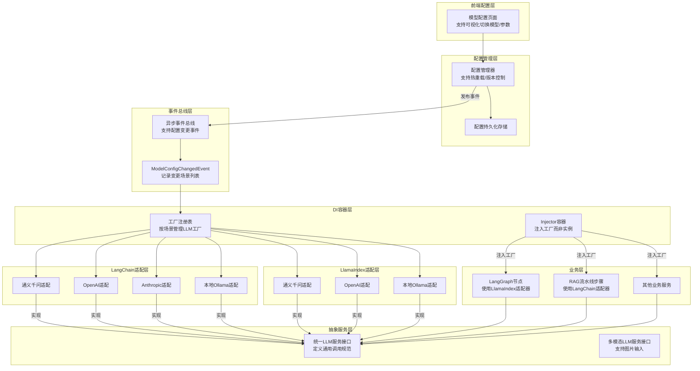

# 全模型支持方案设计文档（LangChain + LlamaIndex）

## 版本信息
- 版本：v2.0
- 日期：2026-04-11
- 状态：待评审
- 变更：修复 P0-P2 问题，新增 LlamaIndex 热更新支持，移除旧代码过渡

## 方案概述
本方案通过抽象层封装 + 工厂模式 + DI 容器注入，实现项目大模型层同时兼容 **LangChain** 和 **LlamaIndex** 两大框架支持的所有模型提供商。支持页面可视化配置和热部署能力，无需重启服务即可动态切换模型。

**核心设计决策：**
1. **统一抽象接口**：定义与框架无关的 LLM 服务接口，LangChain 和 LlamaIndex 适配器分别实现
2. **工厂注入模式**：DI 容器注入工厂而非实例，解决 Injector singleton 与热更新的冲突
3. **双框架支持**：LangChain 适配器用于 RAG 流水线步骤，LlamaIndex 适配器用于 LangGraph 节点
4. **全量迁移**：直接替换所有硬编码调用，无旧代码兼容层

## 核心架构设计



## 核心功能设计

### 1. 可视化页面配置支持

#### 前端配置项

| 配置分组 | 配置项 | 说明 | 可选值 |
|---------|-------|------|--------|
| **基础配置** | 全局默认模型提供商 | 所有场景默认使用的模型 | tongyi/openai/anthropic/ollama |
| **API密钥配置** | 通义千问API密钥 | 阿里云DashScope密钥 | 敏感信息加密存储 |
| | OpenAI API密钥 | OpenAI官方/第三方接口密钥 | 敏感信息加密存储 |
| | Anthropic API密钥 | Anthropic官方接口密钥 | 敏感信息加密存储 |
| | Ollama服务地址 | 本地Ollama服务地址 | 默认http://localhost:11434 |
| **场景配置** | 报告生成场景 | 评估报告生成使用的模型 | 提供商+具体模型名称 |
| | 儿童发展评估场景 | 儿童发展评估使用的模型 | 提供商+具体模型名称 |
| | 数据校验场景 | 结果校验使用的模型 | 提供商+具体模型名称 |
| | 查询重写场景 | 检索查询重写使用的模型 | 提供商+具体模型名称 |
| | 元数据提取场景 | 文档元数据提取使用的模型 | 提供商+具体模型名称 |
| | 多模态解析场景 | PDF扫描版解析使用的模型 | 提供商+具体模型名称 |
| | 查询分类场景 | 查询路由分类使用的模型 | 提供商+具体模型名称 |
| | ML评分场景 | 大模型评分使用的模型 | 提供商+具体模型名称 |
| | 同义词扩展场景 | 查询同义词扩展使用的模型 | 提供商+具体模型名称 |
| | 记忆提取场景 | 记忆管理使用的模型 | 提供商+具体模型名称 |
| **高级配置** | 全局温度系数 | 默认生成温度 | 0-2范围 |
| | 最大生成长度 | 默认最大Token数 | 正整数 |
| | 重试次数 | 模型调用失败重试次数 | 0-5范围 |
| | 请求超时秒数 | 单次请求超时时间 | 正整数，默认60 |

#### 配置页交互逻辑
- 敏感信息（API密钥）默认显示为掩码，支持修改
- 场景配置支持独立选择提供商和对应模型，也可选择"使用全局默认"
- 配置修改后可立即生效，无需重启服务
- 支持配置版本回滚，出现问题可一键恢复到上一个版本
- 提供配置变更日志，记录所有修改历史

### 2. 热部署/热更新机制

#### 热更新流程
1. 用户在配置页面修改模型配置并保存
2. 配置管理器更新持久化存储并发布 `ModelConfigChangedEvent` 事件
3. 事件总线异步广播事件到所有订阅者
4. `LLMFactoryRegistry` 接收到事件后，对变更场景执行：
   - 调用旧实例的 `dispose()` 方法清理资源（关闭连接池、释放异步资源）
   - 从工厂缓存中移除旧实例
   - 下次调用时自动创建新模型实例
5. DI 容器注入的是工厂，业务代码通过工厂获取实例，天然支持热更新
6. 所有正在处理的请求不受影响，仍使用旧实例完成，新请求获取新实例

#### 热更新特性
- ✅ 零停机：配置更新过程中服务完全可用
- ✅ 无感知：业务代码通过工厂获取实例，自动适配新模型
- ✅ 隔离性：不同场景的模型更新互不影响
- ✅ 回滚能力：配置回滚时自动恢复到历史模型实例
- ✅ 校验机制：配置保存前自动校验模型连通性，避免配置错误导致服务不可用
- ✅ 资源安全：旧实例通过 `dispose()` 正确清理，无资源泄漏
- ✅ 双框架支持：LangChain 和 LlamaIndex 适配器均支持热更新

## 详细技术设计

### 1. 统一 LLM 服务接口

```python
from abc import ABC, abstractmethod
from typing import Optional, Any, AsyncGenerator

class ILLMService(ABC):
    """大模型服务统一抽象接口（与框架无关）"""
    
    @abstractmethod
    def generate(
        self,
        prompt: str,
        system_prompt: Optional[str] = None,
        temperature: Optional[float] = None,
        max_tokens: Optional[int] = None,
        **kwargs
    ) -> str:
        """同步生成文本"""
        pass
    
    @abstractmethod
    async def agenerate(
        self,
        prompt: str,
        system_prompt: Optional[str] = None,
        temperature: Optional[float] = None,
        max_tokens: Optional[int] = None,
        **kwargs
    ) -> str:
        """异步生成文本"""
        pass
    
    @abstractmethod
    def stream(
        self,
        prompt: str,
        system_prompt: Optional[str] = None,
        temperature: Optional[float] = None,
        max_tokens: Optional[int] = None,
        **kwargs
    ) -> Any:
        """同步流式生成"""
        pass
    
    @abstractmethod
    async def astream(
        self,
        prompt: str,
        system_prompt: Optional[str] = None,
        temperature: Optional[float] = None,
        max_tokens: Optional[int] = None,
        **kwargs
    ) -> AsyncGenerator[str, None]:
        """异步流式生成"""
        pass
    
    def dispose(self) -> None:
        """清理资源（关闭连接池、释放异步资源等）"""
        pass
```

**设计说明：**
- `with_structured_output` 已移除（当前无使用场景，避免过度设计）
- 新增 `dispose()` 方法用于热更新时清理资源
- `**kwargs` 支持扩展参数（如 `images` 用于多模态场景）

### 2. 多模态 LLM 服务接口（可选）

```python
from abc import ABC, abstractmethod
from typing import Optional, Any, AsyncGenerator, List
from pathlib import Path

class IVLMService(ABC):
    """多模态大模型服务接口（支持图片输入）"""
    
    @abstractmethod
    async def agenerate_with_images(
        self,
        prompt: str,
        images: List[Any],  # 可以是 PIL.Image、base64 字符串或文件路径
        system_prompt: Optional[str] = None,
        temperature: Optional[float] = None,
        max_tokens: Optional[int] = None,
        **kwargs
    ) -> str:
        """异步生成文本（支持图片输入）"""
        pass
    
    def dispose(self) -> None:
        """清理资源"""
        pass
```

**设计说明：**
- 多模态场景独立接口，避免污染 `ILLMService`
- `images` 参数支持多种格式（PIL.Image、base64、文件路径），由适配器内部统一处理

### 3. LangChain 模型适配层实现示例

```python
from langchain_community.chat_models import ChatTongyi, ChatOpenAI, ChatAnthropic
from langchain_community.chat_models.ollama import ChatOllama
from langchain_core.messages import HumanMessage, SystemMessage
from src.core.llm.base import ILLMService

class LangChainTongyiLLMService(ILLMService):
    """LangChain 通义千问适配器"""
    
    def __init__(self, model: str, api_key: str, base_url: Optional[str] = None, **kwargs):
        self._model = ChatTongyi(
            model=model,
            api_key=api_key,
            base_url=base_url,
            **kwargs
        )
    
    def _build_messages(self, prompt: str, system_prompt: Optional[str] = None) -> list:
        messages = []
        if system_prompt:
            messages.append(SystemMessage(content=system_prompt))
        messages.append(HumanMessage(content=prompt))
        return messages
    
    def generate(self, prompt: str, system_prompt: Optional[str] = None, **kwargs) -> str:
        messages = self._build_messages(prompt, system_prompt)
        return self._model.invoke(messages, **kwargs).content
    
    async def agenerate(self, prompt: str, system_prompt: Optional[str] = None, **kwargs) -> str:
        messages = self._build_messages(prompt, system_prompt)
        response = await self._model.ainvoke(messages, **kwargs)
        return response.content
    
    def stream(self, prompt: str, system_prompt: Optional[str] = None, **kwargs) -> Any:
        messages = self._build_messages(prompt, system_prompt)
        return self._model.stream(messages, **kwargs)
    
    async def astream(self, prompt: str, system_prompt: Optional[str] = None, **kwargs) -> AsyncGenerator[str, None]:
        messages = self._build_messages(prompt, system_prompt)
        async for chunk in self._model.astream(messages, **kwargs):
            yield chunk.content
    
    def dispose(self) -> None:
        """LangChain 模型无需特殊清理"""
        self._model = None

class LangChainOpenAILLMService(ILLMService):
    """LangChain OpenAI 适配器"""
    
    def __init__(self, model: str, api_key: str, base_url: Optional[str] = None, **kwargs):
        self._model = ChatOpenAI(
            model=model,
            api_key=api_key,
            base_url=base_url,
            **kwargs
        )
    
    # 方法实现与通义千问一致，复用 _build_messages 和统一接口...

# 其他 LangChain 适配器实现类似...
```

### 4. LlamaIndex 模型适配层实现示例

```python
from llama_index.llms.dashscope import DashScope
from llama_index.llms.openai import OpenAI
from llama_index.llms.ollama import Ollama
from src.core.llm.base import ILLMService

class LlamaIndexTongyiLLMService(ILLMService):
    """LlamaIndex 通义千问适配器"""
    
    def __init__(self, model: str, api_key: str, **kwargs):
        self._model = DashScope(
            model=model,
            api_key=api_key,
            **kwargs
        )
    
    def generate(self, prompt: str, system_prompt: Optional[str] = None, **kwargs) -> str:
        from llama_index.core.llms import ChatMessage, MessageRole
        messages = []
        if system_prompt:
            messages.append(ChatMessage(role=MessageRole.SYSTEM, content=system_prompt))
        messages.append(ChatMessage(role=MessageRole.USER, content=prompt))
        response = self._model.chat(messages, **kwargs)
        return str(response.message.content)
    
    async def agenerate(self, prompt: str, system_prompt: Optional[str] = None, **kwargs) -> str:
        from llama_index.core.llms import ChatMessage, MessageRole
        messages = []
        if system_prompt:
            messages.append(ChatMessage(role=MessageRole.SYSTEM, content=system_prompt))
        messages.append(ChatMessage(role=MessageRole.USER, content=prompt))
        response = await self._model.achat(messages, **kwargs)
        return str(response.message.content)
    
    def stream(self, prompt: str, system_prompt: Optional[str] = None, **kwargs) -> Any:
        from llama_index.core.llms import ChatMessage, MessageRole
        messages = []
        if system_prompt:
            messages.append(ChatMessage(role=MessageRole.SYSTEM, content=system_prompt))
        messages.append(ChatMessage(role=MessageRole.USER, content=prompt))
        return self._model.stream_chat(messages, **kwargs)
    
    async def astream(self, prompt: str, system_prompt: Optional[str] = None, **kwargs) -> AsyncGenerator[str, None]:
        from llama_index.core.llms import ChatMessage, MessageRole
        messages = []
        if system_prompt:
            messages.append(ChatMessage(role=MessageRole.SYSTEM, content=system_prompt))
        messages.append(ChatMessage(role=MessageRole.USER, content=prompt))
        async for response in await self._model.astream_chat(messages, **kwargs):
            yield str(response.delta)
    
    def dispose(self) -> None:
        """LlamaIndex 模型无需特殊清理"""
        self._model = None

class LlamaIndexOpenAILLMService(ILLMService):
    """LlamaIndex OpenAI 适配器"""
    
    def __init__(self, model: str, api_key: str, base_url: Optional[str] = None, **kwargs):
        self._model = OpenAI(
            model=model,
            api_key=api_key,
            api_base=base_url,
            **kwargs
        )
    
    # 方法实现与通义千问一致...

# 其他 LlamaIndex 适配器实现类似...
```

### 5. 模型工厂实现（支持热更新）

```python
from typing import Dict, Type, Optional
from src.core.llm.base import ILLMService, IVLMService
from src.core.llm.adapters.langchain import *
from src.core.llm.adapters.llamaindex import *
from src.config import settings
from src.core.event_bus import event_bus, ModelConfigChangedEvent

class LLMServiceFactory:
    """LLM 服务工厂（支持热更新）"""
    
    _instances: Dict[str, ILLMService] = {}
    
    # LangChain 适配器映射
    _langchain_adapters: Dict[str, Type[ILLMService]] = {
        "tongyi": LangChainTongyiLLMService,
        "openai": LangChainOpenAILLMService,
        "anthropic": LangChainAnthropicLLMService,
        "ollama": LangChainOllamaLLMService,
    }
    
    # LlamaIndex 适配器映射
    _llamaindex_adapters: Dict[str, Type[ILLMService]] = {
        "tongyi": LlamaIndexTongyiLLMService,
        "openai": LlamaIndexOpenAILLMService,
        "ollama": LlamaIndexOllamaLLMService,
    }
    
    def __init__(self):
        # 监听配置变更事件
        event_bus.subscribe(ModelConfigChangedEvent, self._on_config_changed)
    
    @classmethod
    def get_for_scene(cls, scene: str, framework: str = "llamaindex") -> ILLMService:
        """
        获取指定场景的 LLM 服务实例
        
        Args:
            scene: 场景名称（如 assessment、report_generation）
            framework: 框架类型（langchain 或 llamaindex）
        """
        cache_key = f"{framework}:{scene}"
        if cache_key not in cls._instances:
            cls._instances[cache_key] = cls._create_instance(scene, framework)
        return cls._instances[cache_key]
    
    @classmethod
    def _create_instance(cls, scene: str, framework: str) -> ILLMService:
        """根据场景配置创建对应的 LLM 实例"""
        provider = getattr(settings, f"provider_{scene}", settings.default_provider)
        model_name = getattr(settings, f"model_{scene}")
        
        # 选择适配器注册表
        adapter_map = cls._langchain_adapters if framework == "langchain" else cls._llamaindex_adapters
        adapter_cls = adapter_map[provider]
        
        # 构建适配器参数
        kwargs = cls._build_adapter_kwargs(provider, scene)
        
        return adapter_cls(model=model_name, **kwargs)
    
    @classmethod
    def _build_adapter_kwargs(cls, provider: str, scene: str) -> dict:
        """构建适配器初始化参数"""
        base_kwargs = {
            "temperature": getattr(settings, f"temperature_{scene}", settings.llm_temperature),
            "max_tokens": getattr(settings, f"max_tokens_{scene}", settings.llm_max_tokens),
        }
        
        if provider == "tongyi":
            base_kwargs["api_key"] = settings.dashscope_api_key
        elif provider == "openai":
            base_kwargs["api_key"] = settings.openai_api_key
            base_kwargs["base_url"] = settings.openai_base_url
        elif provider == "anthropic":
            base_kwargs["api_key"] = settings.anthropic_api_key
        elif provider == "ollama":
            base_kwargs["base_url"] = settings.ollama_base_url
        
        return base_kwargs
    
    @classmethod
    def _on_config_changed(cls, event: ModelConfigChangedEvent) -> None:
        """配置变更时清理旧实例"""
        for scene in event.changed_scenes:
            # 清理 LangChain 实例
            lc_key = f"langchain:{scene}"
            if lc_key in cls._instances:
                cls._instances[lc_key].dispose()
                del cls._instances[lc_key]
            
            # 清理 LlamaIndex 实例
            li_key = f"llamaindex:{scene}"
            if li_key in cls._instances:
                cls._instances[li_key].dispose()
                del cls._instances[li_key]
```

**设计说明：**
- 工厂缓存键包含 `framework:scene`，区分 LangChain 和 LlamaIndex 实例
- `_on_config_changed` 调用 `dispose()` 清理资源后再删除实例
- 配置变更后自动清理，下次调用时创建新实例

### 6. DI 容器集成（工厂注入模式）

```python
# di_container.py
from injector import Binder, Module, provider, singleton
from src.core.llm import ILLMService, LLMServiceFactory

class LLMModule(Module):
    """LLM 依赖注入模块"""
    
    @provider
    def provide_llm_factory(self) -> LLMServiceFactory:
        """注入工厂本身，而非实例"""
        return LLMServiceFactory()
    
    @provider
    def provide_assessment_llm_factory(self, factory: LLMServiceFactory) -> callable:
        """注入评估场景的 LLM 工厂函数"""
        return lambda: factory.get_for_scene("assessment", framework="llamaindex")
    
    @provider
    def provide_report_llm_factory(self, factory: LLMServiceFactory) -> callable:
        """注入报告场景的 LLM 工厂函数"""
        return lambda: factory.get_for_scene("report_generation", framework="llamaindex")
    
    @provider
    def provide_validation_llm_factory(self, factory: LLMServiceFactory) -> callable:
        """注入校验场景的 LLM 工厂函数"""
        return lambda: factory.get_for_scene("validation", framework="llamaindex")
    
    @provider
    def provide_query_rewrite_llm_factory(self, factory: LLMServiceFactory) -> callable:
        """注入查询重写场景的 LLM 工厂函数（LangChain）"""
        return lambda: factory.get_for_scene("query_rewrite", framework="langchain")
    
    @provider
    def provide_synonym_expand_llm_factory(self, factory: LLMServiceFactory) -> callable:
        """注入同义词扩展场景的 LLM 工厂函数（LangChain）"""
        return lambda: factory.get_for_scene("synonym_expand", framework="langchain")
    
    # 其他场景工厂注入...
```

**业务代码使用方式：**

```python
# 节点/服务通过 DI 获取工厂函数
class AssessmentNode:
    def __init__(self, llm_factory: callable):
        self._llm_factory = llm_factory
    
    async def execute(self, state: AgentState) -> dict:
        # 每次调用时从工厂获取最新实例（支持热更新）
        llm = self._llm_factory()
        response = await llm.agenerate(prompt, system_prompt)
        return {"result": response}
```

**设计说明：**
- DI 容器注入的是**工厂函数**而非 LLM 实例
- 业务代码每次调用时通过工厂函数获取实例，天然支持热更新
- 解决了 Injector `@singleton` 与热更新的根本冲突

### 7. 事件总线扩展

```python
# event_bus.py 扩展
import asyncio
import time
from collections import defaultdict
from typing import Type, Dict, List, Callable, Any
from src.utils.logger import logger

class BaseEvent:
    """事件基类"""
    def __init__(self):
        self.timestamp = time.time()

class ModelConfigChangedEvent(BaseEvent):
    """模型配置变更事件"""
    def __init__(self, changed_scenes: List[str]):
        super().__init__()
        self.changed_scenes = changed_scenes

class EventBus:
    """事件总线，支持同步和异步回调"""
    _sync_subscribers: Dict[Type[BaseEvent], List[Callable[[Any], None]]] = defaultdict(list)
    _async_subscribers: Dict[Type[BaseEvent], List[Callable[[Any], Any]]] = defaultdict(list)
    
    @classmethod
    def subscribe(cls, event_type: Type[BaseEvent], callback: Callable[[Any], None]) -> None:
        """订阅同步事件"""
        cls._sync_subscribers[event_type].append(callback)
        logger.debug(f"Subscribed to sync event: {event_type.__name__}")
    
    @classmethod
    def subscribe_async(cls, event_type: Type[BaseEvent], callback: Callable[[Any], Any]) -> None:
        """订阅异步事件"""
        cls._async_subscribers[event_type].append(callback)
        logger.debug(f"Subscribed to async event: {event_type.__name__}")
    
    @classmethod
    def publish(cls, event: BaseEvent) -> None:
        """发布事件（同步+异步）"""
        event_type = type(event)
        logger.debug(f"Publishing event: {event_type.__name__}")
        
        # 同步回调
        for callback in cls._sync_subscribers.get(event_type, []):
            try:
                callback(event)
            except Exception as e:
                logger.error(f"Sync event callback failed for {event_type.__name__}: {e}")
        
        # 异步回调
        for callback in cls._async_subscribers.get(event_type, []):
            try:
                asyncio.create_task(callback(event))
            except Exception as e:
                logger.error(f"Async event callback failed for {event_type.__name__}: {e}")

# 全局事件总线实例
event_bus = EventBus()
```

### 8. 配置系统扩展

```python
# config/modules/models/llm.py
from pydantic import Field
from pydantic_settings import BaseSettings

class ModelSettings(BaseSettings):
    # ========== 原有配置保留 ==========
    dashscope_api_key: str = Field(default="", validation_alias="DASHSCOPE_API_KEY", description="阿里云百炼API密钥")
    model_report_generation: str = Field("qwen3.5-plus", validation_alias="MODEL_REPORT_GENERATION", description="报告生成使用的模型")
    model_assessment: str = Field("qwen3.5-plus", validation_alias="MODEL_ASSESSMENT", description="评估使用的模型")
    model_validation: str = Field("qwen3.5-turbo", validation_alias="MODEL_VALIDATION", description="校验使用的模型")
    model_query_rewrite: str = Field("qwen3-omni-flash", validation_alias="MODEL_QUERY_REWRITE", description="查询重写使用的模型")
    model_metadata_extraction: str = Field("qwen3-omni-flash", validation_alias="MODEL_METADATA_EXTRACTION", description="元数据提取使用的模型")
    model_vl_parsing: str = Field("qwen3-omni-flash", validation_alias="MODEL_VL_PARSING", description="多模态解析使用的模型")
    model_query_classification: str = Field("qwen3-omni-flash", validation_alias="MODEL_QUERY_CLASSIFICATION", description="查询分类使用的模型")
    ml_scoring_qwen_model: str = Field("qwen3.5-turbo", validation_alias="ML_SCORING_QWEN_MODEL", description="ML评分使用的模型")
    model_synonym_expand: str = Field("qwen3-omni-flash", validation_alias="MODEL_SYNONYM_EXPAND", description="同义词扩展使用的模型")
    model_memory_extraction: str = Field("qwen-turbo", validation_alias="MODEL_MEMORY_EXTRACTION", description="记忆提取使用的模型")
    
    # ========== 新增通用模型提供商配置 ==========
    default_provider: str = Field(default="tongyi", validation_alias="DEFAULT_PROVIDER", description="默认模型提供商")
    openai_api_key: str = Field(default="", validation_alias="OPENAI_API_KEY", description="OpenAI API密钥")
    openai_base_url: str = Field(default="https://api.openai.com/v1", validation_alias="OPENAI_BASE_URL", description="OpenAI接口地址")
    anthropic_api_key: str = Field(default="", validation_alias="ANTHROPIC_API_KEY", description="Anthropic API密钥")
    ollama_base_url: str = Field(default="http://localhost:11434", validation_alias="OLLAMA_BASE_URL", description="Ollama服务地址")
    
    # ========== 新增场景提供商配置 ==========
    provider_report_generation: str = Field(default="tongyi", validation_alias="PROVIDER_REPORT_GENERATION", description="报告生成提供商")
    provider_assessment: str = Field(default="tongyi", validation_alias="PROVIDER_ASSESSMENT", description="评估场景提供商")
    provider_validation: str = Field(default="tongyi", validation_alias="PROVIDER_VALIDATION", description="校验场景提供商")
    provider_query_rewrite: str = Field(default="tongyi", validation_alias="PROVIDER_QUERY_REWRITE", description="查询重写提供商")
    provider_metadata_extraction: str = Field(default="tongyi", validation_alias="PROVIDER_METADATA_EXTRACTION", description="元数据提取提供商")
    provider_vl_parsing: str = Field(default="tongyi", validation_alias="PROVIDER_VL_PARSING", description="多模态解析提供商")
    provider_query_classification: str = Field(default="tongyi", validation_alias="PROVIDER_QUERY_CLASSIFICATION", description="查询分类提供商")
    provider_ml_scoring: str = Field(default="tongyi", validation_alias="PROVIDER_ML_SCORING", description="ML评分提供商")
    provider_synonym_expand: str = Field(default="tongyi", validation_alias="PROVIDER_SYNONYM_EXPAND", description="同义词扩展提供商")
    provider_memory_extraction: str = Field(default="tongyi", validation_alias="PROVIDER_MEMORY_EXTRACTION", description="记忆提取提供商")
    
    # ========== 高级配置 ==========
    llm_temperature: float = Field(default=0.7, validation_alias="LLM_TEMPERATURE", description="默认生成温度")
    llm_max_tokens: int = Field(default=2048, validation_alias="LLM_MAX_TOKENS", description="默认最大生成长度")
    llm_retry_count: int = Field(default=3, validation_alias="LLM_RETRY_COUNT", description="调用失败重试次数")
    llm_timeout_seconds: int = Field(default=60, validation_alias="LLM_TIMEOUT_SECONDS", description="请求超时秒数")
```

**配置说明：**
- 修复了原有缺失的 `openai_base_url`、`ollama_base_url` 等字段
- 新增了 `model_synonym_expand`、`model_memory_extraction` 配置
- 所有配置项均支持环境变量覆盖
- `provider_*` 配置项与 `model_*` 命名保持一致

### 9. 场景与框架映射表

| 场景 | 使用框架 | 当前使用者 | 说明 |
|------|---------|-----------|------|
| assessment | LlamaIndex | AssessmentNode | 儿童发展评估 |
| report_generation | LlamaIndex | ReportingNode | 报告生成 |
| validation | LlamaIndex | ValidationNode | 数据校验 |
| query_rewrite | LangChain | QueryRewriteStep | RAG查询重写 |
| synonym_expand | LangChain | SynonymExpandStep | 同义词扩展 |
| metadata_extraction | LlamaIndex | MetadataExtractor | 元数据提取 |
| vl_parsing | LlamaIndex | PDFVLParser | 多模态PDF解析 |
| query_classification | LlamaIndex | QueryRouter | 查询分类 |
| ml_scoring | LlamaIndex | QwenScorer | ML评分 |
| memory_extraction | LlamaIndex | MemoryManager | 记忆提取 |

## 迁移路径

### 阶段 1：基础架构搭建

1. 创建 `backend/src/core/llm/` 目录结构：
   - `base.py`：`ILLMService` 和 `IVLMService` 接口
   - `adapters/langchain/`：LangChain 适配器
   - `adapters/llamaindex/`：LlamaIndex 适配器
   - `factory.py`：`LLMServiceFactory` 工厂
2. 扩展 `event_bus.py`：新增 `ModelConfigChangedEvent` 和异步支持
3. 扩展 `config/modules/models/llm.py`：新增提供商配置和场景配置
4. 修改 `di_container.py`：改为工厂注入模式
5. 所有功能保持兼容，原有硬编码调用暂时保留

### 阶段 2：全量迁移业务代码

**直接替换所有硬编码调用，无兼容层：**

1. 迁移 LangGraph 节点（使用 LlamaIndex 适配器）：
   - `ValidationNode`：替换 `DashScope` 为工厂注入
   - `AssessmentNode`：替换 `DashScope` 为工厂注入
   - `ReportingNode`：替换 `DashScope` 为工厂注入
2. 迁移 RAG 流水线步骤（使用 LangChain 适配器）：
   - `QueryRewriteStep`：替换 `ChatTongyi` 为工厂注入
   - `SynonymExpandStep`：替换 `ChatTongyi` 为工厂注入
3. 迁移其他服务：
   - `MetadataExtractor`：替换为工厂注入
   - `QueryRouter`：替换为工厂注入
   - `QwenScorer`：替换为工厂注入
   - `MemoryManager`：替换为工厂注入
   - `PDFVLParser`：替换为工厂注入（使用 `IVLMService`）
4. 删除所有硬编码的 `DashScope` 和 `ChatTongyi` 初始化代码

### 阶段 3：全量验证与发布

1. 全功能回归测试
2. 热更新功能验证：修改配置确认模型自动切换
3. 多模型兼容性测试：验证 OpenAI/Anthropic/Ollama 等模型正常工作
4. 资源泄漏测试：热更新后确认无连接池泄漏

## 验收标准

1. ✅ 支持所有 LangChain 和 LlamaIndex 官方模型，无需修改业务代码
2. ✅ 支持页面可视化配置所有模型相关参数
3. ✅ 配置修改后热生效，无需重启服务
4. ✅ 不同业务场景可独立配置不同的模型提供商和框架
5. ✅ 原有业务功能 100% 兼容，无破坏性变更
6. ✅ 支持配置版本回滚和变更历史记录
7. ✅ 模型调用错误统一处理，自动重试
8. ✅ 热更新时旧实例正确清理，无资源泄漏
9. ✅ LangChain 和 LlamaIndex 双框架均支持热更新
