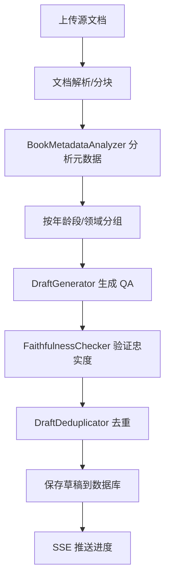

# 05 - 草稿引擎详细设计

## 需求

将当前 `draft_service.py`（1157行）拆分为独立的草稿引擎，负责测试用例的生成、审核和导入全流程。

## 当前问题

1. 1157行 God Class，6+ 职责混杂
2. LLM Prompt 硬编码（line 636: "你是专业的儿童发展测试用例草稿生成专家。"）
3. Faithfulness 验证使用硬编码阈值 0.65
4. Embedding 缓存/余弦相似度与 `draft_deduplication_service.py` 重复
5. `review_draft` 内嵌 TestCase 转换逻辑
6. `_save_drafts_idempotent` 74行复杂条件逻辑
7. 信号量并发数硬编码为 5
8. 最大 token 硬编码为 2048

## 引擎架构

```
service/rag_eval/draft/
├── facade.py                # DraftEngineFacade (~120行)
├── generator.py             # DraftGenerator (~200行)
├── faithfulness_checker.py  # FaithfulnessChecker (~150行)
├── deduplicator.py          # DraftDeduplicator (~100行)
└── book_analyzer.py         # BookMetadataAnalyzer (~120行)
```

## 各组件职责

### DraftEngineFacade（门面）

对外统一入口，协调各子组件。

```python
class DraftEngineFacade:
    def __init__(
        self,
        generator: DraftGenerator,
        faithfulness_checker: FaithfulnessChecker,
        deduplicator: DraftDeduplicator,
        book_analyzer: BookMetadataAnalyzer,
        draft_repo: DraftRepository,
        source_doc_repo: SourceDocumentRepository,
        task_manager: AsyncTaskManager,
    ):
        self._generator = generator
        self._faithfulness_checker = faithfulness_checker
        self._deduplicator = deduplicator
        self._book_analyzer = book_analyzer
        self._draft_repo = draft_repo
        self._source_doc_repo = source_doc_repo
        self._task_manager = task_manager

    async def start_generation(self, source_doc_id: str, config: DraftGenerationConfig) -> str:
        """启动草稿生成任务，返回 task_id"""
        
    async def list_drafts(self, filters: DraftFilters) -> DraftList:
        """列出草稿（分页+过滤）"""
        
    async def get_draft(self, draft_id: str) -> DraftRead:
        """获取草稿详情"""
        
    async def update_draft(self, draft_id: str, update: DraftUpdate) -> DraftRead:
        """更新草稿"""
        
    async def review_draft(self, draft_id: str, review: DraftReview) -> TestCaseRead | DraftRead:
        """审核草稿：通过则生成测试用例，拒绝则标记"""
        
    async def batch_import(self, draft_ids: List[str]) -> List[TestCaseRead]:
        """批量导入已审核草稿为测试用例"""
        
    async def batch_delete(self, draft_ids: List[str]) -> None:
        """批量删除草稿"""
```

### DraftGenerator（QA生成器）

从文档分块中生成问答对。

```python
class DraftGenerator:
    def __init__(
        self,
        llm_factory: LLMServiceFactory,
        prompt_manager: PromptManager,
        config_manager: ConfigManager,
    ):
        self._llm_factory = llm_factory
        self._prompt_manager = prompt_manager
        self._config = config_manager

    async def generate_from_chunks(
        self,
        chunks: List[DocumentChunk],
        config: DraftGenerationConfig,
        progress_callback: Callable[[GenerationProgress], None],
    ) -> List[DraftCreate]:
        """从文档分块批量生成草稿
        
        流程:
        1. 按年龄段分组 chunks
        2. 对每个分组，调用 LLM 生成 QA 对
        3. 返回 DraftCreate 列表
        
        通过 prompt_manager 获取 prompt 模板（key: rag.eval.draft_generation_prompt）
        """
    
    async def _generate_qa_from_chunk(
        self,
        chunk: DocumentChunk,
        config: DraftGenerationConfig,
    ) -> List[DraftCreate]:
        """从单个 chunk 生成 QA 对（LLM 调用）"""
```

**配置化参数**（通过 ConfigManager）：
- `rag.eval.draft.concurrency` → 并发数（默认 5）
- `rag.eval.draft.max_tokens` → 最大 token（默认 2048）
- `rag.eval.draft.llm_model` → 使用的 LLM 模型
- `rag.eval.draft.temperature` → 温度参数

### FaithfulnessChecker（忠实度验证）

验证生成的草稿是否忠实于源文档。

```python
class FaithfulnessChecker:
    def __init__(
        self,
        embedding_helper: EmbeddingHelper,
        config_manager: ConfigManager,
    ):
        self._embedding = embedding_helper
        self._config = config_manager

    async def verify(self, question: str, answer: str, source_text: str) -> FaithfulnessResult:
        """验证答案对源文本的忠实度
        
        采用 RAGAS 风格:
        1. 将答案拆分为独立声明
        2. 每条声明计算与源文本的语义相似度
        3. 使用可配置阈值判断是否忠实
        
        阈值配置: rag.eval.draft.faithfulness_threshold (默认 0.7)
        """

class FaithfulnessResult(BaseModel):
    score: float                    # 0-1
    is_faithful: bool
    claim_details: List[ClaimDetail]

class ClaimDetail(BaseModel):
    claim: str
    source_similarity: float
    is_supported: bool
```

### DraftDeduplicator（去重器）

对新草稿与已有草稿进行去重。

```python
class DraftDeduplicator:
    def __init__(
        self,
        embedding_helper: EmbeddingHelper,
        config_manager: ConfigManager,
    ):
        self._embedding = embedding_helper
        self._config = config_manager

    async def deduplicate(
        self,
        new_drafts: List[DraftCreate],
        existing_drafts: List[DraftRead],
    ) -> DeduplicationResult:
        """对新草稿去重
        
        策略:
        1. 计算新草稿问题与已有草稿问题的 embedding 相似度
        2. 超过阈值(可配置)的标记为重复
        3. 返回去重后的草稿列表和重复报告
        
        阈值配置: rag.eval.draft.similarity_threshold (默认 0.85)
        """

class DeduplicationResult(BaseModel):
    unique_drafts: List[DraftCreate]
    duplicates: List[DuplicatePair]
    total_new: int
    total_unique: int
    total_duplicates: int

class DuplicatePair(BaseModel):
    new_draft: DraftCreate
    existing_draft_id: str
    similarity: float
```

### BookMetadataAnalyzer（书籍分析器）

从文档中提取年龄段、领域等元数据。

```python
class BookMetadataAnalyzer:
    def __init__(self, config_manager: ConfigManager):
        self._config = config_manager

    def analyze_chunks(self, chunks: List[DocumentChunk]) -> ChunkGroupResult:
        """将分块按年龄段和领域分组
        
        配置:
        - rag.eval.draft.keyword_threshold (默认 10)
        - rag.eval.draft.domain_keywords (JSON, 领域关键词映射)
        - rag.eval.draft.age_patterns (JSON, 年龄正则映射)
        """

    def _group_chunks_by_age(self, chunks: List[DocumentChunk]) -> Dict[str, List[DocumentChunk]]:
        """按年龄段分组"""

    def _detect_domain(self, text: str) -> TestDomain:
        """检测文本所属领域"""

    def _detect_age_stage(self, text: str) -> AgeStage:
        """检测文本所属年龄段"""
```

## 生成流程



## 共享工具提取

以下工具函数从 `draft_service.py` 和 `draft_deduplication_service.py` 提取到 `utils/`：

```python
# utils/embedding_helper.py
class EmbeddingHelper:
    """Embedding 计算与缓存"""
    async def get_embedding(self, text: str) -> List[float]: ...
    async def get_embeddings_batch(self, texts: List[str]) -> List[List[float]]: ...

# utils/similarity.py  
def cosine_similarity(vec_a: List[float], vec_b: List[float]) -> float: ...
def euclidean_distance(vec_a: List[float], vec_b: List[float]) -> float: ...
```

## 验收标准

1. 所有文件 < 200 行
2. LLM Prompt 通过 PromptManager 获取（key: `rag.eval.draft_generation_prompt`）
3. 所有阈值通过 ConfigManager 获取，零硬编码
4. Embedding 工具函数在 `utils/` 中统一定义，零重复
5. `review_draft` 生成的 TestCase 通过 `RunEngine` 的 `TestCaseRepository` 保存
6. 生成任务通过 `AsyncTaskManager` 管理，进度通过 SSE 推送
7. 每个子组件有独立单元测试
