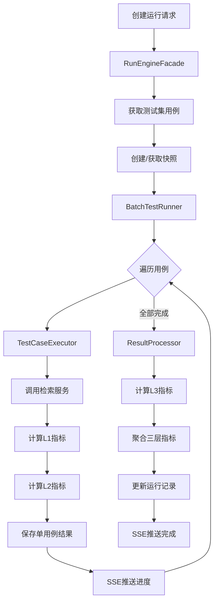

# 07 - 运行引擎详细设计

## 需求

设计统一的测试运行引擎，负责测试执行、快照管理和结果聚合。替代当前分散在 `test_executor.py`、`test_batch_runner.py`、`test_result_analyzer.py`、`test_run_creator.py`、`snapshot_service.py` 中的逻辑。

## 当前问题

1. `test_executor.py` 有两条代码路径（`execute_test_case` 和 `run_test_case`），计算指标不一致
2. `test_batch_runner.py` 直接创建 ORM 对象和管理事务
3. `test_result_analyzer.py` 的 `compare_test_runs` 有 N+1 查询问题
4. `snapshot_service.py` 完全同步但用于异步上下文
5. `snapshot_service.py` 访问其他服务的私有方法（`_load_store()`、`_initialize_index()`）
6. 各执行器指标计算不一致（有的算 MRR/NDCG，有的不算）

## 引擎架构

```
service/rag_eval/run/
├── __init__.py
├── facade.py                # RunEngineFacade (~120行)
├── executor.py              # TestCaseExecutor (~120行)
├── batch_runner.py          # BatchTestRunner (~180行)
├── result_processor.py      # ResultProcessor (~100行)
└── snapshot_manager.py      # SnapshotManager (~120行)
```

## 各组件职责

### RunEngineFacade（门面）

```python
class RunEngineFacade:
    def __init__(
        self,
        executor: TestCaseExecutor,
        batch_runner: BatchTestRunner,
        result_processor: ResultProcessor,
        snapshot_manager: SnapshotManager,
        metric_engine: MetricEngineFacade,
        run_repo: TestRunRepository,
        case_repo: TestCaseRepository,
        set_repo: TestSetRepository,
    ):
        ...

    async def execute_batch(self, test_set_id: str, snapshot_id: str | None, config: RunConfig) -> str:
        """批量执行测试
        
        1. 获取测试集中的所有测试用例
        2. 创建或使用指定快照
        3. 通过 BatchTestRunner 并发执行
        4. 返回 run_id
        """

    async def execute_single(self, run_id: str, case_id: str) -> TestRunResultItem:
        """执行单个测试用例"""

    async def list_runs(self, filters: RunFilters) -> list[TestRunRead]:
        """列出测试运行"""

    async def get_run(self, run_id: str) -> TestRunRead:
        """获取测试运行详情"""

    async def delete_run(self, run_id: str) -> None:
        """删除测试运行"""

    async def batch_delete(self, run_ids: list[str]) -> None:
        """批量删除"""

    async def compare_runs(self, run_id_1: str, run_id_2: str) -> RunComparison:
        """比较两个运行"""

    async def create_snapshot(self, name: str | None, description: str) -> SnapshotRead:
        """创建快照"""

    async def list_snapshots(self) -> list[SnapshotRead]:
        """列出快照"""

    async def restore_snapshot(self, snapshot_id: str) -> None:
        """恢复快照"""
```

### TestCaseExecutor（单用例执行器）

统一当前 `execute_test_case` 和 `run_test_case` 为单一入口。

```python
class TestCaseExecutor:
    def __init__(
        self,
        retrieval_service: RetrievalFacade,
        metric_engine: MetricEngineFacade,
        config_manager: ConfigManager,
    ):
        self._retrieval = retrieval_service
        self._metrics = metric_engine
        self._config = config_manager

    async def execute(self, test_case: TestCaseRead, snapshot_id: str | None = None) -> TestRunResultItem:
        """执行单个测试用例的完整流程
        
        1. 通过 RAG 检索服务执行检索
        2. 收集检索结果和实际生成答案
        3. 计算 L1 指标（检索质量）
        4. 计算 L2 指标（生成质量）
        5. 组装结果
        """

    async def _execute_retrieval(self, query: str, snapshot_id: str | None) -> RetrievalResult:
        """调用检索服务，传入快照ID实现隔离"""

    async def _calculate_l1_metrics(
        self,
        expected_doc_ids: list[str],
        retrieved_docs: list[RetrievedDoc],
    ) -> dict[str, MetricScore]:
        """计算 L1 检索质量指标"""

    async def _calculate_l2_metrics(
        self,
        question: str,
        response: str,
        contexts: list[str],
    ) -> dict[str, MetricScore]:
        """计算 L2 生成质量指标"""
```

**关键变更**：统一使用 `retrieval_service`（而非 `rag_service.retrieve_knowledge`），确保一致性。

### BatchTestRunner（批量并发执行器）

```python
class BatchTestRunner:
    def __init__(
        self,
        executor: TestCaseExecutor,
        result_processor: ResultProcessor,
        task_manager: AsyncTaskManager,
        config_manager: ConfigManager,
    ):
        self._executor = executor
        self._result_processor = result_processor
        self._task_manager = task_manager
        self._config = config_manager

    async def run_all(
        self,
        run_id: str,
        test_cases: list[TestCaseRead],
        snapshot_id: str | None,
        config: RunConfig,
    ) -> None:
        """批量执行测试用例
        
        1. 获取并发度配置 (rag.eval.run.concurrency, 默认 3)
        2. 创建 asyncio.Semaphore
        3. 并发执行所有用例
        4. 通过 SSE 推送进度
        5. 完成后触发 ResultProcessor 聚合
        """

    async def _execute_with_semaphore(
        self,
        case: TestCaseRead,
        semaphore: asyncio.Semaphore,
        snapshot_id: str | None,
        progress_callback: Callable,
    ) -> TestRunResultItem:
        """在信号量控制下执行单个用例"""
```

### ResultProcessor（结果聚合器）

```python
class ResultProcessor:
    def __init__(
        self,
        metric_engine: MetricEngineFacade,
        run_repo: TestRunRepository,
    ):
        self._metrics = metric_engine
        self._run_repo = run_repo

    async def aggregate(self, run_id: str, results: list[TestRunResultItem]) -> RunMetrics:
        """聚合所有结果，计算三层指标
        
        1. 汇总 L1/L2 单用例指标
        2. 计算 L3 系统质量指标（回归、成本等需要跨用例对比）
        3. 计算综合分数
        4. 更新 TestRun 记录
        """

    async def compare_runs(self, run_id_1: str, run_id_2: str) -> RunComparison:
        """比较两个运行（单次查询，避免 N+1）"""

    def _aggregate_layer_metrics(self, results: list[TestRunResultItem], layer: int) -> dict[str, float]:
        """聚合单层所有用例的指标均值"""
```

### SnapshotManager（快照管理器）

```python
class SnapshotManager:
    def __init__(
        self,
        index_manager: IndexManagerFacade,
        snapshot_repo: SnapshotRepository,
        config_manager: ConfigManager,
    ):
        self._index_manager = index_manager
        self._repo = snapshot_repo
        self._config = config_manager

    async def create(self, name: str | None, description: str) -> SnapshotRead:
        """创建知识库快照
        
        通过 IndexManagerFacade 的公开接口操作：
        1. 获取当前索引状态
        2. 复制向量库数据
        3. 记录配置版本
        4. 保存快照元数据
        """

    async def list(self) -> list[SnapshotRead]:
        """列出所有快照"""

    async def get(self, snapshot_id: str) -> SnapshotRead:
        """获取快照详情"""

    async def restore(self, snapshot_id: str) -> None:
        """恢复快照
        
        通过 IndexManagerFacade 的公开接口：
        1. 加载快照数据
        2. 替换当前索引
        3. 验证恢复结果
        """
```

**关键变更**：不再直接访问 `_load_store()` 等私有方法，通过 `IndexManagerFacade` 公开接口操作。

## 执行流程



## SSE 事件类型

| 事件类型 | 数据 | 时机 |
|---|---|---|
| `run_started` | `{run_id, total_cases}` | 运行开始 |
| `case_started` | `{case_id, question}` | 单用例开始 |
| `case_completed` | `{case_id, metrics, time_ms}` | 单用例完成 |
| `case_failed` | `{case_id, error}` | 单用例失败 |
| `run_completed` | `{run_id, metrics}` | 全部完成 |
| `run_failed` | `{run_id, error}` | 运行失败 |
| `progress` | `{completed, total, percentage}` | 进度更新 |

## 配置 Key

| 配置 Key | 默认值 | 说明 |
|---|---|---|
| `rag.eval.run.concurrency` | 3 | 批量执行并发度 |
| `rag.eval.run.timeout_ms` | 30000 | 单用例执行超时 |
| `rag.eval.run.auto_snapshot` | true | 是否自动创建快照 |

## 验收标准

1. `TestCaseExecutor` 只有单一执行入口，L1/L2 指标计算一致
2. `BatchTestRunner` 通过 `asyncio.Semaphore` 控制并发，通过 `AsyncTaskManager` 管理任务
3. `SnapshotManager` 只通过 `IndexManagerFacade` 公开接口操作，不访问私有方法
4. `ResultProcessor.compare_runs` 单次查询获取所有数据，无 N+1 问题
5. 所有方法为 async，无 sync/async 混用
6. 每个文件 < 200 行
7. SSE 事件类型统一、完整
